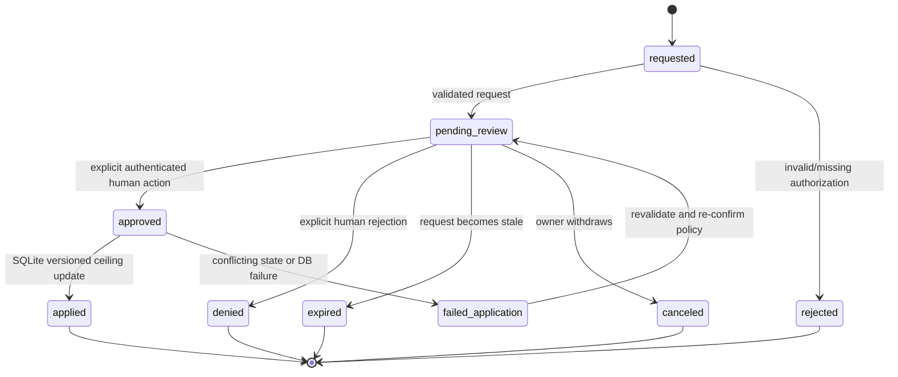

# Human approval gates and durable decision workflow

## Source of authority

**Approved and mandatory:** When approved project budget is insufficient, Rolvya must pause **new billable task admission** and require **explicit user approval to raise the budget ceiling**. Never automatically permit a percentage overrun; preserve completed work and notify the owner ([ADR 0002](../decisions/0002-hard-budget-approval.md)). Rust is the backend; SQLite is the authoritative database. The exact identity/session UX, role delegation, in-flight worker cancellation and other human-review gates remain **Proposed/Open**. This document is a conceptual workflow specification, not a deployed approval service.

## Three independent concepts

- **Approval request:** proposal to perform a privileged change, with a clearly defined amount/scope and auditable actor.
- **Budget ceiling:** durable project value last set by explicit authenticated human authorization; never a worker- or scheduler-selected default override.
- **Scheduler pause/blocker:** operational status of readiness/admission; can have multiple concurrent causes (budget, missing dependency, policy, capacity, credentials, conflict).

An approval for a budget increase does not grant GitHub merge permission, switch cloud provider, rewrite the fixed task graph or clear all other blockers.

## Proposed request lifecycle

**Important distinction:** a request marked `approved` but not durably `applied` must not increase scheduling headroom. An operator should verify that the approval application and audit records are committed before any new billable work is admitted. The exact state names and retry process are proposals.

## Proposed approval record

| Field | Purpose |
| --- | --- |
| `request_id`, `project_id`, `request_type` | Stable idempotency and project binding |
| `requested_by`, `reviewed_by` | Distinguish requester and authenticated approver |
| `previous_ceiling_minor`, `proposed_ceiling_minor`, `currency` | Display an unambiguous **total new ceiling**, not only a relative increment |
| `expected_budget_version` | Prevent stale-approval lost updates |
| `reason`, `affected_tasks`, `expires_at` | Scope, rationale and stale request detection |
| `cost_snapshot_ref` | Actual settled, held reservations, uncertain exposure and scenario estimates |
| `reviewed_at`, `applied_at`, `audit_event_ref` | Provenance and durable application |
| `decision_idempotency_key` | Duplicate click/replay safety |

The definitive API schema, field types and currency policy are not yet selected; money must not rely on binary floating-point.

## Budget increase happy path

1. Scheduler finds a ready task and determines that a conservative new billable reservation exceeds approved remaining headroom, or that provider exposure cannot be bounded.
2. Persist a budget-blocked admission state, affected task IDs and redacted audit event. **Do not dispatch** a new paid attempt.
3. Show owner current total ceiling, settled charges, active holds, unknown delayed usage, remaining headroom, proposed **new total ceiling** and category-specific optimistic/expected/pessimistic projections.
4. Owner explicitly signs in and confirms the exact new ceiling through a request bound to the specific project and expected version.
5. Rust backend authenticates and authorizes the actor and verifies the request, currency and no stale expected version; it writes the new ceiling, approval and audit record **atomically in SQLite**.
6. Scheduler is informed of the durable event and **rechecks** DAG dependencies, worker capacity, Git conflicts, model entitlement and current cost exposure under the new ceiling.
7. Only a separate serialized SQLite admission transaction may reserve and dispatch a new billable attempt.

No UI notification acknowledgement, conversation text, worker callback, administrative environment override, planner output or prior approval request counts as a new ceiling approval.

## Failure and concurrency matrix

| Case | Expected behavior |
| --- | --- |
| Duplicate approve click with same request ID | One durable ceiling update, one logical audit decision |
| Two reviewers apply competing amounts | Version check prevents silent overwrite; unresolved request requires re-review |
| Session expires before confirmation | Reject; leave ceiling and pause unchanged |
| SQLite unavailable while confirming | No new paid work; approval may remain uncommitted/unapplied |
| Provider invoice arrives between display and click | Show stale cost warning; recompute headroom before admission |
| Owner rejects/ignores request | Remain paused; preserve completed work |
| Owner approves a smaller amount insufficient for candidate | Approval may be recorded, but task stays budget-blocked |
| Unauthorized worker posts `approved` state | Reject/audit; never grant spending authority |
| Network timeout after successful budget update | Fetch by request ID and expected version; do not apply twice |
| Worker already running at budget exhaustion | Follow separately approved **in-flight policy**, which is not selected here |

## Other proposed human gates (not yet approved)

Plan activation, protected-branch merge/release, high-risk secret rotation, nontrivial architecture changes and live-cloud benchmarking may require explicit human approval. Their exact trigger, reviewers and UX need separate policy decisions. **Do not falsely infer** that the owner has approved one universal approval workflow for all such actions.

## Security and privacy contract

Authenticate the owner and enforce project-scoped authorization server side. Protect against CSRF, replay, stale sessions and cross-project request IDs using a selected mechanism. Record approvals and denials in tamper-evident/durable audit logs; omit raw tokens, sensitive prompt contents and personal data where not required. UI must display rejected, pending, approved-but-not-applied and applied states distinctly.

## Test obligations

- Property-based budget tests with interleaved invoice, approval and reservation events.
- Randomized concurrent authorization and duplicate-click replay.
- Stale version rejection across multi-tab approval.
- Synthetic unauthenticated/worker-initiated approval denial.
- Crash injection between event write and transaction commit.
- Confirm a budget-paused project retains immutable DAG, completed artifacts, settled ledger and attempt history.
- Verify later approval does not bypass a dependency or policy blocker.

## Open decisions

Identity provider, reviewer role delegation, session/2FA and audit signing, request expiry, currency conversion and tax treatment, UI confirmation format, maximum available ceiling, in-flight cancellation behavior and other human-review gates.

Related: [identity authorization](identity-authorization.md), [budget accounting](budget-reservation-reconciliation.md), [scheduler](scheduler.md), [owner journeys](../product/user-flows.md), [open questions](../project/open-questions.md).
