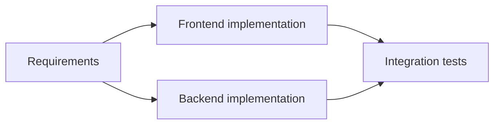

# DAG planning and task contract

## Fixed upfront plan (approved)
A single main planning agent breaks a user request into a top-level task, arbitrarily nested subtasks and executable leaf tasks. **All nodes and dependencies are planned and validated before execution starts.** The runtime may update state, reassign failed work or change execution parameters under policy, but it must not add new tasks to the original graph. Workers do not create tasks or run their own project decomposition.

## Semantics to preserve
- **Hierarchy:** parent/child describes decomposition and result aggregation.
- **Dependency:** directed prerequisite edge says one task must finish before another becomes eligible. Hierarchy is *not automatically* an execution dependency; the planner must represent both explicitly.
- **Ready:** every required predecessor has met the documented success conditions; the task has valid execution resources and budget authorization.
- **Parallelism:** ready tasks without conflicting dependencies may execute simultaneously, subject to resource and integration isolation.
- **Completion:** executable leaf task success requires independently validated outputs. **Approved ADR 0009**: a parent is a non-executable group and becomes validated succeeded only after all required descendants and applicable group acceptance criteria are validated. No parent receives a worker attempt.

## Example (illustrative, not prescribed structure)

Frontend and backend may run concurrently after requirements are satisfied. The graph is a dependency example; parent/child relationships must be stored separately.

## Minimum proposed task record
| Field | Meaning |
| --- | --- |
| task_id, project_id, parent_id | Unique identity and hierarchy; parent nullable |
| dependency_ids | Explicit predecessor task IDs |
| title, goal, scope, exclusions | Bounded, testable work |
| instruction, context_refs | Compact fixed execution contract and referenced memory |
| model, effort, access_mode | Planner-assigned execution option |
| acceptance_criteria | Observable completion requirements |
| expected_resources, estimate | Runtime and cost assumptions |
| state, attempts, timestamps | Durable execution lifecycle |
| output_refs, verification | Artifacts and evidence |

This is a **draft contract**, not a committed database/API schema.

## Validator requirements
Check unique IDs, existing edge targets, no cycles, consistent hierarchy, reachable/feasible execution steps, leaf-agent assignments, nonempty acceptance criteria, valid cost and resource assumptions, and explicit aggregation dependencies. Detect shared-file/write conflicts and require isolation or sequencing before admitting parallel tasks.

## Planning uncertainty and token economy
Favor scoped medium tasks, compact per-task context, references over duplicated prompts, reuse of test evidence and clear ownership. An estimated <=10-minute duration is a target, not a termination SLA. Store optimistic/expected/pessimistic costs separately from execution usage.

## Recovery boundary
For a failed node, the orchestrator diagnoses the error and may retry, alter effort/model or reassign an attempt **without creating a new task**. Whether a changed plan requires a full new version and human approval is an **open decision**.

## Acceptance examples for future implementation
1. Reject a graph containing A→B→A, preserving the previous valid plan.
2. Block a task with an unfinished predecessor, even if spare workers exist.
3. Run two independent ready tasks concurrently when budget and capacity allow.
4. Prevent a worker from inserting child tasks into the active DAG.
5. Record reassignment and repeated attempts under the same task identity.

The [task/attempt model](task-model.md) defines the approved group-only parent versus executable-leaf policy and immutable-plan hashing; [main orchestrator](orchestrator.md) distinguishes planner model output from trusted Rust activation.

Related: [architecture overview](overview.md), [execution](execution.md), [budget policy](budget-costs.md), [decision register](../decisions/README.md).
