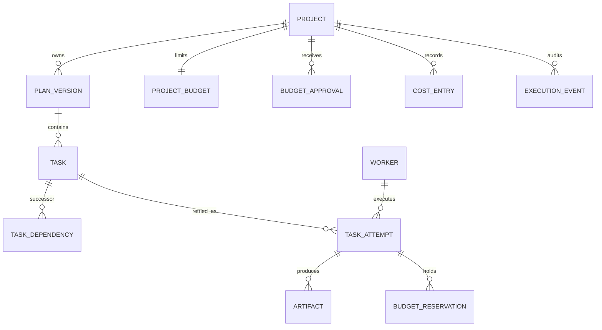

# Persistence and data model

## Decision boundary

**Approved decisions:** the backend is **Rust only** ([ADR 0004](../decisions/0004-control-plane-language.md)), and the one authoritative database is **SQLite only** ([ADR 0005](../decisions/0005-authoritative-database.md)). Low memory/energy usage and fast requests matter; persist full upfront DAG plans, context, model/effort assignments, states, attempts, costs and approvals. The main control VPS target discussed was 2–4 GB RAM. **Open implementation details:** SQLite physical schema, WAL/durability configuration, foreign-key/index strategy, tenancy, migration and backup intervals, transaction code and remote database file placement. This file proposes a logical schema; see the [Rust + SQLite backend contract](rust-sqlite-backend.md) and [SQLite schema draft](sqlite-schema-draft.md) for detailed but still proposed implementation design.

## Domain entities and relationships

| Entity | Identity and essential attributes | Constraints |
| --- | --- | --- |
| Project | project_id, owner_id, name, status, created_at | Parent of plans, budget and repositories |
| PlanVersion | plan_id, project_id, version, status, created_at, approved_at, graph_hash | A validated, immutable snapshot once activated |
| Task | task_id, plan_id, parent_task_id, goal, scope, acceptance_criteria, model, effort, access_mode, context_ref, state | All nodes fixed before execution; parent belongs to same plan |
| TaskDependency | plan_id, predecessor_id, successor_id | Same plan; distinct tasks; directed DAG without cycles |
| TaskAttempt | attempt_id, task_id, worker_id, state, lease_token, lease_expires_at, started_at, ended_at, exit_reason | Retry/reassignment creates an attempt, **not** a task |
| Worker | worker_id, provider_kind, capabilities, capacity, lifecycle, last_heartbeat | Remote only, no personal computer worker |
| Artifact | artifact_id, project_id, task_id, attempt_id, kind, uri, hash, created_at | Durable references; payload may live outside DB |
| TaskContext | context_id, task_id, version, content_ref, content_hash, classification | Compact per-task instructions; immutable for a given attempt |
| ProjectBudget | project_id, currency, approved_ceiling, updated_at | Human-approved ceiling; no automatic percentage overrun |
| BudgetApproval | approval_id, project_id, actor_id, currency, previous_ceiling, new_ceiling, approved_at, request_id | Positive increase requires explicit human authorization |
| BudgetReservation | reservation_id, task_id, attempt_id, category, amount, currency, state, expires_at | Atomic admission; prevent double booking |
| CostEntry | entry_id, project_id, attempt_id, category, amount, currency, source_ref, measured_at, recorded_at | Append-only accounting, corrections via compensating entries |
| ExecutionEvent | event_id, project_id, task_id, attempt_id, type, recorded_at, payload_ref | Immutable audit of state transitions and relevant decisions |
| RemoteRepository | repository_id, project_id, remote_provider, remote_identifier, allowed_refs | No local computer repository paths |
| IntegrationOperation | operation_id, task_id, provider, idempotency_key, remote_ref, result | Prevent duplicate irreversible remote operations |

## Logical relationship sketch

An edge also references a predecessor task; the diagram simplifies this to remain readable. Hierarchy (`parent_task_id`) and dependency edges are **separate** concepts.

## Integrity and concurrency

1. Build and validate an entire planned graph before marking its plan version active. Reject missing references, cycles, cross-plan edges, unintended simultaneous writes and invalid parent relationships.
2. Freeze the task set and dependency edges once execution begins. No worker can create subtasks. Revised planning would require a separately authorized new plan version; exact policy remains open.
3. Make task admission, attempt lease and budget reservation atomic or equivalently serialized. Budget capacity is **approved ceiling minus settled costs minus enforceable outstanding reservations**, with late charges and uncertainty accounted for conservatively.
4. Enforce unique attempt IDs, unique dependency pairs, idempotency keys, and a single currently valid fencing/lease token per running task.
5. Preserve successfully completed task artifacts when another task fails, workers disappear or the budget gate pauses work.
6. Use monotonic recorded event order or an equivalent per-project sequence for deterministic recovery; clocks alone must not resolve conflicting writes.
7. Store large logs, working trees and binaries in controlled remote artifact storage; keep references and checksums in the database.
8. Never persist raw credentials in prompts, task contexts, event payloads or repositories; store resolvable secret identifiers instead.

## Suggested read/write patterns

- Ready tasks: use indexed incoming dependency relationships plus verified predecessor status, not repeated full graph scans.
- Scheduler: index tasks by plan/state/priority, attempts by task and lease expiration, and workers by lifecycle/last heartbeat.
- Budget: index reservations and cost entries by project/category/state; keep balance computation transactionally safe and reconcile delayed provider usage.
- Graph explorer: retrieve a plan version, parent/child outline and dependency adjacency efficiently.
- Recovery: identify expired leases and reconcile idempotent remote operations before reassignment.
- History: paginate task attempts and execution events; control retention and redaction.

These are logical access requirements; indexes and column types are not final SQL DDL.

## Data lifecycle and migrations

Document schema versions, forward/backward compatibility, backup and restore strategy, artifact retention, event compaction, deletion/privacy rules and recovery-point objectives before deployment. Backups should be restorable with a tested recovery process; single-instance preference does not remove failure risks.

## Acceptance criteria for implementation

- Invalid cyclic DAG cannot be activated.
- Independent tasks are eligible together, but dependency-blocked tasks remain blocked.
- Concurrent billable admissions cannot exceed the remaining approved budget.
- A failed worker attempt can be retried without new task creation or duplicate side effects.
- Crash/restart reconstructs task states, reservations and previous successful artifact refs.
- No local personal-computer integration appears in persisted remote repository/worker contracts.
- Stored cost categories distinguish AI API, compute, storage and transfer and retain three forecast scenarios in planning data.

## Pending ADRs

Choose SQLite schema strategy, WAL/journal durability and busy/locking policies; ownership/multitenancy; atomic budget locking; artifact storage; event retention and backup RPO/RTO; graph storage representation. **Database engine selection is closed: SQLite.**

Related: [overview](overview.md), [DAG planning](dag-planning.md), [execution](execution.md), [budget](budget-costs.md), [security](security.md), [decision register](../decisions/README.md).
