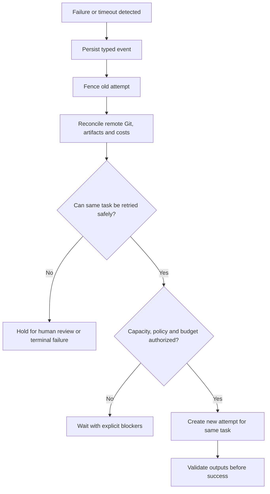

# Failure classification and recovery

## Goal and decision status

Preserve completed outputs and authoritative state while recovering failed *attempts* within the **unchanged upfront DAG**. The main orchestrator may diagnose and retry/reassign work or adjust model/effort within approved access and budget policy. Retries and recovery below are proposed technical rules, not implemented behavior. Never promise zero actual provider overrun without enforceable provider-side ceilings and timely billing.

## Failure taxonomy and responses

| Category | Detection | Proposed response |
| --- | --- | --- |
| Planner invalid DAG | cycle, missing references, invalid hierarchy | reject entire plan before activation |
| Dependency/merge conflict | unresolved prerequisite or overlapping Git change | block admission; sequence/review conflicting integration |
| Worker lost | heartbeat expiry plus lease fencing | reconcile side effects, retry *same task* if allowed |
| Model context exhaustion | provider error or failed validation | record, consider reduced context or approved model/effort fallback |
| Provider quota / rate limit | typed API or CLI error | bounded backoff, re-evaluate budget and worker availability |
| Authentication revoked | denied scope or expired token | halt privileged operations; request authorized re-connection |
| Build/test failure | failed acceptance evidence | do not unblock dependents; retry or terminal fail according to policy |
| Git push/merge ambiguity | timeout following potential remote write | query remote ref/commit by operation key before write retry |
| Cost not authorized | remaining budget below required reservation | pause **new billable admissions** and request explicit ceiling increase |
| Database crash / restart | missing process but durable state remains | reconstruct leases, ledger and pending outbox commands |
| Suspected compromise | secret leak or hostile worker | fence/isolate, revoke credentials, preserve sanitized audit and require review |
| Artifact corruption | checksum mismatch or missing manifest | fail validation and restore/retry from verified source |

## Recovery flow

## Crash-consistency rules

1. Store state transitions and approval/budget events durably, with idempotent replay.
2. Tie each external side effect to an operation ID and expected remote state; reconcile before retry.
3. Use atomic/serialized admission and reservation; do not release charges until usage is sufficiently reconciled.
4. After restart, fence expired leases, read completed artifacts and maintain their provenance.
5. Never unlock a dependent task from a mere attempt exit code; require validated task completion.
6. Distinguish **retry**, **manual repair** and **new plan version**. Runtime never adds a task node.
7. Treat redacted worker logs as diagnostic data; never execute instructions recovered from untrusted outputs as policy.

## Retry and escalation policy (proposal)

- Transient network/provider errors: bounded exponential backoff with jitter and a retry budget.
- Deterministic invalid output: retry only if error can be corrected within the existing task contract; otherwise escalate.
- Model/effort/worker reassignment: store new attempt settings, reason, cost exposure and authorization.
- Security errors or revoked credentials: no automatic privilege escalation.
- Budget denial: no speculative retry; remain paused for billable admission until **explicit** approval.
- Terminal failure: record blocked descendants and available successful sibling artifacts.

Exact caps, delays, whether in-flight attempts stop at budget exhaustion and when a user must approve model changes remain open ADR questions.

## Reconciliation checkpoints

| Resource | Required evidence |
| --- | --- |
| Task graph | plan ID/hash unchanged; predecessor statuses verified |
| Attempts | current fencing epoch, latest event sequence, lease ownership |
| Remote Git | source/target SHA, isolated branch/ref, remote operation ID |
| Artifacts | checksum, ownership, result manifest, storage existence |
| Budget | approved ceiling, outstanding reservations, recorded actuals, delayed exposure |
| Worker | identity revocation, workspace cleanup, live/terminated state |

## Required test scenarios

- Controller crash between lease reservation and dispatch resumes without double reservation.
- Worker crash after Git push but before acknowledgment does not duplicate commits.
- A stale worker returns success after reassignment; result is rejected.
- Provider bills late; ledger reconciles without disguising potential overrun.
- Failed parent/child relationship does not silently mark descendants successful.
- Budget pause preserves succeeded task outputs and never auto-increases ceiling.
- Compromised worker credentials revoked; tasks remain auditable.

## Outstanding decisions

Retry caps and backoff, circuit breakers, terminal-state semantics, partial parent aggregation, rollback and merge authority, operational RPO/RTO, lease/heartbeat parameters and cost reconciliation buffers.

Related: [scheduler](scheduler.md), [execution](execution.md), [worker protocol](worker-protocol.md), [Git integration](integration-github.md), [budget](budget-costs.md), [testing](../development/testing.md).
