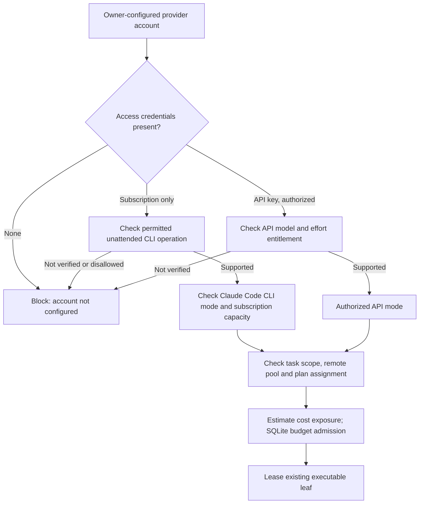

# Coding agent CLI/API and entitlement enforcement

## Source decisions, historical preference and legal boundary

Historical Rolvya discussions explicitly named **Claude Code CLI** and **Codex CLI** as coding-agent execution interfaces, and assigned a **model plus effort level per preplanned task**. The stated product-mode preference was **no API key and only a monthly subscription → Claude CLI where provider rules permit; an API key configured → API-key access mode**. This is a **historical user requirement to preserve**, not evidence that all subscription products or Codex/Claude CLI versions allow noninteractive remote multi-worker use. If a future UI offers both modes on one account, the exact selection/override policy still needs owner approval.

**Binding architecture:** main agent chooses model/effort/access mode as part of the complete fixed DAG; remote executable leaves alone run third-party tools; Rust owns the control plane; SQLite stores the plan/attempt/approval ledger; unapproved provider/model fallback and hidden spending are forbidden. Provider terms, entitlements, subscription concurrency limits, delegated login, available models and current prices must be checked before enabling an adapter.

## Actors and trust zones

| Component | Allowed role | Forbidden behavior |
| --- | --- | --- |
| Project owner | Register an eligible CLI or API access mode and authorize provider accounts | Accidental authorization by a generic login confirmation |
| Main planner | Assign eligible provider/model/effort/mode to every executable leaf **up front** | Infer a paid API fallback without owner permission |
| Rust capability registry | Validate actual permitted modes and resource needs against user account configuration | Treat a CLI binary being installed as proof of billing entitlement |
| Rust scheduler | Select eligible remote host, reserve conservative billable exposure, dispatch existing leaf | Create tasks, alter model/mode without allowed retry policy or bypass approval |
| Remote worker | Execute the approved CLI/API invocation in an isolated remote sandbox | Generate child task tree, read another user's credentials, assume unlimited subscription |
| Provider billing adapter | Record attributable usage, throttling and cost uncertainty | Report subscription as zero-cost API or use stale rates as guarantees |

## Eligibility decision flow (proposed)

The diagram captures the **historical subscription-only Claude CLI preference**. A Codex CLI adapter may be developed where provider rules and owner configuration permit, but must not be silently selected in contradiction to that historical mode rule. The user has not approved an unconditional list of model products or a universal fallback ordering.

## Per-task required fields

`provider_kind`, `model_id`, `effort_level`, `access_mode` (`cli_subscription` / `api_key` candidate values), `account_ref`, `credential_ref` (never model-visible secret bytes), `context_manifest_hash`, `remote_worker_requirements`, `max_authorized_exposure_ref`, `acceptance_criteria_ref`, `allowed_fallbacks` and `provenance`.

Freeze planned model/effort/mode in the plan snapshot. On an owner-allowed failure fallback, record the changed choices in a **new attempt** of the *same existing task*, with a reason and a new reservation. Main-agent diagnosis is advisory, Rust checks authorizations and budget. Reject attempts to change the active DAG or secretly buy a more expensive API execution.

## Capability registry proposal

| Field | Reason |
| --- | --- |
| Provider/adapter name and version | CLI/API behavior changes across releases |
| Verified effective entitlement and terms date | Avoid assuming past subscription rights still hold |
| Model inventory, capability and effort mapping | Provider effort labels are not interchangeable |
| Authentication method / secure credential reference | Remote session must be isolated per owner/project |
| Unattended automation permission | Critical for cloud/VPS workers |
| Maximum allowed concurrent sessions / rate limits | Avoid quota errors and terms violations |
| Execution timeout/cancellation behavior | Needed by Approved bounded-or-stop budget policy |
| Availability and retry class | Distinguish model/service outage from task failure |
| Metering source, unit, billing lag and uncertainty | Separate AI API from compute; no fabricated zero subscription cost |
| Region/data handling restrictions | Provider pool must be compatible with project security policy |

Account verification belongs to a trusted Rust component; workers should receive only time-limited, attempt-scoped authority. A terminal exit status 0 is not independent acceptance evidence.

## CLI invocation and safety (design requirements)

- Treat shell commands and environment variables as security-sensitive; use typed argument vectors rather than interpolating untrusted task text into a shell.
- Isolate working directories/containers, process groups, user IDs, CPU/RAM, disk, network egress and resource cleanup on **remote** hosts.
- Do not log OAuth session tokens, API keys, browser cookies, refresh tokens or full privileged environment variables.
- Support cooperative cancellation plus provider-level termination and wait for actual process/resource state before releasing financial liability.
- Detect “authentication expired”, “subscription limit”, “quota exceeded”, “terms not verified”, “API key invalid” and “unsupported model” as distinct typed blockers.
- Treat command output and repository text as untrusted; neither is allowed to approve budgets or alter planner task topology.
- If CLI execution is prohibited by provider terms or environment, **block**, do not tunnel or use unofficial private endpoints.

## Cost and metering

- **API:** estimate/measure model input/output usage at provider-specific current rates, track tool and retry costs, and post verified charges in `ai_api`.
- **CLI subscription:** do **not** invent per-token API bills; separately record eligibility/limits and any known subscription allocation or incremental costs per an approved policy. A subscription fee may be outside project-specific API billing, but its compute worker, storage and transfer still cost money.
- **Remote compute:** record host/container cost even for CLI mode, process startup/cleanup, minimum billing and idle pools.
- **Storage/transfer:** artifact retention, logs, Git checkout/push and model/worker communication.
- Produce optimistic/expected/pessimistic estimates and **separate conservative admissible exposure**, with uncertainty surfaced. Approved ADR 0010 requires bounded pre-reserved continuation or stop-on-risk.

## Failure/retry matrix

| Event | Result | Forbidden fallback |
| --- | --- | --- |
| No eligible subscription rights on remote host | Block with explanation | Assume successful interactive local login proves cloud entitlement |
| API key exists but user did not authorize paid API mode | Await explicit configuration | Launch API just because key was discovered |
| Model unavailable or renamed | Block/revalidate capability, propose new attempt when permitted | Rewrite original plan model silently |
| Context exhaustion | Record precise error and diagnostics, suggest trimmed *nonessential* context and approved fallback | Drop acceptance/security invariants to fit tokens |
| Quota/rate limit | Typed wait/backoff respecting usage/budget and rate rules | Hot-loop retries or multi-account evasion |
| Worker process unexpectedly exits | Preserve logs/artifact hashes, classify, reconcile charges and remote Git | Mark task successful or create new task |
| Provider account revoked | Revoke access and fence attempts | Reuse cached tokens or another account silently |

## Future validation tests

- No API key + valid permitted subscription + Claude CLI capability → planned CLI mode; absence of permitted automation → explicit block.
- API key configured and **authorized API mode** → use selected API model/effort; meter AI and compute separately.
- Both modes available → use explicit owner-approved selection rule (still to decide), not arbitrary priority.
- Subscription session expiration during run → safe stopped/fenced attempt and no credential leakage.
- Main planner requests Codex CLI for a subscription-only account constrained to Claude CLI → reject/unresolved instead of automatic switch.
- Failed attempt changes model/effort/host only after compatibility and new reservation; task ID and frozen graph unchanged.
- UI estimate never labels an unmeasurable subscription or delayed provider charge as guaranteed zero.

## Pending decisions and evidence

Exact supported Claude Code/Codex CLI versions and models, provider licensing/remote automation entitlement, API provider catalog, subscription session delegation, fallback approval UX, mixed-mode priority, concurrency limits, effort labels, usage retention, provider-side spending caps and CLI cost attribution. Validate these against official provider terms **at implementation time**; this documentation is not a license opinion.

Related: [model access summary](model-access.md), [agents](agents.md), [context](context-memory.md), [worker protocol](worker-protocol.md), [budget reconciliation](budget-reservation-reconciliation.md), [historical audit](../project/historical-decision-audit.md).
