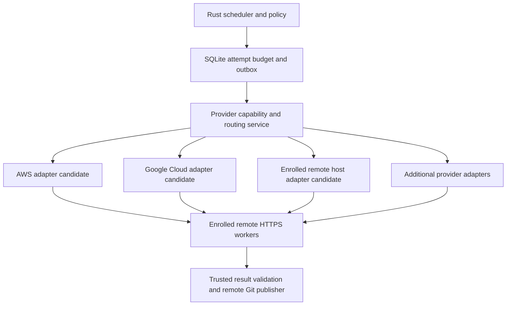

# Multi-provider remote worker adapter contract

## Binding architectural direction

**Approved ADR 0011:** Rolvya supports an **extensible multi-provider remote worker system**; neither scheduler nor the activated task graph is tied to AWS, Google Cloud or any single host. **Approved ADR 0006:** the worker-to-controller control channel uses **worker-initiated HTTPS**. **Approved ADR 0008:** GitHub integration uses **GitHub App** authentication. Rust backend and SQLite authoritative database are mandatory.

**Not yet approved:** concrete provider adapter trait signatures, external plugin loading, default provider policy, regional catalogs, account enrollment, provider quotas, sandbox types and first-shipped provider list. This is a **proposed implementation contract, not working code**.

## Layers



This is a conceptual drawing. Adapter implementations and initial support are **not** deployed. The trusted Git publisher is a separate backend authority and is **not a provider adapter**.

## Provider registry and tenant boundaries (proposed)

Store provider definitions (`provider_kind`, `adapter_version`, supported features), authorized project/provider account linkage, region/zone, quotas, allowed worker pool, permitted models/access modes, security policy, cost meter confidence, secret reference and lifecycle health in SQLite. Keep actual secret bytes in an approved secret store.

Do not mistake a provider definition being installed for a user's authorization to spend on that provider. Before a new attempt, independently establish:

1. The immutable plan permits the provider/resource class and any fallback.
2. The actor/project explicitly authorized the provider account and budget ceiling.
3. The adapter's sandbox/image/CPU/RAM/networking and model/CLI entitlement satisfy the assigned task.
4. Required regional/privacy and remote Git restrictions pass.
5. A conservative, **enforceable** reservation can be computed for the specific provider and attempt.
6. The SQLite budget/lease/outbox admission commits before external paid launch.

A provider choice never changes task graph topology. Actual provider selection and configuration are recorded on the **attempt**, enabling comparisons and recoverable reattempts. Dynamic cost-based routing is a possible enhancement but **not** permission to change provider/model/effort beyond the approved plan and retry policy.

## Core typed Rust port outline (illustrative)

```rust
// Sketch only; names/types are unapproved and not compiled.
trait RemoteWorkerProvider {
    fn capabilities(&self, config: &ProviderConfig) -> Result<Capabilities, ProviderError>;
    fn estimate_bound(&self, config: &ProviderConfig, work: &Workload) -> Result<CostBound, ProviderError>;
    fn launch(&self, op: &AuthorizedLaunch) -> Result<LaunchOutcome, ProviderError>;
    fn inspect(&self, key: &ProviderOperationKey) -> Result<ProviderState, ProviderError>;
    fn request_cancel(&self, key: &ProviderOperationKey) -> Result<CancelOutcome, ProviderError>;
    fn reconcile_cost(&self, key: &ProviderOperationKey) -> Result<ProviderCostEvidence, ProviderError>;
    fn cleanup(&self, key: &ProviderOperationKey) -> Result<CleanupEvidence, ProviderError>;
}
```

An actual Rust adapter likely needs asynchronous operation and explicit cancel-safe handling; do **not** copy this illustrative synchronous trait into production as a finalized API. Type-safe money, provider operation keys and error states must be designed in the actual Rust workspace.

## Capability data contract (example only)

```json
{
  "provider_kind": "example-cloud",
  "provider_account_ref": "example-authorized-account",
  "region": "example-region",
  "execution_modes": ["container-job"],
  "worker_protocol": "https-pull-draft",
  "supports_cancel": true,
  "supports_idempotent_launch": true,
  "enforceable_runtime_limit": "provider-specific",
  "cpu_memory_class": "example",
  "quota_status": "unknown",
  "metering_confidence": "requires-verification"
}
```

**Never interpret booleans as verified operational proof.** For example, `supports_cancel` says an API exposes cancellation, not that a provider instantly stops charges. `enforceable_runtime_limit` must identify its source/evidence and the cost categories it actually covers.

## Adapter lifecycle

1. Registry discovers authorized compatible provider pool(s); unsupported/unhealthy/ineligible pools cannot be selected.
2. Rust evaluates provider capability and full worst-case bounded cost estimate without launching.
3. SQLite atomically commits existing task attempt, fence epoch, reservation, selected provider pool and outbox operation key.
4. Dispatcher uses provider-specific `launch`. A lost response becomes `launch_unknown`, requiring provider inspection before reissue.
5. Remote worker connects outbound via approved HTTPS claim/heartbeat/progress/result.
6. Independent validator checks artifacts; groups aggregate required validated results per Approved ADR 0009.
7. Provider termination/cleanup and delayed cost reconciliation continue after worker exits or is fenced.
8. A provider outage may lead to a **new attempt of the same existing task** on another **approved and eligible** provider after reconciliation and new budget admission. No new DAG tasks.
9. A provider with missing credible exposure bound triggers stop-on-risk under Approved ADR 0010.

## Identity and compliance

Every provider adapter must isolate per-project/provider credentials, verify controller-side authorization and support rotation/revocation. Worker task instructions are untrusted relative to provider credentials. Reject unsupported unattended coding-agent CLI subscription use rather than assuming API fallback. Restrict network egress and remote Git operations to authorized endpoints. An owner-supplied remote VPS is a **remote host**, never the user's personal computer.

## Vendor-independent error classes

`UnsupportedCapability`, `ProviderUnavailable`, `QuotaExceeded`, `ProviderCredentialsRevoked`, `LaunchAmbiguous`, `UnboundedExposure`, `CancelUnconfirmed`, `UsageStale`, `ResourceNotFound`, `RateLimited`, `PolicyDenied`. Every error must map to auditable scheduler/ledger states, not silent success or a fresh paid launch.

## Cross-provider verification plan

- Fake AWS/GCP/remote-server adapters report different IDs, startup characteristics and metering units; scheduler must still enforce one task identity and one SQL authority.
- Independent executable tasks from a fixed DAG may use multiple approved providers concurrently without breaking prerequisite verification.
- One provider outage must not cancel validated results on another provider.
- Reassignment changes **attempt** metadata and creates a fresh reservation; idempotent dispatch prevents duplicate paid launches.
- Provider auto-retries must be controlled/reconciled; unknown bills are not zero.
- Cancel request accepted but final provider charge pending remains `stop_requested` or `cost_uncertain`, not `free`.
- Controller RAM, SQLite writer contention and idle worker polling must be measured on small remote VPS conditions.
- No local desktop agent or user personal-repository access appears in any provider adapter.

## Open decisions

Actual adapter packaging (compiled Rust crate registry vs plugin isolation), Rust async runtime, configuration format, provider onboarded list, SaaS and self-hosted compatibility, first supported region, secret manager, pricing source and versioned API/contract schema.

Related: [Approved multi-provider ADR 0011](../decisions/0011-multi-provider-worker-infrastructure.md), [Approved worker HTTPS ADR 0006](../decisions/0006-worker-communication.md), [provider lifecycle](../operations/remote-worker-lifecycle-contract.md), [provider evaluation](../operations/worker-provider-evaluation.md), [scheduler](scheduler.md), [budget reconciliation](budget-reservation-reconciliation.md).
