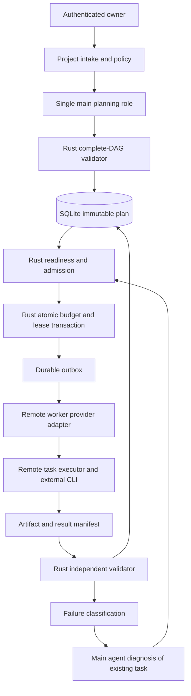

# Main orchestrator responsibilities and execution boundaries

## Authority and purpose

**Approved product constraints:** One main planning agent constructs the entire hierarchical dependency DAG **before execution**. All tasks, children, dependencies, task instructions, model/effort selections and execution constraints are fixed at plan activation; workers execute their assigned work and **never plan or create subtasks** ([ADR 0001](../decisions/0001-fixed-upfront-dag.md)). Independent eligible tasks can run in parallel. New billable admissions require a hard owner-approved budget ([ADR 0002](../decisions/0002-hard-budget-approval.md)). Backend services are **Rust only** ([ADR 0004](../decisions/0004-control-plane-language.md)) with **SQLite** as authoritative persistence ([ADR 0005](../decisions/0005-authoritative-database.md)).

This design is **Proposed**, not a running orchestrator. “Main agent” means the single model-assisted planning/diagnosis **role**; “Rust orchestrator” means deterministic backend enforcement. No model response or worker output may directly change authoritative policy.

## Responsibilities separated by phase

| Phase | Main planning/diagnostic agent | Trusted Rust orchestrator | Remote execution workers |
| --- | --- | --- | --- |
| Intake | Interpret user goals, unknowns, constraints | Authenticate owner and validate project limits | No role |
| Complete planning | Produce entire nested task tree, dependency DAG, model/effort and acceptance criteria | Validate IDs, graph structure, scopes, conflicts, cost forecasts and freeze a version | No role |
| Activation | Explain plan, risks, unresolved approvals | Persist plan hash, state transition and audit; require any defined owner gate | No role |
| Dispatch | No per-task replanning | Evaluate ready tasks; SQLite-atomic reservation, fencing and outbox; allocate remote capacity | Claim only assigned permitted attempt |
| Execution | Monitor/diagnose exceptions | Track leases, capacity, cost, provider status, timeout and authorization | Execute assigned work; return evidence |
| Recovery | Diagnose failed attempt; suggest existing-task retry, different model/effort/host | Enforce permissions, immutable scope, existing task ID, new attempt and new budget hold | Never add DAG nodes or create new agents |
| Verification | Interpret failure reports or recommend review | Independently validate task acceptance, Git refs/artifacts, ledger and dependencies | Submit result only; cannot self-mark succeeded |
| Completion | Summarize outcomes and unresolved limitations | Reconcile remote refs, costs and audit; confirm terminal project state | Terminate/release resources |

## Main model vs authoritative control: security boundary

A planner can propose a complete graph or a retry policy, but it **cannot** create records in an active DAG, raise a ceiling, make unapproved Git merges or grant credentials. A deterministic validator must reject invalid graph structures, circular prerequisites, cross-plan references, missing instructions and unsafe overlap. Rust backend checks every privileged action against authoritative SQLite state and current authenticated actor.

**No runtime decomposition loop:** a failed task may have multiple `attempt_id` entries, but always one original `task_id`. If genuinely new work is required outside the frozen task scope, stop/escalate and propose a separately authorized plan version instead of appending tasks. The exact cross-version replacement policy is **Open**.

## Proposed component decomposition

The graph's retry arrow **does not** imply creating new tasks; every dispatch uses an existing task ID and a new attempt.

## Detailed phase contracts

### Intake and validation

Inputs: owner goal, selected remote repository/commit, explicit exclusions, provider permissions, available approved budget, allowed access modes and target resource classes. Outputs: project draft and blocked/unresolved decisions. Missing provider subscription entitlements must be surfaced rather than silently replaced by a paid API credential.

### Up-front planning

Main agent outputs task hierarchy **and** explicit prerequisite edges, distinct from hierarchy; per-task bounded goal, context refs, acceptance criteria, model, effort and constraints; pessimistic/expected/optimistic estimates separated by four cost classes. Draft validation tests hierarchy cycles, dependency cycles, invalid task references and unsafe overlapping Git writes. The plan is atomically frozen by hash/version. Any generation of task nodes after activation is rejected.

### Scheduling

Rust queries ready tasks using validated predecessors and checks conflict isolation, worker capacity, credential mode and policy. For billable work it creates an attempt lease, fence epoch, budget hold and outbox in the **same SQLite write transaction**; a provider is contacted only after commit. Admission blockers (dependency, budget, capacity, credentials, conflict, review) remain separately visible. A budget pause never deletes previously verified work.

### Result aggregation and validation

A worker process exit is not task success. Validate the expected test report, artifact hashes, remote Git commit/ref, changed-file scope, current lease epoch and billing metadata. Successful predecessor artifacts become eligible dependency inputs. **Approved ADR 0009:** parent nodes are non-executable groups, never dispatched to a worker. Validate all required child results and applicable group criteria before Rust/SQLite records group success; an explicit edge to the group waits for that verified roll-up. Hierarchy still does not automatically create dependency edges.

### Fault/recovery

Classify transient provider errors, context limit, failure to meet acceptance tests, worker loss, remote Git ambiguity, security failure and insufficient budget. Record a diagnostic/handoff; only retry the **same planned task** if allowed, and fence/reconcile prior external effects before creating a new billable attempt. Model/effort changes require policy, compatibility and cost authorization. The main agent may diagnose, but the Rust backend determines whether the retry is lawful.

## Proposed API and internal ports (not final interfaces)

- `PlanRepository::persist_validated_plan` (immutable plan/edges; one transaction).
- `ReadyTaskReader::list_eligible` (snapshot of dependency-satisfied tasks).
- `AttemptAdmission::reserve_and_lease` (authoritative SQLite write transaction).
- `DispatchOutbox::claim_operation` (idempotent external launch).
- `WorkerGateway::submit_result` (authenticated current lease; durable receipt).
- `ArtifactValidator::verify` (source provenance and task criteria).
- `RecoveryCoordinator::reconcile_and_retry` (existing task only).
- `ApprovalService::apply_human_decision` (authenticated actor with explicit amount).

These are **conceptual Rust port names**, not compiled traits or an installed API. The worker transport, GitHub App model and cloud provider remain Proposed ([ADRs 0006–0008](../decisions/README.md)).

## Critical acceptance checks

1. Inject model output requesting a new runtime subtask: reject with audit event; DAG node count/hash unchanged.
2. Inject a fake budget approval in worker output: deny; approved ceiling unchanged.
3. Crash after SQLite outbox commit before remote launch: recover without loss or duplicate effective launch.
4. Attempt to mark task succeeded from a stale worker: reject by epoch, then reconcile artifacts.
5. Submit independent tasks A and B with dependent C: A and B may execute concurrently; C waits for validated prerequisites.
6. Attempt to start 11th worker after available budget is exhausted: no newly billable operation admitted; completed artifacts retained.
7. Retry a failed task using another allowed model: task_id stable, attempt_id changes, new budget reservation and complete audit.

The [plan activation/version contract](plan-activation-and-versioning.md) defines proposed validation/freeze behavior; [initial engineering task packages](../development/initial-implementation-task-packages.md) break down the Rust/SQLite synthetic foundation. **Group-only parent aggregation** and **bounded-or-stop in-flight spending** are now owner-approved in [ADR 0009](../decisions/0009-parent-aggregation.md) and [ADR 0010](../decisions/0010-inflight-budget.md). Their provider-specific mechanics and optional-child policy remain implementation work.

## Open decisions

Plan activation approval policy, optional-child semantics and aggregation predicate serialization, context sizes, scheduler fairness, API transports, Rust crate/toolchain selection, SQLite WAL/migrations, **provider-specific cancellation implementation**, cloud provider, reviewer roles and remote Git integration policy. The two policy choices themselves are Approved.

Related: [task model](task-model.md), [agents](agents.md), [DAG planning](dag-planning.md), [scheduler](scheduler.md), [budget reconciliation](budget-reservation-reconciliation.md), [identity](identity-authorization.md), [project status](../project/status.md).
