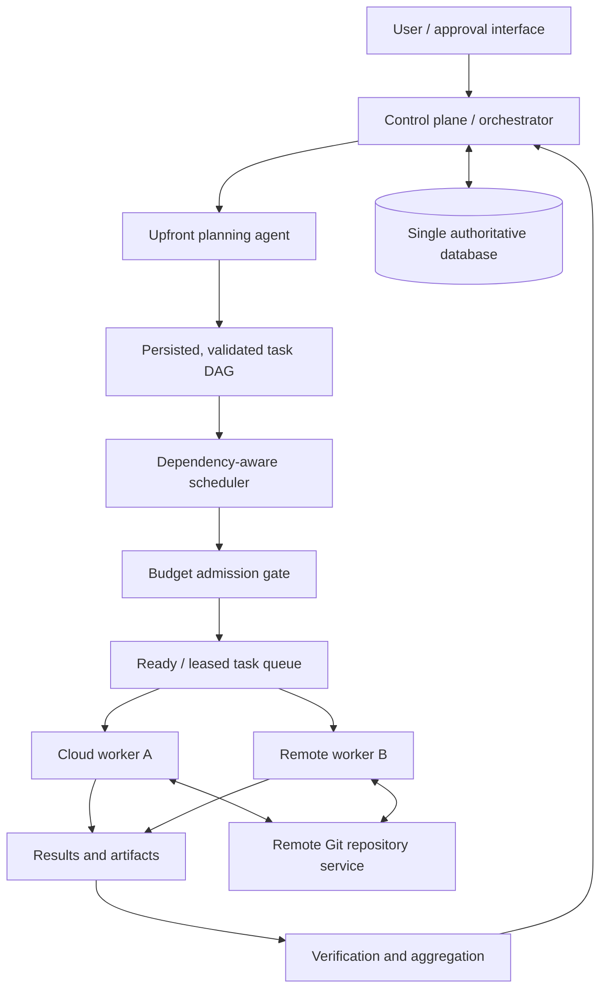

# System architecture overview

## Purpose and status
Rolvya is an open-source orchestration system for AI coding agents. **Architecture intent, not implemented functionality.** Only explicitly approved decisions are binding; detailed interfaces and stack choices remain subject to ADR review.

## Approved invariants
1. One coordinating main agent produces the full hierarchical task plan **before execution**. During runtime no new task nodes are generated.
2. The plan is a directed acyclic graph (DAG): a task starts only when all required predecessors have successfully satisfied their completion criteria. Independent ready tasks may run concurrently.
3. Workers execute bounded tasks, rather than spawning or planning subordinate agents. Per-task instructions include scope, context, model and effort.
4. Insufficient remaining budget stops admission of **new billable work** until explicit owner approval to increase the budget. Never silently permit a percentage overrun. Preserve completed work.
5. Integration with Git repositories is through **remote providers** (including self-hosted servers). No Local Agent, Local Sync or access/synchronization to repositories on the user's personal computer.
6. Documentation is maintained in portable Markdown readable by GitHub and Obsidian.

## Logical component map

Arrows represent intended logical control/data flows, not finalized network connections or protocol contracts.

## Component responsibilities
- **User interface and approvals:** capture project intent, review plans, show task/budget state, explicitly approve budget increases and significant decisions. UI stack and UX are open.
- **Planning agent:** decomposes top-level work into nested tasks; fixes dependency edges, goals, constraints, model/effort assignments and completion criteria before run admission.
- **DAG validator:** rejects cycles, missing references, contradictory parent/dependency semantics and unbounded or invalid task assignments.
- **Scheduler:** maintains ready/waiting/running/terminal states; admits independent tasks when dependencies, resource limits and budget permit; ensures controlled concurrency.
- **Worker control and adapters:** provision/use remote compute, deliver scoped instructions, execute CLI agents or API-based models under approved credential and resource policies, and collect results.
- **Persistence:** an authoritative **SQLite** database stores project, task graph, execution state, instructions/context, attempts, approvals and the cost ledger. The **Rust** backend exclusively controls SQLite access; schema, WAL and migration configuration remain proposed.
- **Validation and integration:** verify work, manage compatible remote Git changes and aggregate outputs. Merge-conflict and test-gate rules require dedicated contracts.
- **Observability and recovery:** durable events, logs, lifecycle/heartbeats, retries and reconciliation; exact fault policy remains open.

## Deployment constraints and options
The control plane is intended to work on a modest remote VPS (roughly 2–4 GB RAM was discussed). **Approved [ADR 0011](../decisions/0011-multi-provider-worker-infrastructure.md) requires extensible multi-provider Rust worker adapters**: cloud services and enrolled user-provided **remote** hosts can coexist. All enrolled remote workers use **Approved HTTPS pull/claim** ([ADR 0006](../decisions/0006-worker-communication.md)), while GitHub integration uses **Approved GitHub App** ([ADR 0008](../decisions/0008-github-authentication.md)). AWS, Google Cloud and other services are **candidate concrete adapters, not selected first-release providers**. Local personal-computer workers are excluded.

## Known planning targets, not guarantees
Task granularity was discussed as medium complexity, usually targeting no more than about 10 minutes per worker task. Many independent tasks may execute simultaneously; no fixed 20-worker limit or hardware capacity has been approved. Resource quotas and model limits must determine actual concurrency.

## Interfaces awaiting specification
Planner output schema; DAG validation rules; task state-machine transitions; worker lease protocol; cloud lifecycle; model adapters and CLI versus API policy; context packaging; remote Git permissions; artifact format; budget reservation/settlement; identity/secrets; retries, reconciliation and audit event contracts.

## Expanded technical specifications

See the proposed [persistence and data model](data-model.md), [agent memory and context](context-memory.md), and [API and event contract inventory](api-contracts.md). **Rust-only backend** and **SQLite database** are approved in [ADR 0004](../decisions/0004-control-plane-language.md) and [ADR 0005](../decisions/0005-authoritative-database.md). See the [backend design contract](rust-sqlite-backend.md). Network protocols, crate choices and specific SQL schemas are not yet approved.

## Documentation navigation
See [DAG planning](dag-planning.md), [execution and scheduling](execution.md), [budget and costs](budget-costs.md), [workers and models](workers.md), [security](security.md) and the [decision register](../decisions/README.md). Read the [project status](../project/status.md) for what is actually implemented.
