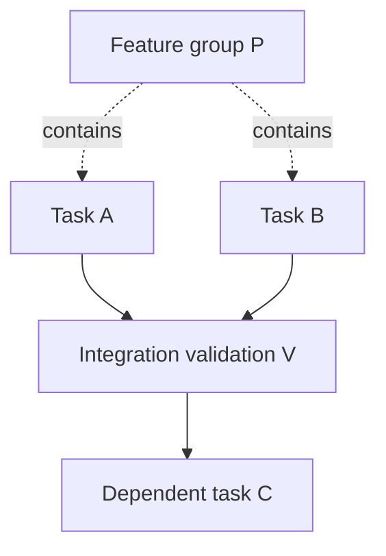

# Hierarchical parent task aggregation policy

## Why a separate decision is necessary

**Approved:** plans may have deeply nested parent/child tasks, and explicit DAG edges govern executable prerequisites. **Not approved:** whether a parent task may execute code itself; exactly when a parent is considered successful; how an edge pointing to a parent is satisfied; or how canceled/failed descendants aggregate. This document proposes alternatives and conservative acceptance rules. It does **not** turn one model into a final owner decision.

## Separate hierarchy from scheduling dependencies

Parent/child is a **decomposition** relation; prerequisite edges are **execution gates**. A parent P of leaf tasks A and B does not automatically make A depend on B, nor automatically mean that P may execute while A and B do. An edge P → C must have explicitly defined *what verified P outcome means*.



The solid A/B → V and V → C edges are explicit prerequisites; dotted hierarchy edges are not task scheduling dependencies.

## Alternatives

| Policy | Advantages | Risks |
| --- | --- | --- |
| **A: Group-only parents** (recommended first version) | Straightforward leaf scheduling; each group is a result aggregator with no worker attempt | Less flexible for a parent needing its own executable final integration |
| **B: Executable parents** | Allows parent to run a final aggregation or implementation attempt | Ambiguous timing, double-execution and complicated dependency/roll-up semantics |
| **C: Fully implicit descendant dependencies** | Less need for explicit edges in planner output | Violates clarity that hierarchy and DAG are separate; may hide accidental serialization |

**Working proposal:** A for the initial implementation, with an explicit separately planned validation/integration **leaf** if the parent needs code or tests. Do **not** approve this design without owner consent. Policy C should not be silently applied, because it blurs an established distinction.

## Proposed group-only state derivation (conditional on A approval)

- Leaf/task attempt: `planned → waiting → running → validating → succeeded/failed/canceled`.
- Group: `planned → waiting → aggregating → succeeded/failed/blocked` (conceptual; not assigned to any worker).
- A group can become **validated succeeded** only if all *required* child outputs are independently validated succeeded **and** the group's explicitly declared acceptance predicate passes.
- If any required child is failed/canceled without approved alternative outcome, the group cannot be marked succeeded.
- Child status **running/validating** means group remains nonterminal; previously successful siblings retain their artifacts and attempts.
- If a descendant reports a new unplanned task requirement, the active DAG remains fixed; group is blocked and a separately authorized plan proposal may be needed.
- An edge whose predecessor is a group is satisfied **only by accepted aggregate group success**, not simply by a count of worker exits.
- A group cannot declare itself succeeded via worker-submitted status, main-agent suggestion or incomplete artifact set.

The plan validator should enforce explicit required/optional child semantics, acceptance criteria and group-to-dependent edges before activation. Whether optional descendants are supported at all is **Open**; an initial proposal may require **all children required** to avoid ambiguity.

## Candidate aggregator contract (not compiled Rust API)

```text
validate_group_success(group_id, frozen_plan_hash, validated_children, evidence_refs):
    reject if group_id is executable under group-only policy
    reject if plan hash differs from activated plan
    reject if any required direct child or recursively required descendant incomplete
    reject if any declared group acceptance criterion not proven
    validate evidence manifests and integration/Git refs
    commit group state and audit in one authorized SQLite transition
    wake explicit dependent edges only after accepted group result
```

Avoid checking only direct children if required descendant validity or aggregation propagation has not been established. Derive group status from authoritative SQLite task outcomes, not worker-provided counts.

## Proposed failure and cancellation matrix

| Descendant condition | Parent/group result |
| --- | --- |
| All required descendants verified, group criteria pass | Candidate success |
| Any required descendant still running/waiting/validating | Not terminal |
| Required descendant fails with retry permitted | Blocked/waiting while original task is retried |
| Required descendant irrecoverably fails | Failed or blocked under recorded recovery policy; never success |
| Optional descendant canceled | Depends on optional-child policy, currently unapproved |
| Parent validation evidence missing | Remains unverified even if all children succeeded |
| New task discovered after activation | Escalate new-plan proposal; do not insert nodes |

## Safety and correctness checks

1. Hierarchy depth cannot cause unbounded recursive stack exhaustion; use iterative traversal/bounds as justified.
2. State aggregation has no dependency cycles and cannot recursively call itself indefinitely.
3. Group-to-group and group-to-leaf dependency edges reference valid same-plan identities.
4. Failed required descendant can never be hidden by successful siblings.
5. A canceled project retains completed leaf artifacts for reuse according to future plan-version policy.
6. Concurrent child completion events produce one idempotent group transition and one audit event.
7. No group attempt is scheduled under group-only interpretation.
8. A dependent leaf waits for independently validated parent/group success.
9. Graph hash remains unchanged by group state derivation.

## Human approval needed

Owner must decide: group-only versus executable parents, group completion rule (all required vs optional), whether group acceptance predicates must exist, semantics of group dependency edges, and cancellation behavior. Record approved selection as a new ADR or owner-approved addendum to [ADR 0001](../decisions/0001-fixed-upfront-dag.md). Do **not** let an AI agent select the policy by assuming the recommended option is binding.

Related: [task model](task-model.md), [plan activation](plan-activation-and-versioning.md), [DAG planning](dag-planning.md), [orchestrator](orchestrator.md), [open questions](../project/open-questions.md).
