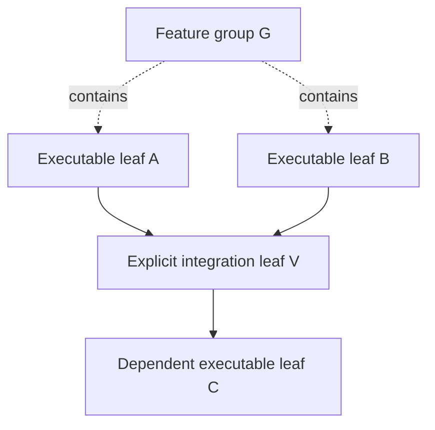

# Hierarchical parent task aggregation contract

## Binding decision vs implementation detail

**ADR 0009 is Approved (2026-10-21):** parent tasks are **non-executable group nodes**; only planned executable leaves run workers. Groups organize and aggregate independently verified children; hierarchy and explicit dependency edges remain separate. This file specifies **proposed mechanics**, not a working Rust implementation or finalized schema.

A worker must **never** execute a group as though it were a leaf, create descendants during execution, or mark a group successful from its own report.

## Graph semantics



Dotted arrows represent **decomposition**, solid arrows represent **explicit dependencies**. G does not imply A → B, B → A or an executable task. If an integration step must run tools or consume model tokens, it is a **planned executable leaf** with its own acceptance criteria, task ID, cost and dependency edges.

## Approved roll-up rules

1. A group has **no executing attempt or worker lease**. It may still have authoritative status and a validated result/artifact manifest in SQLite.
2. Group success requires independently validated success from all **required children** (and, through recursive group success, their required descendants) **plus proven applicable group-level acceptance criteria**.
3. A child that is waiting, running, validating, failed or canceled **cannot** count as successfully validated. A retry may eventually validate the same original executable task, not a new task node.
4. A group with any unsatisfied required child remains incomplete/blocked or records a failure according to later chosen lifecycle enums; it must **not** be succeeded.
5. An explicit dependency pointing to a group is ready **only once that group's aggregate result is validated**. A dependency pointing to an executable leaf depends on that leaf's validated result.
6. Group status derivation is performed by the trusted **Rust backend using SQLite authority**, with idempotent audit and no active DAG mutation.
7. Verified siblings and artifacts remain intact during failure, pause or recovery.

**Conservative initial policy for optional children:** no unapproved optional-child semantics. Treat children as required unless optional behavior has been explicitly defined and approved; plans depending on ambiguous optional flags are held/rejected at validation rather than silently counting canceled work as success.

## Proposed aggregation event contract

```text
onValidatedChildEvent(child_id, plan_hash):
    read activated immutable plan and group ancestors
    verify current event/plan identity and evidence
    for each group bottom-up:
        if group has any required child without validated success:
            leave group non-successful
        else if applicable group acceptance evidence is incomplete:
            leave group non-successful
        else:
            atomically compare-and-set group -> validated success
            append exactly one logical audit event and wake explicit successors
```

This is **conceptual pseudocode**. It must not become an unbounded recursive stack call; implement an iterative/bounded traversal appropriate for arbitrarily deep but resource-limited hierarchies. Success state and audit write must be atomic and replay/idempotent.

## Example state outcomes

| Child/descendant condition | Group result | Next task |
| --- | --- | --- |
| A validated, B executing | Not yet successful | Dependent-on-group waits |
| A/B validated, group acceptance evidence satisfied | Validated success | Explicit dependent becomes eligible |
| Required B irrecoverably failed | Not successful; report blocker/failure | Explicit dependent remains blocked |
| A validated, B retrying same task | Not yet successful; A artifact retained | Wait |
| Optional child specified without approved optional policy | Plan validation rejects/holds ambiguity | No billable dispatch |
| Duplicate child callback from stale attempt | No new group success | Reject stale event |
| Group-specific code needed | Create distinct planned integration **leaf before activation** | Group never leases worker |

## Plan validation requirements

Classify every node as `group` or `executable_leaf` and reject any group attempt assignment, executable-with-children configuration, cross-plan parent links and parent cycles. Check DAG prerequisite cycles independently. A group that is the predecessor of another task must have a documented acceptance and roll-up contract. Do not automatically add prerequisite edges merely because nodes are siblings or ancestors.

## Verification matrix

- Validate nested groups including a deeply nested hierarchy using bounded traversal.
- Assert parent status remains incomplete until every required child and parent acceptance check passes.
- Assert group-to-leaf dependency is blocked until accepted group status.
- Assert no group receives worker ID, model execution call, lease, cloud launch or attempt billing.
- Simulate two children validating concurrently and replay a result; one logical group-success transition is stored.
- Simulate required-child failure, stale result and project budget pause; verified sibling artifacts persist.
- Verify plan hash unchanged by roll-up and cross-plan references denied.

## Open implementation details

Exact group-state enum, serialization of group acceptance predicate, optional-child support, group cancellation terminal classification, DAG graph size/depth limits and whether verified aggregation requires an independent external reviewer. **Group-only parents themselves are not open.**

Related: [approved ADR 0009](../decisions/0009-parent-aggregation.md), [task model](task-model.md), [plan activation](plan-activation-and-versioning.md), [orchestrator](orchestrator.md), [testing](../development/rust-sqlite-test-matrix.md).
