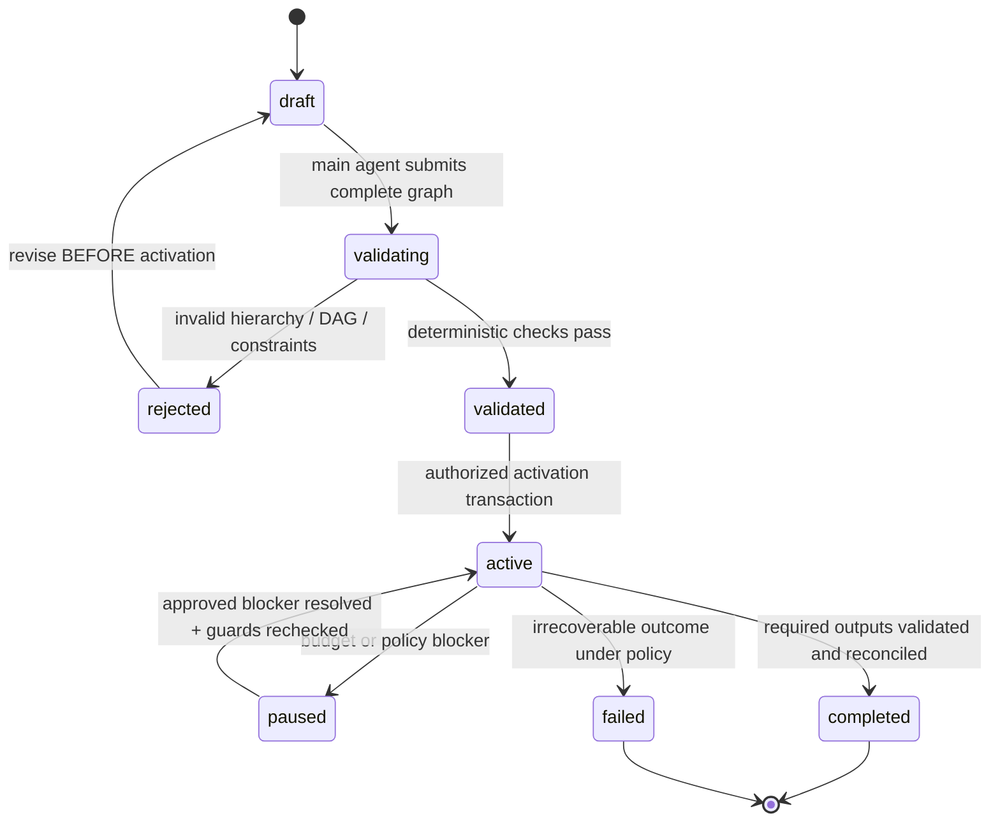

# Plan validation, activation and version boundaries

## Approved invariants versus proposed process

**Approved:** one main agent constructs the **entire hierarchical task set and dependency DAG before execution**; no runtime task insertion by planner, scheduler or worker. Workers execute only assigned tasks; the Rust backend enforces policy with SQLite authority. Other approved invariants include dependency-gated parallelism, remote Git only, completed-work preservation and a hard owner-approved budget.

**Proposed:** exact plan-activation consent flow, storage state names, plan supersession, aggregate parent semantics and schema details. This document does not approve an automatic plan-version replacement or authorize a worker to initiate replanning.

## Immutable objects versus runtime records

| Record | Before activation | After activation |
| --- | --- | --- |
| Plan identity / graph hash | Draft and validation revisions allowed | Frozen; no mutation to activated snapshot |
| Task IDs and complete parent structure | Generated by main planner, validated | Immutable |
| Dependency edges and ordering constraints | Generated and validated | Immutable |
| Goal, scope, exclusions, acceptance criteria, initial model/effort and access mode | Declared for every executable planned task | Frozen as original plan contract; allowed fallback recorded **per attempt** |
| Runtime task status and blockers | Initial state assigned | Mutable only through trusted Rust state machine |
| Attempt, current lease/epoch, result artifact and usage | None or synthetic drafts | Append/update with auditable state transitions |
| Approved project spending ceiling | Human policy | Changed only by explicit authenticated human approval |

**Hash design proposal:** compute a canonical representation of static plan fields, stable array ordering, normalized immutable references and validated graph edges; exclude execution state and timestamps that are not part of the original contract. The hash algorithm/serialization format remains open but changing attempt state cannot change the plan hash.

## Proposed lifecycle

This is a *suggested* state diagram; exact enum and approval requirements need a separate decision. A budget pause is **not** a task failure; it blocks new billable admissions but retains the graph and validated artifacts.

## Validation pipeline (candidate checks, in order)

1. **Parse and authenticate:** request actor and owner scope; resolve remote repository identity and base SHA; reject missing/ambiguous version IDs.
2. **Completeness:** main agent supplied every planned node (including nested levels), explicit dependencies and all mandatory planned execution settings, acceptance criteria and context hashes.
3. **Hierarchy:** one canonical root or approved forest policy; no missing parents, cycles, cross-plan parent references or unbounded depth/size beyond a **defined** resource policy.
4. **Dependencies:** no missing predecessors, cycles or cross-plan edges; hierarchy links do not silently imply prerequisite edges.
5. **Group semantics:** distinguish organizational parents from executable work; parent completion and dependency-to-parent targets must satisfy an explicit aggregation policy. This policy is currently open; a validator must **reject or defer** ambiguous plans.
6. **Conflict/isolation:** identify write overlap in remote Git refs/paths, unsafe shared state, concurrent migrations and other side effects. Isolate or add required edges **before activation**; do not add them during runtime.
7. **Model/provider eligibility:** every executable task has model, effort, access mode and permitted remote resource; unsupported unattended CLI entitlement is a blocker rather than automatic paid fallback.
8. **Budget and resource forecasts:** three project cost scenarios with four categories, available approved budget and conservative candidate exposure. Forecasts are not spending authorization. Live billable provisioning remains a separate admission gate.
9. **Canonical freeze:** compute graph hash; persist task definitions, hierarchy, edges and validated state in an atomic SQLite unit with unique version and idempotent activation request.
10. **Audit and visibility:** durable validation errors, user-facing graph and reasons for inability to activate. Never represent a partial graph as runnable.

## Atomic activation contract

Proposed Rust service entrypoint: `activate_plan(project, expected_plan_version, graph_hash, actor, request_id)`. Inside one SQLite write transaction verify actor and plan eligibility, compare current draft/version/hash, enforce at most one active version per project unless a future owner-approved migration policy allows otherwise, mark plan active and initialize task states/audit. Commit before scheduling any attempt. A duplicate request ID returns the recorded outcome; a conflicting activation must not create two active plans.

Plan activation and **billable task admission** are distinct operations. Activation need not itself spend money; the scheduler must still check budget on every billable attempt.

## Scope changes discovered after activation

Workers may report unplanned requirements and classify them as blockers. The main agent may describe a **new plan proposal** outside the active run but **must not mutate** the activated task graph, create new child tasks in it or relabel the failure as a success. Existing validated artifacts and expenses remain attributed to the old version.

The exact supersession protocol is **Open**: whether active execution is paused/canceled, how successful artifacts can be referenced without conflating task IDs, human consent/approval, new budget forecast and how dependent tasks are revalidated. Until approved, **no automatic supersession**.

## Illustrative cases

- A complete plan of 3 tasks with A and B independent and C dependent on both may activate if its roles, conflicts and costs pass policy. C stays blocked until A and B are *validated*, not merely finished.
- A worker output says “add task D”: record a scope-change request; graph hash, node count and active edges remain unchanged.
- A new attempt changes model after failed run: plan's originally assigned model stays in the snapshot; the attempt records approved fallback.
- A parent with a dependent child but no explicit aggregation definition: activation fails or is held for policy approval; never infer readiness.
- An activation request is duplicated following network loss: the existing version is returned without adding another graph or spending authorization.

## Acceptance tests

| ID | Expected deterministic result |
| --- | --- |
| PA-01 | Partial, cyclic or dangling DAG rejected before activation |
| PA-02 | Cross-plan parent/dependency rejected |
| PA-03 | Duplicate activation request idempotent |
| PA-04 | Activation with stale version/hash rejected |
| PA-05 | After activation attempts and outcomes do not change static graph hash |
| PA-06 | New task or edge write to active plan rejected in Rust policy and SQLite storage |
| PA-07 | Ambiguous parent aggregation blocks activation rather than silently guessing |
| PA-08 | Budget-paused active plan retains prior success artifacts and unchanged graph |
| PA-09 | No cloud/provider call occurs as an implicit side effect of a mere draft validation |
| PA-10 | A second active plan for the same project is prohibited under the initial single-active-version proposal |

## Open decisions

Activation UX, authorized actor roles, group task semantics, plan hash/serialization, whether one active plan per project is mandatory, plan supersession, graph limits, conflict classifier and provider-entitlement validation.

Related: [task model](task-model.md), [parent aggregation](parent-task-aggregation.md), [orchestrator](orchestrator.md), [scheduler](scheduler.md), [SQLite model](sqlite-schema-draft.md), [approvals](approval-workflow.md), [decision register](../decisions/README.md).
