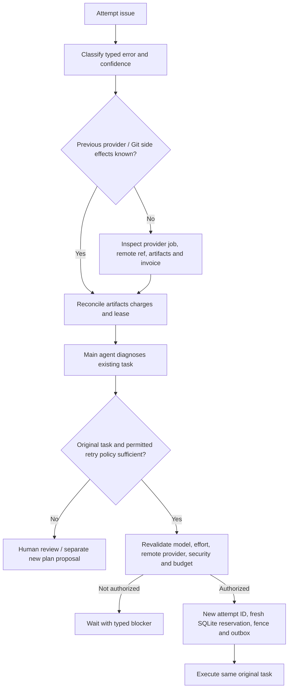

# Failure retry escalation and same-task recovery policy

## Historical material and approved boundaries

Earlier architecture diagrams explored **three execution attempts** with example backoff **1 → 3 → 10 minutes**, escalation to a stronger model, larger CPU/RAM allocation, transfer between worker providers and finally human/main-agent intervention. These are **illustrative historical suggestions**, **not** an owner-approved global retry count, timer schedule, mandatory model ladder or automatic costly failover. Never encode 1/3/10 or 3 retries as default without an explicit configuration/ADR.

**Approved:** the complete hierarchical DAG is built once; no task nodes/edges can be created during execution. A failed worker can trigger main-agent diagnosis and a **new attempt on the same executable leaf**, potentially using an allowed alternative model/effort/remote provider. Rust and SQLite enforce budget/authorization/leases. Group parents never execute. HTTPS workers, GitHub App and multi-provider host architecture are selected. An in-flight worker continues only within enforceable pre-reserved exposure, otherwise stop-on-risk.

## Distinguish failure, attempt, and terminal task state

| Event | Authoritative meaning | Next action |
| --- | --- | --- |
| Temporary network disconnect | Worker/operation result may be **unknown** | Reconnect/inspect, do not blindly provision again |
| Lease expires | Prior worker no longer has authoritative lease after fencing | Inspect provider and possible external side effects, then recovery |
| Worker returns non-zero | Attempt execution failed | Validate/diagnose; logical task may remain retryable |
| Worker returns 0 with missing tests | Not independently accepted | Hold for validation/fix under original task scope |
| Task contract fundamentally impossible | New planned scope may be required | Escalate new plan-version proposal; **never add runtime child** |
| One child irrecoverably fails | Required non-executable group cannot succeed | Block dependent group/edges, preserve verified siblings |
| Cost cannot be bounded mid-run | Approved stop-on-risk trigger | Persist/fence, ask provider to stop, reconcile charges |
| Credential compromised | Security incident | Block privileged actions, revoke, preserve sanitized audit |

A retry is never a reason to change the activated plan's original goal, identity, parent-child edges or dependency graph.

## Proposed decision pipeline



The Rust backend makes final admission decisions; the main agent recommends a recovery strategy. A worker report is untrusted task data and may not instruct the controller to raise spending, bypass security, create child tasks or force a Git merge.

## Suggested classification and retry strategy (not numerical policy)

| Failure | Auto-retry eligibility | Model/effort/worker strategy | Mandatory guard |
| --- | --- | --- | --- |
| Retryable HTTP timeout, rate limit | Potentially, with bounded exponential backoff + jitter | Usually same eligible model/provider first, unless capacity data warrants change | Idempotent operation key, cloud cost and rate limits |
| Remote provider startup failure | Possibly new same-task attempt after inspection | Alternative **authorized** provider if compatible | Verify no orphan paid job / unreported invoice |
| CLI auth expired or revoked | **No** automatic credential escalation | Owner/admin authorization or session refresh policy | Least privilege, subscription terms |
| Context/token limit | Controlled same-task retry if allowed | Compact nonessential context, or policy-approved model/effort change | Never omit required acceptance/security context |
| CPU/RAM exhaustion / process killed | May retry with policy-approved resource class | Larger **remote** pool only if affordable and allowed | Bound new compute/transfer and initial orphan charges |
| Deterministic compile/test error | Diagnose whether original goal can be completed | Same task repair attempt, not speculative infinite loops | Actual test evidence and retry cost |
| Remote Git write uncertain | No blind retry until reconciled | Inspect commit/ref under trusted Rust publisher | Base SHA, lease epoch, protected branch policy |
| Model output tries to add task | **Reject** | New plan proposal only if user approves scope change | Immutable plan hash and audit |
| Security/prompt-injection signal | **Stop and review** | Fence/quarantine; no elevated fallback | Revocation, sanitized logs |
| Insufficient budget / unbounded exposure | **No new billable retry** | Wait explicit budget approval; stop-on-risk current attempts | ADR 0002/0010 and SQLite admission |

## Retry budget and termination conditions (proposed)

Separate:
- **Attempt count** (bounded by an eventual owner-approved max, currently not specified).
- **Total wall-clock window** including backoff and provider startup.
- **AI model token/call quota** when API metering supports limits.
- **Compute/transfer/storage maximum exposure** for each new paid attempt.
- **Repeat failure signature** and number of no-progress attempts.
- **External side-effect uncertainty** (no new paid launch while ambiguous).
- **Maximum allowed escalation** to a higher-cost model/effort/provider.
- **Security block**, which overrides all retry budgets.

When one bound is exhausted, mark task blocked and request policy/human attention rather than consume unlimited worker capacity. A deadline or cost cap cannot be inferred solely from the ~10-minute worker sizing target.

## Artifacts and Git reconciliation

1. Fence the prior current lease and persist attempt state + intended external operation IDs.
2. Inspect cloud provider physical executions (including provider auto-retry), process status, logged resource use and potential late invoice.
3. Inspect remote Git ref/commit for ambiguous publication; **do not** simply force push an identical patch without expected SHA guard.
4. Confirm accepted artifacts and hashes from successful siblings and prior attempt; retain them regardless of failure.
5. New attempt receives compact handoff with failure category, operations already performed, remote base/ref, acceptance criteria and verified predecessor artifacts.
6. Before new billable admission, enforce same task ID, permitted model/effort/access mode, provider authorization and **fresh** conservative reservation in SQLite.
7. If acceptance remains impossible under original graph, escalate separately authorized plan proposal; do not mutate active plan in place.

## Historical retry illustration — explicitly not binding

```text
Historical diagram:
  initial attempt → wait 1 minute → second attempt
                  → wait 3 minutes → another attempt
                  → wait 10 minutes / consider escalation
  repeated failure → diagnose / human intervention

Interpretation: these numbers were an example of backoff/escalation in a graphic.
No owner approval establishes 1, 3, 10 minutes as runtime defaults.
```

Do not treat “three attempts” as both three retries plus the original attempt; exact max attempts and timer semantics must be deliberately defined.

## Evidence and tests

- Repeated identical webhook, worker result and bill callback → one logical state/charge effect.
- Cloud launch response lost after job created → inspect by operation key, **zero blind duplicate launch**.
- A1 task failure → A2 on alternative authorized provider with same task ID, changed attempt ID, new ledger reservation.
- Disallowed model/API mode fallback → block even if higher capability might help.
- Historical backoff constants absent from approved configuration → code does not silently assume 1/3/10.
- Plan group parent cannot be retried as a paid worker task; underlying executable leaves can.
- Cost exhaustion blocks new paid attempt and preserves accepted sibling artifacts.
- A task without progress across configured bounded retries becomes a typed blocked/failed outcome, not infinite new tasks.
- Provider cost remains unknown after cancellation → audit and stop-on-risk; no premature reservation release.

## Open questions

Max attempts, bounded retry delay/timeouts, repeat-failure thresholds, model/effort escalation permissions, worker size increase rules, auto/manual retry boundary, retry fairness and conflict repair, how to authorize a superseding plan, whether already partially published Git changes can be reused, and entitlement-specific usage caps.

Related: [existing failure recovery](failure-recovery.md), [scheduler selection](scheduler-selection-policy.md), [model entitlement](model-access-entitlement-contract.md), [cost reconciliation](budget-reservation-reconciliation.md), [agent handoffs](../development/agent-handoffs.md), [historical audit](../project/historical-decision-audit.md).
