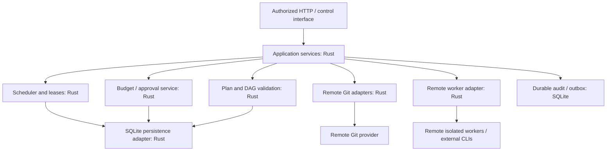

# Rust backend and SQLite implementation contract

## Decisions versus proposals

**Approved:** Rolvya-owned backend services use **Rust only** ([ADR 0004](../decisions/0004-control-plane-language.md)); Rolvya's sole authoritative database engine is **SQLite** ([ADR 0005](../decisions/0005-authoritative-database.md)). This document develops a **proposed implementable architecture** consistent with those decisions. **Axum (ADR 0012), SQLx (ADR 0013), initial WAL/pool/busy settings (ADR 0014), HTTPS transport (ADR 0006) and atomic `BEGIN IMMEDIATE` admission (ADR 0031) are approved.** Versions, physical schema, `synchronous`/checkpoint policy, authorization and exact wire implementation still require validation. No backend has yet been compiled or deployed.

The original product invariants remain mandatory: immutable fully preplanned DAG; workers execute assigned tasks without generating tasks; independent prerequisites may proceed concurrently; new billable work is blocked on insufficient approved budget until explicit owner authorization; no automatic percentage overrun; completed results persist; no personal-computer Local Agent or Git sync.

The [Rust workspace proposal](rust-workspace.md) elaborates tentative crate/trait boundaries for AI contributors. Module names are not yet fixed; Rust-only backend and SQLite-only database engines are approved.

## Proposed Rust modular architecture



External CLIs and code belonging to user projects on workers are not Rolvya-owned backend language exceptions. The front end remains a separate undecided concern.

### Logical module responsibility and dependency direction

| Module boundary (names illustrative) | Owns | Must never do |
| --- | --- | --- |
| `domain` | Typed IDs, plan/edge/task/attempt states, money, approved policy invariants | Know HTTP, cloud provider or SQLite connection details |
| `planner_contract` | Schema and validation of full pre-execution plan output | Add tasks after plan activation |
| `scheduler` | Readiness, dependency, conflict/capacity decisions, attempt admission policy | Grant budget increases, trust worker success directly |
| `budget` | Ceiling approval, exposure calculations, reservations, settlement and audit rules | Authorize work outside one atomic persistence boundary |
| `storage_sqlite` | SQLite connections, SQL migrations, transaction semantics, indexed queries, outbox | Accept direct remote-worker SQL writes |
| `worker_control` | Authenticated remote leases, fencing, heartbeat, result manifests | Spawn subtasks or assume exactly-once execution |
| `remote_git` | Provider authorization, pinned refs, idempotent side effects | Direct access or sync to personal desktop repositories |
| `api` | Authentication, input validation, DTO/versioning, observability | Bypass domain approvals or transaction guards |

Names are proposals for separation, not mandatory crate or directory names. Rust edition, async runtime, SQLite driver, API framework, migration library and crates require review; no language or database alternatives are in scope.

## SQLite deployment boundary

- The SQLite database file exists on controlled **remote** persistent storage, accessed by the authoritative Rust control process.
- **Do not share the live SQLite file over a network filesystem with remote worker processes.** Workers interact only with authorized controller APIs/messages.
- A database file and its WAL/checkpoint metadata, with approved WAL enabled, are part of the same recovery discipline.
- Artifact bodies/build outputs may live in remote object storage, while SQLite keeps IDs, hashes, refs, ownership, retention and status.
- A single server process may contain multiple Rust modules; availability and topology require future infrastructure decisions.

The [SQLite physical schema draft](sqlite-schema-draft.md) elaborates an illustrative first migration and admission tests. The draft is **not** approved DDL.

## Initial physical schema design principles (proposed)

The authoritative [logical entity model](data-model.md) defines `Project`, `PlanVersion`, `Task`, `TaskDependency`, `TaskAttempt`, `Worker`, `TaskContext`, `Artifact`, `ProjectBudget`, `BudgetApproval`, `BudgetReservation`, `CostEntry`, `ExecutionEvent`, `RemoteRepository`, and `IntegrationOperation`.

1. UUID/ULID/text/binary identity representation is open; keep IDs opaque to prevent key confusion.
2. A task belongs to exactly one plan; predecessor/successor references must be in that plan; parent relation is **not** the dependency edge.
3. Store plan content hash and an activation epoch; activated graph nodes and edges cannot be inserted, removed or mutated. Changes require a separate human-authorized plan-version policy.
4. Store a separate attempt identity/monotonic fencing epoch; worker-side status never becomes authoritative without verified transitions.
5. Preserve human approval identity and value. Use integer minor currency units or a precisely defined alternative; avoid floats in reservation arithmetic.
6. Add uniqueness for project/plan/attempt scope, dependency pairs, reservation idempotency keys and provider operation idempotency keys.
7. Index ready/blocked task scans, predecessor lookup, lease expiration, reservation exposure, provider reconciliation and audit pagination.
8. Enable SQLite foreign-key checking **per connection**; reject invalid cross-project and cross-plan references using composite constraints or validated transaction logic.

### Illustrative transaction sketch (not finalized SQL)

```sql
-- Outline only: actual schema/SQL identifiers are not yet specified.
BEGIN IMMEDIATE;
-- Verify an activated immutable plan and validated predecessor results.
-- Verify one current lease epoch, allowed worker and isolated remote Git target.
-- Read the human-approved project ceiling and committed costs.
-- Conservatively reserve all outstanding liabilities and this attempt's exposure.
-- If approved headroom is insufficient: ROLLBACK; DO NOT dispatch.
-- Otherwise insert one TaskAttempt and its BudgetReservation.
-- Persist an outbox event for remote dispatch in the SAME transaction.
COMMIT;
```

Do not execute the sketch verbatim; it is deliberately incomplete. `BEGIN IMMEDIATE` is the **Owner-approved admission mechanism** in [ADR 0031](../decisions/0031-atomic-task-budget-admission.md). The precise physical SQL schema remains Proposed. Critically, validate the budget condition **inside** the write transaction rather than calculating it beforehand. Dispatch to cloud providers happens **after** commit via a durable outbox reader; the outbox and provider idempotency key permit crash recovery.

## Concurrency and WAL design (initial configuration approved; tuning remains open)

SQLite supports many simultaneous readers but serializes writers. **Start with approved WAL, a maximum four-connection SQLx pool and five-second busy timeout (ADR 0014)** on a locally attached filesystem. Use short transactions and explicitly manage/checkpoint WAL; benchmark lock contention and tuning before changing approved defaults. WAL does not permit arbitrary shared network filesystem writer access; a worker cannot bypass the Rust API by opening the DB file. Unbounded heartbeat writes and audit append volume can dominate write contention—batch or throttle **without** losing critical audit or lease fencing semantics.

Durability choice (`synchronous`, journal mode, fsync behavior) must be benchmarked against recovery requirements rather than copied from generic sample configurations. Test DB file permission hardening, low-disk-space behavior, WAL growth and checkpoint failure.

## Rust API and state handling

Use type-safe wrappers for `ProjectId`, `PlanId`, `TaskId`, `AttemptId`, `LeaseEpoch`, `Money`, and `ApprovalId` (names illustrative). Distinguish optimistic expected/pessimistic *forecast* from actual charges and enforceable reserved exposure. Validate all external DTOs before issuing persistence writes; use explicit error categories for dependency blocked, budget denied, stale lease, provider conflict, unknown usage and auth failure.

Long-running user code, CLI agents and Git build commands execute only in isolated remote workers, **not in the control-plane Rust process**. Backend adapters may supervise/provision and monitor them through approved remote communication modes.

## Failure and recovery ordering

1. SQLite commit establishes the authoritative admission and durable outbound intent.
2. An outbox dispatcher performs external launch using a stable operation key.
3. A reply may be duplicated, delayed or lost; use fencing epoch and deduplication.
4. After crashes, reconcile cloud launch, remote Git ref/artifact and cost exposure before retrying.
5. An expired/failed attempt yields **a new attempt of the same task** under policy; no DAG modification.
6. Audit, cost entries and completed artifact references survive budget pauses and restarts.
7. Migration rollback/restoration must never silently erase owner approvals or spending evidence.

## Development contract tests

| Test | Expected result |
| --- | --- |
| Cyclic DAG inserted into draft | Activation rejects, never queues billable tasks |
| Parallel lease requests on same task | Exactly one current authorized lease epoch |
| Two budget reservations beyond headroom | At most one admission commits |
| Crash after outbox commit before cloud call | Replay sends at most one effective external operation |
| Crash after cloud launch before acknowledgement | Reconcile by stable provider ID; do not duplicate chargeable worker blindly |
| FK/cross-project spoofing | Reject and log without writing state |
| Database busy/locked | Retry boundedly where safe or fail admission; no partial reservation |
| Low disk space/corrupt WAL | Fail closed for new billable work and invoke recovery procedure |
| Existing successful artifacts when budget pauses | Retained and queryable |
| Remote worker attempts direct DB file access | Denied by network/filesystem architecture |
| Unauthorized budget ceiling write | Rejected even with stale UI or worker messages |

## Concrete deliverable sequence after further approvals

1. Owner approves remaining critical identity, transport and budget in-flight policies.
2. Implement a small Rust domain library and deterministic plan validation with fake workers.
3. Add SQLite migrations, foreign keys, persistence adapter, fake ledger and concurrent reservation tests.
4. Implement durable outbox, lease fencing and crash recovery using simulated provider IDs.
5. Add remote provider adapters and live test runs **only after explicit approved spend**.
6. Measure target VPS RSS/CPU/latency and SQLite lock/checkpoint behavior; set SLOs from evidence.

## Open technical choices, NOT language/database choices

Rust edition/toolchain and remaining dependency versions; SQLite `synchronous`/checkpoint parameters, schema DDL, indexes and migration details; the **approved HTTPS** worker wire schema and the **approved GitHub App** permission implementation; concrete cloud regions/cost bounds; backup RPO/RTO; method-specific authorization; provider invoice/stop-on-risk mechanics. The backend, SQLx, Axum, WAL defaults and atomic admission pattern are already approved.

## References

- [Rust language book](https://doc.rust-lang.org/book/)
- [SQLite transactions](https://www.sqlite.org/lang_transaction.html)
- [SQLite WAL](https://www.sqlite.org/wal.html)
- [SQLite foreign keys](https://www.sqlite.org/foreignkeys.html)
- [SQLite backup API](https://www.sqlite.org/backup.html)

Related: [approved Rust ADR](../decisions/0004-control-plane-language.md), [approved SQLite ADR](../decisions/0005-authoritative-database.md), [schema/model](data-model.md), [scheduler](scheduler.md), [worker protocol](worker-protocol.md), [budget](budget-costs.md), [operations](../operations/deployment.md).

## Approved transaction admission boundary (ADR 0031)

The Owner approved one **short `BEGIN IMMEDIATE` SQLite write transaction** to recheck active immutable plan and ready executable task/dependencies, explicit Owner-approved project headroom and known/uncertain exposure, and atomically persist same-task attempt + fenced lease epoch + budget hold + audit + durable outbox intent. **Commit before any billable remote provider call.** Rollback must leave no launch intent. Recover stale/duplicate dispatch with stable idempotency and provider-cost reconciliation. This is **Approved policy**, but schema, migration, implementation and passing tests are still absent. See [ADR 0031](../decisions/0031-atomic-task-budget-admission.md).
