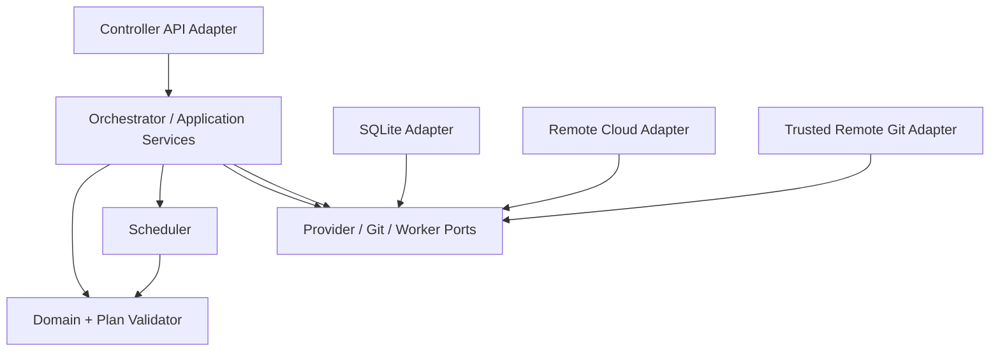

# Rust workspace and backend component boundaries

## Status

**Approved stack:** Rolvya-owned backend code is **Rust only** and authoritative database **SQLite only** ([ADRs 0004–0005](../decisions/README.md)). This document proposes a modular Cargo workspace to reduce coupling and help AI coding agents work on independent modules. **No crates, dependency versions, Rust edition, HTTP framework, build system configuration or workspace directories have been approved or implemented.** Any paths below are illustrative.

## Design objectives

- Fit the small remote control VPS (2–4 GB RAM was discussed but not benchmarked).
- Keep trusted DAG/budget/authorization invariants independent of cloud providers, network transport and model CLI details.
- Make Rust+SQLite transactions easy to review and fault-inject.
- Isolate third-party provider adapters behind bounded domain contracts.
- Enable scoped, parallel agent contribution through distinct modules and files.
- Avoid accidentally implementing a backend in Go/Node/Python just because an adapter or UI framework makes it convenient.

## Proposed workspace sketch (not real directories)

```text
rolvya/
  Cargo.toml                     # workspace manifest, not yet created
  crates/
    domain/                      # typed IDs, plan/task/attempt, budget primitives
    plan-validator/              # hierarchy + dependency validation
    orchestrator/                # plan activation and recovery coordinator
    scheduler/                   # dependency readiness, admission and leases
    budget/                      # approval/ledger domain policies
    persistence-sqlite/          # SQLite queries, transactions, migrations
    worker-contracts/           # transport-neutral worker messages
    worker-provider/            # cloud / remote-host adapters
    model-adapters/             # CLI/API provider capability declarations
    remote-git/                  # trusted Git integration and ref checks
    security/                    # identity and authorization decisions
    api-contracts/              # DTOs/errors, independent of one network framework
    telemetry/                  # structured events and health
  apps/
    controller/                  # sole remote control-plane Rust binary
  migrations/                   # SQLite-only migrations, when approved
  tests/
    fake-provider/              # deterministic test harness
```

The sketch is **not an instruction to scaffold all crates immediately**. Prefer fewer crates if coupling/build times outweigh parallel ownership. The main planning agent, not a framework convention, chooses execution models and effort for preplanned tasks; no task addition at runtime.

## Dependency direction and cycle prevention



Use domain contracts/traits to keep business policy unaware of provider SDKs. Physical persistence must still execute SQLite admission atomically; splitting ledger and lease into two independently committed calls is forbidden even if module boundaries differ.

## Rust domain types (conceptual, not compiling API)

```rust
// Illustrative pseudotypes, not finalized public interfaces.
struct ProjectId(String);
struct PlanId(String);
struct TaskId(String);
struct AttemptId(String);
struct LeaseEpoch(u64);

struct MoneyMinor {
    currency: CurrencyCode,
    amount: i64,
}

// Use checked integer arithmetic; never let negative/overflowing amounts
// silently authorize additional billable work.
```

Encode immutable plan contents separately from mutable execution status. Use private constructors/validated deserialization for privileged state changes; avoid raw `String` IDs or `f64` charges at authorization boundaries. Provide explicit error types such as `BudgetDenied`, `DependencyBlocked`, `StaleLease`, `ProviderUnknown`, `GitConflict` and `Unauthorized`.

## SQLite adapter and async considerations

Only the Rust backend opens SQLite connections. Evaluate WAL, connection pool limits, busy handling, checkpointing, foreign keys **on each connection**, and short transactions. Do not hold an SQLite write transaction across an external network/API `await`: commit the outbox intent first, then launch asynchronously. A reactive server should avoid blocking its request executor on lengthy synchronous disk operations; choose appropriate I/O strategy after selecting crates.

No secondary database engine, shared network filesystem SQLite writer or worker-direct DB connection is permitted without explicit architecture change.

## Trait/port contracts (proposed)

| Interface | Required behavior |
| --- | --- |
| `PlanValidator` | Whole graph validation; no cycles, dangling refs, invalid scope or policy |
| `PlanStore` | Persist draft/validated/activated immutable graph and version/hash |
| `AdmissionTransaction` | **One SQLite atomic operation** that rechecks prerequisites, ceiling, reservation, attempt, lease and outbox |
| `WorkerPoolAdapter` | Capacity, launch/inspect/cancel/cleanup, idempotent/reconciled provider refs |
| `WorkerGateway` | Authenticated attempt claim, heartbeat, progress, result manifest |
| `RemoteGitAdapter` | Repository identity, pinned base, isolated refs, write/merge separation |
| `ApprovalStore` | Authenticated human budget ceiling update and durable audit |
| `ArtifactVerifier` | Independent acceptance check, hash/ref/test provenance |
| `CostMeter` | Settled, held, provisional and unknown exposure by category |

Interface names/trait design are tentative; error semantics and invariants are the important contracts.

## Testing and developer ergonomics

- Unit tests for typed IDs, DAG validation, checked cost arithmetic and transition guards.
- SQLite transaction tests for simultaneous admissions, `SQLITE_BUSY`, process crashes, migration rollback and restore.
- Transport-neutral fake workers, fake Git provider and controllable clock; deterministically replay duplicate messages.
- Security checks for cross-project access, prompt injection and protected Git ref writes.
- Measure Rust backend memory, CPU, process startup, allocation and SQLite throughput on equivalent remote 2–4GB environments.
- Record reproducible `cargo` command outputs only **after** a real workspace and toolchain exist. No fake green CI results.

## Agent development ownership and change discipline

One planned implementation task owns narrow crate/files and an explicit base remote Git commit; parallel agent branches must not race on the workspace manifest, migrations or shared trait contracts. Integration happens only after tests and review. Use the [agent handoff](../development/agent-handoffs.md), [review process](../development/review-process.md), [engineering standards](../development/standards.md) and approved ADRs. Rust-only refers to **Rolvya backend**; frontend choice and externally executed user-project toolchains remain independent.

## Open decisions

Workspace granularity, Rust version and edition, async runtime, SQLite Rust driver, HTTP transport crate, model provider SDKs, protobuf/JSON schema, CLI process supervisor, tracing stack, authentication and release targets. These selections require evidence and must not be silently treated as approved.

Related: [orchestrator](orchestrator.md), [backend contract](rust-sqlite-backend.md), [SQLite schema draft](sqlite-schema-draft.md), [agents](agents.md), [implementation slices](../project/implementation-slices.md).
