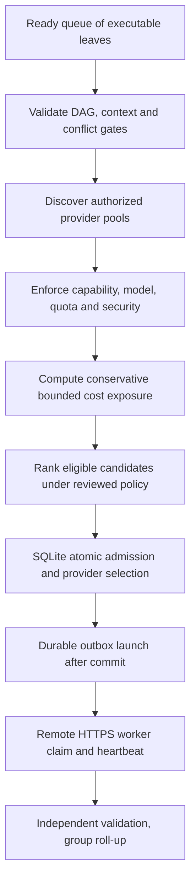

# Dependency-aware multi-provider scheduler selection policy

## Authority and historical requirements

The historical worker infrastructure diagrams described scheduler inputs: **task priority, estimated duration, CPU/RAM, model needs, worker availability, Spot/On-Demand cost, region and latency**, and illustrated a 20-worker limit. These are **historical design dimensions**, not a binding fixed priority formula or approved 20-worker production maximum. The user favored **many active independent agents**, a small **remote** Rust controller (2–4 GB discussed) and scalable cloud/user-supplied **remote** worker hosts. A ~10-minute task is a sizing preference, not SLA. The project must not deploy agents on the user's personal computer.

**Approved:** full immutable upfront task DAG and group-only non-executable parents; dependent leaves wait for validated predecessors; Rust backend, SQLite DB, worker HTTPS pull, multi-provider adapters, remote Git only and budget hard approval/stop-on-risk. Exact ranking/fairness and resource weights below are **Proposed**.

## Hard eligibility before ranking — proposed order

A worker cannot be considered suitable merely because it is cheap or idle. Enforce hard gates **before** price/performance scoring:

1. **Active plan:** validated immutable graph; task is an **executable leaf**, not a group.
2. **Dependencies:** every explicit predecessor's required result, including group aggregate evidence, is validated; no missing dependency.
3. **Conflict:** remote repository/base ref/path/side-effect ownership safe for concurrent execution; any extra dependency needed must have been inserted **before activation**, not at dispatch.
4. **Mode/model:** original planned model/effort/access mode and approved fallback policy are supported and eligible (provider terms verified).
5. **Security:** task and provider accounts authorized for project; geography, isolation, network egress, secrets and Git access rules met.
6. **Capacity:** CPU/RAM/disk and worker concurrency/region quotas available; host heartbeat and provider status credible.
7. **Financial:** conservative **enforceable** total exposure across AI API/compute/storage/transfer covered by atomic approved budget reservation; no automatic percentage overrun. Provider warm capacity/billing must also be accounted.
8. **Lease/attempt:** current task not already owned by another valid fenced attempt; replay of an uncertain provider launch reconciled.
9. **Cloud fallback:** selected provider is configured/owner-authorized and compatible; unknown or unbounded billed exposure is a blocker, not a low score.

If any gate fails, persist a typed blocker and **do not launch** paid work. Successful sibling results remain available. Do not auto-reassign an existing running attempt between providers; a future retry uses a new attempt of the same task after reconciliation.

## Candidate ranking (not approved numerical formula)

Only *eligible* ready leaf/provider-pool pairs are ranked. Candidate dimensions:

| Input | Intended effect | Risks requiring validation |
| --- | --- | --- |
| Task priority | Higher declared priority may be processed earlier | Starvation of low-priority tasks |
| Ready age | Aging/fair-share can prevent indefinite wait | Need project/tenant equity policy |
| Estimated duration | Short work may free capacity sooner | Overfavoring short jobs; estimates uncertain |
| CPU/RAM/disk class | Select sufficient resources and minimize oversizing | Remote coding/test CPU peaks; OOM and cold-start overhead |
| Model and effort | Place on eligible model/credential environment | License/concurrency/quota; model labels differ |
| Live capacity/quota | Avoid scheduling to unreachable/capped pools | Stale provider health and burst quotas |
| Price/region | Compare billed *total* including minimums and startup | Spot interruptions, time-of-day pricing, taxes/FX |
| Startup + network latency | Consider image pull, artifact distance and egress | Cheapest CPU may have worst completion time |
| Availability/preemption | Penalize risky spot/preemptible mode if task cannot checkpoint | Retry cost and bounded exposure |
| Locality/data constraints | Prefer valid region/authorized remote repository access | Security/privacy and transfer cost |
| Historical failure data | Avoid repeated provider failures | Bias, data recency, low sample counts |
| Owner constraints | Allowed vendor/account, max concurrency and cost policy | Never override for apparent speed |

A weighted score, multi-armed optimizer or fairness algorithm is **not approved**. The Rust scheduler should be deterministic/auditable for equal inputs, with explicit explanations of the chosen provider and rejected candidates. Cost optimization cannot bypass a hard gate.

## Workflow sketch

A ranking decision by itself **must not** spend money. Serialize the final budget/current-attempt recheck, reservation, lease epoch and outbox in one SQLite transaction. If state changed while ranking, reconsider; never reuse a stale “approved headroom” snapshot for launch.

## Capacity semantics

- **2–4 GB** is a target for the remote controller, not a guarantee of concurrent process capacity; heavy builds and model CLI processes run on remote workers.
- **20 concurrent workers** from historical diagrams is a synthetic load example, not a confirmed upper bound or default. The owner may configure a per-project cap during preflight; actual safe capacity and controller limits require measurements.
- Concurrency is limited by **the number of eligible independent leaves**, CPU/RAM/quota, Git write isolation, usage provider restrictions and approved budget—not just the count of idle agents.
- Multiple authorized remote providers can be used simultaneously without sharing provider secrets or violating task/model access.
- Pre-warmed workers and idle remote VPS capacity may incur cost before task claim, so idle pool management is also billable work requiring accounting.

## Approved dynamic concurrency and project cap (ADR 0022)

**Owner-approved 2026-10-22:** no arbitrary universal worker-count ceiling. Before execution, the owner may optionally configure a maximum concurrent attempt count for this project. When omitted, no product-policy numerical cap is invented. The Rust scheduler adjusts actual concurrent admissions to ready executable leaves, provider/model quotas, resource and sandbox capacity, remote Git conflict constraints, runtime health, safe controller/SQLite throughput and **atomically authorized** budget exposure. An illustrative 20-worker diagram is not a hard default.

Automatic admission does **not** mean maximizing paid jobs indiscriminately: [ADR 0021](../decisions/0021-scheduler-selection-modes.md) offers Economical, Balanced (default) and Performance selection. If the extra paid host adds little benefit, the selected mode may choose to wait rather than spend. Approved concurrent work that remains within enforceable reservations may continue while admissions pause; independent verified work stays intact. Exact backpressure thresholds, fairness/aging weights and ramp/hysteresis algorithms are not yet approved.

[ADR 0022 — Dynamic worker concurrency](../decisions/0022-dynamic-worker-concurrency.md) contains the binding decision and acceptance scenarios.

## Spot/preemptible capacity

Spot/On-Demand provider types were considered for price/availability. **Automatic Spot → On-Demand fallback is not approved as a blanket billing rule.** If fallback is allowed under a project-specific configuration, create a new attempt only after fenced/verified previous attempt status and fresh bounded budget admission; account for provider minimums, retries and egress. A preempted worker does not authorize adding new planned tasks.

## Proposed fairness and backpressure

A scheduler may use per-project/tenant queues, aging and reservation-aware provider quotas to avoid starvation. Exact implementation needs benchmark evidence and owner choice. Use bounded ready-batch pagination and efficient SQLite indexes, not a full-graph scan on every heartbeat. Idle HTTPS worker polling should have adaptive backoff/long poll under approved ADR 0006. Avoid lock contention on a single SQLite writer.

## Decision trace for each admission

Persist selection inputs and meaningful rejection reasons: task/plan hash, predecessor acceptance snapshot, owner-allowed providers/modes, candidate resource class, region/price timestamp, safety/cost bound evidence, selected provider pool, estimated duration, reservation ref, attempt id, conflict gate and current lease fence. **Do not** log raw provider credentials.

## Test requirements

- A and B are independent and eligible; C depends on A/B. C never admitted until both **validated**, regardless of priority score.
- Group parent never receives worker; a dependency on group waits for independently validated aggregate.
- High-priority task with forbidden model/region never bypasses eligibility; lower-priority valid task may proceed.
- 20 fake workers on a small host measure observed RSS/CPU/poll load; no assumed production 20-worker guarantee.
- Spot capacity lost; On-Demand alternative with greater cost is only used if explicitly allowed and budget-authorized.
- Two different cloud adapters admit ready leaves safely under the same SQLite ceiling.
- Two schedulers race for the last funds; at most one new billable attempt admitted.
- A provider has capacity but a missing enforceable usage cap: deny paid launch.
- Task-conflicting remote Git writes are isolated/serialized without runtime DAG mutation.
- Fairness/latency/throughput measured before specifying SLOs or ranking weights.

## Open decisions

Ranking/fairness weights, aging rules, queue priorities, measured safety/backpressure capacity thresholds, warm worker billing/idle cleanup, preemptible fallback, region policy, capacity sampling and resource defaults. **The optional owner-set project concurrency cap and absence of an arbitrary universal default are Approved ADR 0022**; first worker adapter priorities are Approved ADR 0018 but deployment and regional parameters require evidence. This document does not supersede the approved fixed DAG or multi-provider/budget ADRs.

Related: [scheduler](scheduler.md), [multi-provider adapters](multi-provider-adapter-contract.md), [DAG](dag-planning.md), [budget](budget-reservation-reconciliation.md), [infrastructure history](../operations/infrastructure-options.md), [model entitlement](model-access-entitlement-contract.md), [verification](../development/remote-integration-test-matrix.md).
