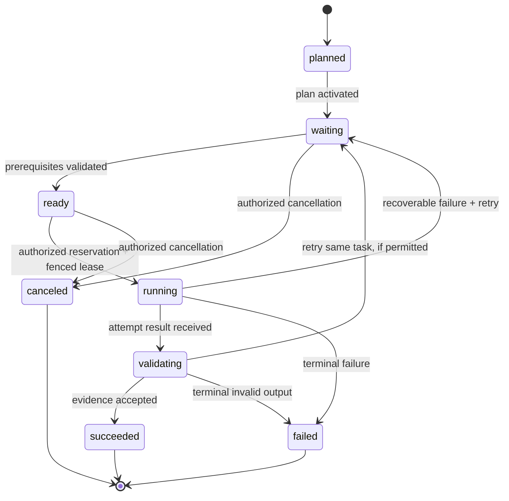

# Scheduler state machine and admission

## Authority and design status

**Approved invariants:** all tasks and dependencies are fixed by the main agent before execution; worker agents never create tasks; only dependency-satisfied tasks may run; independent tasks may run concurrently; newly billable work must stop when the approved budget is insufficient, without an automatic overrun. Detailed enums, priorities, timeouts and transaction mechanisms below are **proposals**, not adopted code or production settings.

## Separate concepts: task status, attempt status, and admission blockers

Do not overload one status field with multiple causes. The proposed model tracks:

| Dimension | Suggested values | Meaning |
| --- | --- | --- |
| Task lifecycle | planned, waiting, ready, running, validating, succeeded, failed, canceled | Logical task outcome across attempts |
| Attempt lifecycle | created, leased, starting, executing, submitting, succeeded, failed, expired, canceled | One worker execution with a unique ID |
| Admission blockers | dependency, budget, capacity, conflict, credentials, policy, human-review | Zero or more reasons a nonterminal task cannot start |
| Project run control | draft, validated, active, paused, stopping, completed, failed | Project-wide scheduler control |
| Worker lifecycle | provisioning, registering, available, leased, executing, draining, lost, terminated | Operational capacity, not logical task completion |

An approved budget increase removes a budget blocker but does not automatically clear dependency, capacity or policy blockers.

## Proposed transition graph



A budget pause prevents **new billable attempt admission**; it is not inherently a task failure. **Approved ADR 0010:** an already-running attempt may continue only within a demonstrably enforceable pre-reserved exposure; if full future exposure can no longer be safely bounded, initiate stop-on-risk, fence the lease, cancel provider execution where possible and reconcile costs/side effects. External cancellation does not guarantee no final provider charge.

## Transition authorization and guards

| From → to | Required guard / evidence | Actor |
| --- | --- | --- |
| draft plan → active | complete DAG; no cycles; validated identities; accepted plan | authorized controller / human gate where defined |
| waiting → ready | all explicit predecessors validated, no unresolved conflicting writes | scheduler |
| ready → running | worker capability, secure context, remote Git isolation, atomic cost reservation, fenced lease | scheduler transaction |
| running → validating | current lease token; immutable result manifest; usage record; referenced artifacts | authenticated worker + controller |
| validating → succeeded | acceptance checks, remote reference provenance and validation evidence | validator |
| running/validating → waiting | retryable failure; retries permitted; prior attempt fenced and external effects reconciled | orchestrator |
| any nonterminal → canceled | authorized user or policy request; remote side effects reconciled | controller |
| any → failed | failure deemed terminal with recorded reason | orchestrator |

No worker is allowed to write a task's authoritative terminal status directly. **Approved ADR 0009:** only executable leaves may be leased. Group parents receive no execution attempt and become validated succeeded only after required child outcomes plus group acceptance are independently proven. An explicit predecessor edge to a group waits for validated aggregate success; hierarchy alone adds no prerequisite.

## Admission algorithm (illustrative pseudocode)

```text
for candidate in ready_tasks(active_plan):
    confirm(plan_immutable && predecessors_validated)
    confirm(no_unsafe_git_conflict && worker_capacity && mode_authorized)
    estimated_exposure = conservative_cost_cap(candidate)
    begin_serializable_or_equivalent_transaction()
        recheck(task_ready && worker_available && project_active)
        recheck(remaining_approved_budget >= estimated_exposure)
        reserve_budget_and_lease_attempt_atomically()
        append_auditable_event()
    commit()
    dispatch_with_fencing_token()
```

If reservation or capacity fails, record the specific blocker and keep the task eligible for re-evaluation. Do not treat optimistic forecast as a guaranteed cost ceiling. Separate nonbillable bookkeeping from billable admission; do not allow background worker provisioning to escape the same cost gate.

## Invariants and recovery

1. No nodes or edges are inserted into the active DAG.
2. A dependent task is not admitted before every required predecessor is *validated succeeded*.
3. At most one current fenced attempt may own authoritative progress for a task.
4. State transitions, reservation changes and outbox dispatch must be recoverable following process crashes.
5. Retried operations keep task identity but acquire a new attempt identity.
6. A stale worker result cannot overwrite an accepted newer attempt or release someone else's reservation.
7. All admitted billable exposure is covered by user-approved budget; invoice delays require conservative limits and reconciliation.
8. A project pause preserves successful results and audit evidence.

## Fairness and throughput questions

Priority rules, aging, per-project fairness, global and provider concurrency limits, starvation mitigation, batching, lease durations, warm-pool charges and **provider-specific stop implementation/timing** require further decisions. The *bounded-or-stop* spending policy is already approved. A 10-minute worker task remains a *sizing target*, not an approved timeout.

## Verification cases

- Cyclic or incomplete plans cannot activate.
- With A → C and independent B, B can run while C remains blocked.
- Two simultaneous workers cannot reserve beyond the same budget ceiling.
- Losing scheduler after reservation does not duplicate leases or charges on restart.
- Budget denial retains success artifacts; notification does not grant approval.
- Late, fenced attempt cannot publish a successful terminal outcome.
- Worker never creates a new task node.

The [main orchestrator](orchestrator.md) distinguishes model-led diagnosis from Rust-enforced admission, and the [human approval workflow](approval-workflow.md) distinguishes a pending request from an applied authenticated ceiling increase.

See [approved parent aggregation](../decisions/0009-parent-aggregation.md) and [approved in-flight spending](../decisions/0010-inflight-budget.md) for mandatory scheduling rules.

Related: [DAG planning](dag-planning.md), [execution](execution.md), [worker protocol](worker-protocol.md), [failure recovery](failure-recovery.md), [budget](budget-costs.md), [data model](data-model.md), [testing](../development/testing.md).
