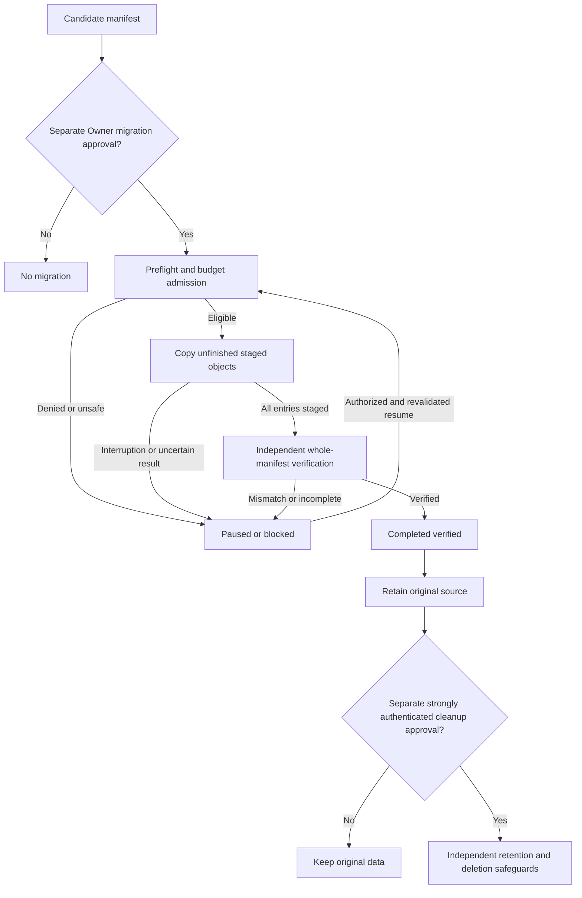

# Resumable historical storage migration — proposed state machine

## Authority, scope and status

**Approved policy:** [ADR 0030](../decisions/0030-project-activity-audit-log.md) requires that a storage destination switch affect only future eligible writes. Historical archives/checkpoints move **only** through separately Owner-approved migration, subject to administrator allowlisting, independent cryptographic/integrity verification, applicable retention and the [hard project budget gate](../decisions/0002-hard-budget-approval.md). The project Owner also approved **chunked/staged, resumable historical migration** on 2026-10-22: validated progress survives connection loss/restarts; work retries only for unfinished or unverified data; the old source remains intact; insufficient authorized budget pauses additional billable work; completion requires independent verification of the whole authorized manifest.

**Approved and unchanged:** Neither migration approval nor migration completion authorizes source deletion. Deleting old-provider data is an entirely separate, strongly reauthenticated Owner-approved and retention/legal-compliant operation. See [ADR 0030](../decisions/0030-project-activity-audit-log.md) and [acceptance tests](../product/acceptance-criteria.md).

**Proposed implementation below:** The state names, journal/manifest fields, transition implementation, chunk sizing, retry/backoff count, cryptographic algorithms, checkpoint cadence and provider-specific APIs have **not** been approved as fixed technical choices, implemented or tested. The names illustrate a possible Rust/SQLite state machine. They do not modify the immutable coding-agent DAG or create executable agent subtasks.

## Independent authorization boundaries

1. **Destination selection/cutover:** administrator-allowlisted target, Owner selection and destination preflight govern **future writes only**; no implicit historical copy or delete.
2. **Historical-data migration:** a distinct authorized operation identifies a precise project, source, target, manifest/snapshot or immutable object versions, approved scope and transfer/storage cost exposure before any billable action. Reconfiguration, workers and UI callbacks cannot authorize it.
3. **Source cleanup:** a subsequent, distinct and strongly authenticated Owner action is needed even if migration completes and all destination copies verify. Mandatory retention/legal holds, independent trust anchors and administrator/provider policies still apply.

A migration must never transform an earlier approval into permission to expand object scope, use a forbidden target, increase the spending ceiling or delete source objects. Multiple Owners, if present, authenticate individually under existing project governance.

## Approved retry behavior and proposed bounded scheduling mechanics

[ADR 0030](../decisions/0030-project-activity-audit-log.md) **approves limited automatic retry with exponential backoff for transient migration-transfer failures**. Every retry is a resumed/renewed storage operation inside the *same* separately authorized migration and must pass fresh provider/security/budget checks. **Unlike executable AI coding-task attempts, storage object/part requests are not governed by the project default of three total worker attempts**; see [ADR 0019](../decisions/0019-centralized-worker-retries.md).

| Failure classification | Automatic retry decision (Approved policy) | Implementation behavior (Proposed) |
| --- | --- | --- |
| Transient network interruption, connection timeout or recoverable transport reset | Eligible only if provider-side effects are reconciled first | Persist pending intent; after reconciliation schedule within finite retry and delay limits |
| Provider throttling (e.g. 429), declared temporary outage or confirmed recoverable 5xx | Eligible under rate-limit instructions, budget and bounded retry policy | Honor provider-specified cool-down where valid, back off exponentially with jitter/cap and per-provider backpressure |
| Request outcome unknown after timeout, restart or lost acknowledgement | **Not** eligible for blind replay | Query provider operation/version/part status and charges first; only retry if needed and authorized |
| Temporary verification read unavailability | A limited read-only retry may be eligible | Re-read using verified source/version expectations; do **not** re-upload an already verified object merely because a verification read timed out |
| Read-back hash/content mismatch, invalid signed checkpoint or altered source version | **No automatic transfer retry** | Block/escalate integrity issue and retain source/anchors; no false verified completion |
| Revoked/invalid credentials, non-allowlisted endpoint/region, authorization failure, legal retention constraint or suspected compromise | **No automatic retry** | Block until explicitly authorized remediation, without provider switching or scope expansion |
| Insufficient approved budget, lost enforceable cost bound, or uncertain unaccounted charges | **No new billable retry** | Mark budget/risk pause; reconcile costs and seek distinct ceiling authorization if required |
| Finite retry limit exhausted or repeated failure without verified progress | **No further automatic retry** | Preserve verified artifacts and source; surface typed blocker, recovery options and cost uncertainty |

### Proposed durable retry scheduler (not a fixed numerical policy)

- Record per **migration and object/part or provider operation**: safe error category, count of admitted failed retry attempts, bounded retry policy snapshot, last attempt time, next eligible attempt time, provider operation/idempotency key, lease generation/fence, last independently verified evidence and known/uncertain costs. Classify errors on the Rust control plane, not solely from untrusted provider/worker message text.
- For an eligible transient failure, a **proposed** scheduling strategy is capped exponential delay (e.g. `min(max_delay, base_delay * 2^attempt_index)`) with jitter, subject to **at least** any trustworthy provider `Retry-After`/rate-limit constraint. Use overflow-safe arithmetic and control-plane-scheduled work rather than a worker sleeping forever. No `base_delay`, `max_delay`, numeric retry count or jitter distribution has been approved.
- Bound both per-item retries and total migration/provider pressure in the eventual implementation; avoid hot loops and synchronized retry storms. For repeated errors, exhaustion must be durable and visible, not silently reset after process crash. Do not assert exactly-once external charges even if logical operations are idempotent.
- On every eligible retry, recheck **manifest identity/version, administrator allowlist, project Owner authorization, destination security/capabilities, provider limits, active lease/fence and available already-approved budget**. Admit new billable work only with a safe enforceable exposure bound and reservation. A retry does **not** re-authorize deletion, budget increase, new objects or a different endpoint.
- If the provider reports a successful/staged prior write, inspect its *version and integrity evidence* and complete independent verification instead of uploading blindly again. A transient read error can lead to another bounded read; **cryptographic/content mismatch stops automatic retries**.
- The UI and protected Activity Log must distinguish waiting-for-retry (and next eligible time), retry limit exhausted, budget/security block, resumed copy, staged-but-unverified and independently verified; report remaining scope and uncertain costs. Those are **proposed fields/UX** in service of the approved bounded/reliable behavior.

## Proposed operation states

| State (illustrative) | Meaning and entry condition | Permitted next states (illustrative) |
| --- | --- | --- |
| `AWAITING_OWNER_APPROVAL` | Immutable candidate manifest, scope/cost estimate and target preflight prepared; **no copy authorized** | `PREFLIGHT`, `CANCELLED` |
| `PREFLIGHT` | Recheck project Owner grant, administrator allowlist, source snapshot/version, destination capabilities, credentials via secret refs, retention and budget admission | `READY`, `PAUSED_BUDGET`, `BLOCKED`, `CANCELLED` |
| `READY` | Approved scope and headroom permit safe admission of an eligible unit of work | `COPYING`, `VERIFYING`, `PAUSED_BUDGET`, `BLOCKED`, `CANCELLED` |
| `COPYING` | Perform bounded copy/staging of manifest entries, with durable per-object/chunk progress | `COPYING`, `VERIFYING`, `PAUSED_RETRYABLE`, `PAUSED_BUDGET`, `BLOCKED`, `CANCELLED` |
| `VERIFYING` | Independently enumerate all approved manifest entries, retrieve/read what is needed, verify exact versions/content and trusted checkpoint continuity | `COMPLETED_VERIFIED`, `COPYING`, `PAUSED_RETRYABLE`, `BLOCKED`, `CANCELLED` |
| `PAUSED_RETRYABLE` | Recoverable transient interruption or uncertain result; verified source/progress survive and a durable bounded next eligible retry is recorded; exhaustion suspends further automatic retries | `PREFLIGHT` after eligible delay/reconciliation and renewed gates, `BLOCKED` if retry limit exhausted/unsafe, `CANCELLED`; no blind paid replay |
| `PAUSED_BUDGET` | Authorized headroom insufficient or remaining provider exposure cannot be bounded; no new billable copy/retry admitted | `PREFLIGHT` after legitimate budget eligibility, `CANCELLED` |
| `BLOCKED` | Security/retention/allowlist/snapshot/integrity condition cannot safely be resolved automatically | `PREFLIGHT` only after authorized remediation, `CANCELLED` |
| `COMPLETED_VERIFIED` | Whole approved manifest verified independently and atomic completion record persisted; **source remains intact** | Terminal for this migration (not a deletion grant) |
| `CANCELLED` | Authorized cancellation; fence/reconcile in-flight requests, retain original source and truthfully record any staged destination data | Terminal for this operation; separate approval needed for a new operation |

The exact number of states, enum naming and use of a dedicated `FAILED_REVIEW` state remain **Proposed**. A failure must always be visible as blocked, paused or failed rather than as success. `COMPLETED_VERIFIED` must not be emitted solely from a worker/provider completion callback.

The diagram summarizes policy only. Source cleanup is **outside** the migration state machine and may still be denied after separate Owner approval.

## Proposed durable migration and object journal

**Authoritative migration state is in Rust-controlled SQLite**, not worker memory or the destination provider. The implementation should durably track, at minimum:

| Record | Fields / semantics (proposed) |
| --- | --- |
| Migration identity | `migration_id`, `project_id`, initiating and approving Owner references, independent approval ID, source/destination adapter IDs and scoped target bindings |
| Immutable manifest | Manifest hash, object count, source immutable version/snapshot ID or equivalent consistency evidence, per-object safe opaque ID, kind (archive vs integrity checkpoint), size/hash metadata when available, required retention/trust dependency and target identity |
| Operation progress | Current state, monotonic operation generation/fencing token, last durable transition, reason codes, resumable cursor/checkpoint, retry-policy snapshot and exhaustion status, timestamps and version for compare-and-set |
| Object/part progress | Object ID/version, staged destination key/version, part/chunk IDs, copy attempt ID, provider operation/idempotency key, durable retry count/error class/next-eligible time, confirmed bytes, verification state and evidence refs; distinguish attempted, uploaded, acknowledged, **independently verified** |
| Financial authority | Explicit approved cost envelope, reservation IDs, authorized headroom at admission, AI API/compute/storage/transfer categories as relevant, known settled charges and uncertain/unreconciled exposure |
| Integrity | Source expected fingerprints or authenticated manifest, independently obtained destination verification, checkpoint trust-root refs, validation results and discrepancies |
| Audit | Redacted actor/correlation IDs and records for approvals, state transitions, transfer errors, pause/retry decisions and completion; no secrets or raw sensitive content |

Use stable keys and atomic uniqueness/compare-and-set to reject duplicate callbacks and stale operations. Provider writes are not assumed transactional with SQLite: persist an intent before an external write, then reconcile the provider side effect before retrying when the acknowledgement is uncertain. Reconciliation must account for possible duplicate provider charges; **idempotent object state does not imply exactly-once billing**.

A manifest must describe a **consistent historical source view**. If source objects can mutate, pin versions/snapshots or use an equivalent consistent-cut procedure. A source version mismatch blocks or revalidates the affected unit; never silently combine incompatible snapshots or expand the manifest. Active new writes after target cutover belong to the new-write path and must not rewrite historical migration scope.

## Proposed transfer and recovery algorithm

1. **Prepare without moving data:** authenticate project Owner; build source manifest; check chosen source/destination and allowed region, encryption, integrity capability, retention requirements, secret references, cost estimate and storage/transfer exposure. Record the manifest and *distinct* approved migration operation only after required authorization.
2. **Admit bounded work:** acquire a durable operation lease/generation and a budget reservation sufficient for the full enforceable maximum exposure of a copy/verify attempt. Reject admission when insufficient; if provider cannot bound in-flight charges, stop/fence and mark exposure uncertain per [in-flight budget policy](inflight-cost-policy.md).
3. **Copy only work still needed:** derive pending entries from durable journal; never trust an in-memory cursor as sole proof. Revalidate previously staged but unverified objects before skipping an upload. For each unit, write to a staging/versioned destination without clobbering verified data or source.
4. **Confirm each staged object:** verify provider acknowledgement and independent content/metadata evidence as supported. Keep individual `VERIFIED` object evidence durable; staged/unverified objects are **not** completed units.
5. **Recover conservatively:** on restart, expired lease, duplicate callback, timeout or ambiguous provider response, fence stale generation and reconcile outstanding provider writes/costs and existing destination objects. Automatic retries are only for classified transient failures within **durable finite limits with bounded exponential backoff**, after any required provider cool-down and renewed eligibility/budget checks; do not blindly reissue an operation of unknown outcome. Persist retry exhaustion, and never silently reset the limit on restart. Do not assume retry costs are zero.
6. **Pause rather than overrun:** when authorized cost exposure is insufficient, preserve source, verified staged objects and journal; do not admit new billable retries or copies until current approval actually covers their risk, or an Owner separately approves an increased ceiling. A paused state is visible in the panel, with last completed unit, estimated remaining cost and unreconciled charges.
7. **Validate the whole manifest:** independent verification must prove all approved objects present, retrievable, correctly versioned and cryptographically/integrity consistent, including audit archive sequence and protected verification anchor continuity. Missing, corrupted or unverifiable entries block completion; preserve previously verified work and source.
8. **Commit verified completion:** atomically persist terminal migration evidence and update only authorized storage pointers for the exact manifest, with safe recovery on transaction failure. Never imply that existing history has moved before this validated handover. **No deletion or source cleanup follows automatically.**
9. **On cancellation or irrecoverable failure:** prevent new copy work, fence/reconcile uncertain in-flight transfers, retain the source and protected anchors, preserve truthful completed/partial destination evidence and audit costs. Disposal of staging data is separately governed by retention/security/storage policy; never conflate staged-copy disposal with authorized source deletion.

### Illustrative interrupted run — not a benchmark

For a fixed manifest of **1,000 objects**, suppose **800 have been independently verified** when connectivity fails. The original provider still holds all **1,000**. After the operation's lease is safely fenced and side effects/costs reconciled, the resumed operation **reuses verified evidence for those 800** and processes the remaining **200 or any entries whose verification evidence has become invalid**. Counts alone do not establish integrity. No source deletion occurs at the end.

## Failure and negative-case policy

| Event | Required safe behavior |
| --- | --- |
| Network fails after upload but before acknowledgement | Inspect provider state under scoped authority and reconcile accounting before reissue; avoid blindly overwriting or double-counting logical progress |
| Destination payload hash/version differs from approved source | Mark affected entry unverified, reject completion, preserve source and escalate/recopy only after safe validation |
| Source snapshot becomes unavailable or changed | Do not invent substitute contents or silently expand scope; pause/block and require revalidation, with new Owner approval if authorized scope materially changes |
| Destination adapter loses allowlist/region/permission capability | Stop further writes, fence attempts and block unsafe resume; previously confirmed copies and source remain truthfully recorded |
| Provider outage, API throttling or controller restart | Persist progress, fence old generation, retry within approved policy and budget after reconciliation; avoid unbounded charged retries |
| Budget headroom exhausted or charges uncertain | Refuse new billable admission, preserve completed copies, show uncertain amounts; Owner must explicitly approve any ceiling increase |
| Full copy claimed but integrity checkpoint cannot be verified against independent trust root | Do not promote migration to verified completion; protect source and trustworthy checkpoints, show verification failure |
| Worker or Editor submits migrate/resume/clean action out of scope | Deny unauthorized operation, do not expand privileges or spend, record sanitized audit denial |
| Cancellation with in-flight provider transfer | Stop/fence where enforceable; reconcile late costs and leave original source intact; do not claim cancel guarantees refunds |

### Safety invariants

- **S1:** Never write historical objects to a forbidden, unverified or unapproved provider/region.
- **S2:** No historical transfer begins without distinct project Owner migration authorization and hard-budget admission.
- **S3:** Every resumed copy/retry remains within the original manifest and approved financial/security scope unless the Owner separately authorizes a change.
- **S4:** Durable independently verified work survives crashes and may be reused only while its integrity and version evidence remain valid.
- **S5:** Staged, copied or provider-acknowledged does not mean independently verified. A migration is complete **only** when the full manifest and trusted checkpoints pass and completion is durably recorded.
- **S6:** Existing source copies and trusted anchors survive pause, error, cancellation and successful migration. Source cleanup **never** occurs through this state machine.
- **S7:** New billable work never starts beyond approved enforceable exposure; unknown charges force conservative reconciliation and, when needed, pause.
- **S8:** Leases/generations prevent stale actors and replayed callbacks from falsely completing a migration or changing its scope.
- **S9:** Retention/legal holds, per-project isolation and strong Owner authentication remain independent of provider success messages.
- **S10:** User-facing status, source/destination location and cost accounting remain accurate under partial success and missing/uncertain evidence.

## Proposed verification fixtures

The normative acceptance scenarios are [AC-078–AC-098](../product/acceptance-criteria.md). Future deterministic Rust/SQLite fake-adapter tests should inject: restart after verified entry 800/1,000, crash between external upload and SQLite acknowledgement, stale lease/callback, missing/corrupt destination object, mutable source version, lost trusted checkpoint, provider allowlist revocation, budget exhaustion and late invoice, and Owner cancellation with in-flight work. Run negative authorization and retention checks; **no tests are implemented or executed**.

## Open engineering decisions

- Stable Rust types, SQLite schema/indices and exact transactional outbox/fencing implementation.
- Provider snapshot/version semantics, multipart/chunk sizing, read-back vs signed digests, crypto algorithms and protected checkpoint promotion.
- **Numeric** storage retry count, exponential backoff base/cap, jitter, pause timeout, concurrent transfer cap and provider-specific throttling; **bounded exponential retry for transient faults is already Approved**, but no numeric defaults are approved.
- Provider-specific cost caps and charging exposure for multipart uploads, verification reads, retries, egress and staging retention; no promise of universally enforceable transfer ceilings.
- Resume UX, user cancellation authority, approval expiration/revocation, critical alert delivery and escalation after permanent corruption.
- Staged-object garbage collection, retention/legal erasure, billing reconciliation and destination location mapping after verified handover.

Related: [ADR 0030](../decisions/0030-project-activity-audit-log.md), [observability](observability.md), [budget reconciliation](budget-reservation-reconciliation.md), [backup and recovery](../operations/backup-recovery.md), [product requirements](../product/requirements.md), [open questions](../project/open-questions.md).
