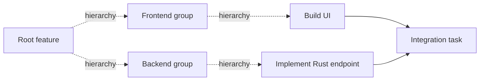

# Hierarchical task and attempt model

## Approved semantics and document scope

The Rolvya main agent plans an arbitrarily deep hierarchy and complete dependency DAG before execution. The active graph is fixed. Workers receive bounded tasks, do not plan new tasks and run independent ready tasks concurrently where safe ([ADR 0001](../decisions/0001-fixed-upfront-dag.md)). Backend is Rust; authoritative persistence is SQLite. This file defines a **proposed canonical domain contract**, not finalized Rust structs or SQL migrations.

## Three distinct graphs or records

- **Hierarchy** — rooted tree (or defined forest) of decomposition relationships. A child describes part of a parent. Hierarchy is *not* a prerequisite edge.
- **Dependency DAG** — explicit directed graph `A -> B` meaning B can start only when A has satisfied validation; cycles forbidden; ancestor/descendant relationships do not implicitly create dependencies.
- **Attempt history** — task T has 0..N attempts A1, A2, ... . Failed retries change attempt ID, not task ID, scope or active graph topology.

The dotted edges illustrate decomposition; solid edges illustrate explicit prerequisites. Example tasks are illustrative and do not imply frontend stack selection.

## Minimum proposed immutable planned fields

| Field | Constraints |
| --- | --- |
| `project_id`, `plan_id`, `plan_hash` | Stable project and whole-plan version/hash; immutable at activation |
| `task_id`, `parent_task_id` | Unique within graph; parent exists in same plan; hierarchy acyclic |
| `dependency_ids` | Explicit predecessors within plan, unique; dependency DAG acyclic |
| `kind` | Proposed `group` vs `executable`; whether nonleaf tasks may be executable is an **Open** decision |
| `goal`, `scope`, `exclusions` | Bounded and testable instructions; explicit allowed remote refs/paths |
| `acceptance_criteria` | Observable conditions; nonempty for executable tasks |
| `model`, `effort`, `access_mode` | Fixed up-front assignment; any fallback tracked as an attempt policy decision |
| `context_hash`, `upstream_artifacts` | Immutable provenance; validated predecessor refs only |
| `estimated_resources`, `cost_scenarios` | CPU/RAM/time and 3 forecast scenarios; four cost categories |
| `conflict_policy` | Overlapping Git write guards or declared sequencing |
| `owner_policy_refs` | Approval requirements, role boundaries and provider eligibility |

Do not include raw credentials in task definitions or model-visible context.

## Runtime state belongs outside immutable plan content

The active plan's **planned content hash** covers graph topology and static task definitions, not mutable state. Task state, current attempt, blocker reasons, lease epochs, actual charges, result validation and artifacts belong in separate runtime/ledger records. A retry must not make the stored plan hash change merely because another attempt occurred.

### Proposed lifecycle dimensions

| Dimension | Proposed values | Meaning |
| --- | --- | --- |
| Plan | draft, validated, active, paused, completed, failed | Frozen content after activation |
| Task | planned, waiting, ready, running, validating, succeeded, failed, canceled | Logical result across attempts |
| Attempt | created, leased, running, submitting, succeeded, failed, expired, canceled | Single execution |
| Blockers | dependency, budget, capacity, credentials, conflict, policy, human review | Zero or more reasons not eligible |

Exact enums, retry caps and timeout defaults need approval. `succeeded` requires independently checked evidence; never equate CLI exit status with task completion.

## Pre-activation validator

1. All task IDs are unique and referenced parents/dependencies exist in the same plan.
2. Hierarchy has no self-parenting or cycles; a root strategy is defined.
3. Dependency graph has no cycles, self-loops or inconsistent prerequisites.
4. All executable tasks have goal, instructions, acceptance criteria, model/effort/mode, capacity and cost estimates.
5. Any shared remote Git write target is isolated, serialized or explicitly flagged as a blocking conflict.
6. Upstream artifact expectations align with dependency edges; implicit dependency through a parent is not assumed.
7. Activation is a single Rust+SQLite policy transaction preserving the graph hash and initial task statuses.

For incremental validation use a linear-time topological traversal in edges+nodes; exact algorithm remains an implementation choice. Reject or escalate unsatisfiable dependencies rather than unilaterally rewriting the plan.

The [plan activation policy](plan-activation-and-versioning.md) and [proposed ADR 0009](../decisions/0009-parent-aggregation.md) define the exact unresolved freeze and group-success decision gates. No parent model is approved yet.

## Parent completion is NOT automatic (open design)

The user approved arbitrary hierarchy, but a precise parent roll-up policy was not yet selected. Two models:

| Model | Description | Tradeoff |
| --- | --- | --- |
| Group-only parent (recommended for first slice) | Parent is organizational; child results and an explicit validator determine aggregate completion | Clean separation, less ambiguity |
| Executable parent with children | Parent may also run its own work; must define how its own attempt and descendant validation interact | More flexibility, harder dependency semantics |

Do not mark a group parent completed just because all children exit; require verified acceptance, and define whether a dependent edge targeting the parent waits for aggregate validation.

## Failed descendants and project completion (proposed)

A failed descendant may block downstream dependencies without discarding successful siblings. A group status reflects blocked/incomplete vs validated complete according to its approved aggregation criteria. Project completion requires no unresolved mandatory task and validated final artifact/integration, not merely a count of processes ending.

A requirement discovered mid-run that requires a brand-new task should be recorded as a **new-plan proposal**; never append it to the activated graph. Replacement plan/version migration semantics require owner approval.

## Scheduler and persistence tests

- Generate random hierarchies and dependency graphs; reject each cyclic edge set.
- Change task state/attempt counts; immutable plan hash unchanged.
- Reassign task T to a new worker/model; T's ID remains stable, attempts differ.
- Two independent executable tasks can be admitted concurrently when isolation/budget permit; dependent task waits.
- Concurrent remote writes to the same ref are either isolated or serialized; never race silently.
- Invalid parent references and cross-plan dependencies cannot persist.
- Persist full graph and attempt history across Rust process crash and SQLite backup restore.

## Open decisions

Exact `group` aggregation rule, executable parents, root layout, graph size/recursion/resource limits, plan-version supersession, id formats, schema/serialization, cross-plan dependencies (prohibited in initial proposal), fair scheduling and Git file-conflict analysis strategy.

Related: [main orchestrator](orchestrator.md), [DAG planning](dag-planning.md), [scheduler](scheduler.md), [SQLite schema draft](sqlite-schema-draft.md), [Rust+SQLite backend](rust-sqlite-backend.md), [open decisions](../project/open-questions.md).
