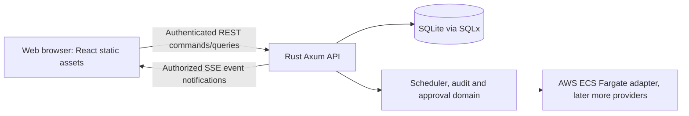

# Rolvya web panel technical stack — approved core and open details

## Decision status

**Owner-approved on 2026-10-25:** React + TypeScript, Vite, React Flow for read-only DAG visualization, Rust Axum JSON REST + SSE, and the single minified application JS containing CSS ([ADR 0043](../decisions/0043-single-bundle-browser-platform-and-ux-boundary.md)). The five sections are separately approved in [ADR 0042](../decisions/0042-five-section-web-panel-navigation.md). **All exact configuration, service worker, MIME/cache, UX interaction, security and visual design details remain implementation work**, guided by the [browser asset contract](web-platform-artifact-and-capability-contract.md) and [UX contract](../product/web-ux-and-accessibility-contract.md). No runnable app or deployment is verified.

## Approved core stack; implementation choices still pending

| Layer | Approved core first-version choice | Reason and boundary |
| --- | --- | --- |
| Browser application | React + TypeScript | Typed, component-based UI suited to an interactive task DAG. Browser application only, not a Node.js Rolvya backend. |
| Build tool | Vite | Produces deployable static browser assets; Node.js is a **build-time** dependency, not a required runtime server. |
| DAG dependency visualization | React Flow (`@xyflow/react`) | Read-only interactive task dependency graph with pan, zoom, selection and custom nodes. Client layout may require a separately reviewed deterministic layout algorithm; React Flow is not the DAG planning authority. |
| Hierarchical task structure | Accessible ordinary tree/list components | The parent-child hierarchy is distinct from dependency edges. Collapsing a group must not mutate an immutable task DAG. |
| Backend and authority | Existing approved Rust Axum API, SQLx / SQLite | Only Rust authorizes plans, task transitions, budgets, subscriptions, identity, results and actions. No JS server, direct DB browser access or alternative database. |
| Initial data access | Typed HTTP JSON REST requests | Paginated/scope-limited reads and guarded mutation commands; contracts and paths remain to be specified and versioned. |
| Live update transport | Authenticated Server-Sent Events (SSE), with REST snapshot/reconnect | One-way state/event notifications without a new WebSocket service; client refetches authoritative state where needed. No polling of SQLite by the browser. |
| Styling/output | Compiled CSS embedded in **one external minified JS app bundle**, no independent CSS | Final styles/fonts/icons and icon provider are deferred; all icon/font assets must stay external, per ADR 0043. No visual design decision is made here. |

**Alternatives considered:** Svelte/Vue might offer smaller initial client bundles, but React integrates directly with React Flow's established component model. Next.js SSR adds a server-side JavaScript deployment surface Rolvya does not need for an authenticated internal dashboard. WebSockets are possible later if measured full-duplex needs justify them. Alternatives have **not** been benchmarked against Rolvya workloads.

## Client/backend boundary

This is an illustration, **not** deployed topology. A single-origin deployment may serve Vite-built assets from the trusted Rust server or reverse proxy. No Vite development server or Node SSR process must run in production. Exact TLS ingress and static asset serving arrangement require deployment review.

## Task graph read models (proposed)

- **Plan graph:** version/hash, preplanned nodes and dependency edges, immutable after activation. Only backend-validated plans are authoritative.
- **Task hierarchy:** parent-child grouping rendered as a separate accessible tree/list. Non-executable parent groups never get attempts.
- **Execution overlay:** task status, blockers, attempts and verified outputs are mutable *separate* records joined by stable task/attempt IDs. An attempt does not become a new DAG task.
- The DAG canvas is initially **read-only regarding topology**. Panning, filtering, node selection, viewport positions and local grouping are presentation only. Any future draft plan editor needs a separate Owner decision and must not mutate active plans.
- Use detail panels and filtering for larger graphs; verify performance at representative DAG sizes before adding virtualization or layout dependencies. Never render unbounded private context or credentials.

## API, event and security rules (proposed implementation boundaries)

- REST responses are project-scoped, paginated where needed, typed, and separate estimated, reserved, actual and unknown expenditure. Version conflict and insufficient budget failures must be visibly distinct.
- SSE transmits only redacted, authorized, scoped events; on disconnect and replay gaps the browser refreshes a REST snapshot rather than trusting stale state. Use bounded event retention, reconnect backoff and backpressure controls. The authoritative event history stays in SQLite/Rust, not browser memory.
- Prefer same-origin HTTPS and existing secure, HttpOnly session cookies (with appropriate SameSite/Secure flags). SSE `EventSource` does not justify moving secrets or bearer tokens into URLs. Verify authentication behavior if cross-origin delivery is ever proposed.
- Every REST mutation enforces server-side session authorization, roles, CSRF protections where cookie sessions apply, one-use Owner action-bound verification for privileged changes, and idempotency/version constraints. Client-side hiding and disabling is only UX, never access control.
- The UI cannot launch cloud jobs directly or raise budget ceilings. Only an approved Rust domain command with atomic SQLite admission may authorize a paid dispatch.
- Fail closed on unverified model subscriptions, secret-broker errors, uncertain provider billing and compromised sessions. Avoid logging plaintext secrets or private model contexts.

## Practical verification before implementation

1. Follow the Owner-approved ADR 0043; verify the actual production output contract with exactly one app JS (including CSS), a separate `sw.js`, and external-only font/icon assets. Frontend routing and package versions still require implementation review.
2. Prototype **fake state only**, rendering a hierarchy and a dependency DAG with two independent leaves and one dependent leaf; show that execution overlays never change edges or plan hashes.
3. Test 401/403, session renewal, CSRF on privileged mutations, reconnect and event replay, ordering gaps, stale version rejection, failure and budget-paused states.
4. Run TypeScript typechecking separately from Vite compilation; add UI component tests and browser accessibility/keyboard navigation checks.
5. Measure static bundle size, initial render and graph performance, SSE connection overhead and Rust/SQLite memory on intended 2–4 GB remote control VPS. No unmeasured performance claim is approved.
6. Freeze exact dependency versions and third-party license checks at implementation time; keep implementation and test evidence linked in [status](../project/status.md).

## Explicitly not selected by this proposal

Frontend routing library, component library, state/query-cache package, graph auto-layout algorithm, CSS framework, exact endpoint schemas and URLs, SSE event envelope/cursor, ingress, deployment domain, accessibility test thresholds, high-volume DAG performance targets, and whether *every* first plan activation requires separate Owner confirmation. These remain Open pending review; do not silently decide them through scaffold defaults. The approved React/Vite/React Flow/REST+SSE/core output architecture is **not** among these open choices.

## Official implementation references (reviewed 2026-10-25)

- [Vite production build and static assets](https://vite.dev/guide/build).
- [Vite TypeScript typecheck guidance](https://vite.dev/guide/features).
- [React Flow library and licence](https://reactflow.dev/).
- [React Flow TypeScript integration](https://reactflow.dev/learn/advanced-use/typescript).
- [Axum SSE](https://docs.rs/axum/latest/axum/response/sse/).

Related: [web panel information architecture](../product/initial-web-panel-structure.md), [approved navigation ADR 0042](../decisions/0042-five-section-web-panel-navigation.md), [approved production output ADR 0043](../decisions/0043-single-bundle-browser-platform-and-ux-boundary.md), [browser artifact contract](web-platform-artifact-and-capability-contract.md), [UX/accessibility](../product/web-ux-and-accessibility-contract.md), [remaining OQ-013](../project/open-questions.md), [API inventory](api-contracts.md), [Rust workspace](rust-workspace.md), [approved security](../architecture/identity-authorization.md).
