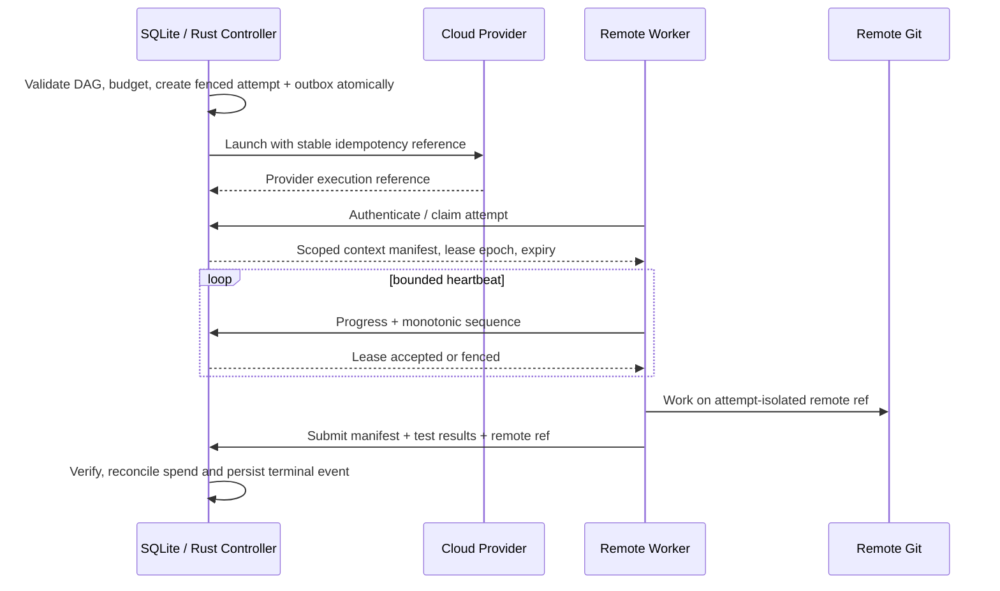

# Remote worker transport and protocol design

## Status and boundaries

**Proposed implementation details for the Approved [ADR 0006](../decisions/0006-worker-communication.md) worker-initiated HTTPS channel.** The transport is selected; wire schema, TLS/auth implementation, timing and Rust libraries are not.  All Rolvya-owned backend/control services are **Rust**; its database is **SQLite**. Remote worker host execution can include third-party agent CLIs, user project compilers and their languages; no Local Agent, desktop Git synchronization or direct worker SQLite access.

This document refines the [transport-neutral logical messages](worker-protocol.md) and [API inventory](api-contracts.md). URI paths, enum names and payloads below are *illustrative designs*, not live endpoints or approved wire protocol.

## Proposed network and trust model



Network topology must not require a publicly reachable worker host: **worker outbound TLS to controller** is the favored design to evaluate. Worker enrollment and bootstrap credential transmission require separate approval. Provider-side launch and worker polling are different operations.

## Illustrative controller operations and permissions

| Operation (conceptual) | Actor | Inputs | Responses and required guards |
| --- | --- | --- | --- |
| `POST /v1/workers/register` | enrolled remote worker | worker identity, attestation capability set, nonce | authenticated worker ref, permitted pool, expiry |
| `POST /v1/attempts/claim` | worker | pool capacity, nonce, request-id | attempt lease or idle/wait reason; claim must bind existing budget-authorized attempt |
| `POST /v1/attempts/{id}/heartbeat` | lease owner | lease epoch, event sequence, resource/usage summary | new lease deadline or fenced/denied |
| `POST /v1/attempts/{id}/events` | lease owner | monotonic sequence, redacted progress, artifact refs | idempotent acknowledgement |
| `POST /v1/attempts/{id}/result` | lease owner | manifest checksum, test report, remote ref, provider operation ID | durable receipt; **not** automatic task success |
| `POST /v1/attempts/{id}/reconcile` | authorized controller | provider evidence, operation ID, ledger reconciliation | corrected authoritative state |
| `POST /v1/attempts/{id}/cancel` | privileged control actor | expected version, reason | fenced/cancel-requested; provider billing may continue until stopped |

Never expose a worker endpoint to raise budget, mutate active DAG, approve a merge, or impersonate a human.

### Example claim response (synthetic, not validated schema)

```json
{
  "protocol": "draft-1",
  "project_id": "project_example",
  "plan_id": "plan_example",
  "plan_hash": "sha256:example",
  "task_id": "task_example",
  "attempt_id": "attempt_example",
  "lease_epoch": 8,
  "context_hash": "sha256:example",
  "base_remote_ref": "refs/heads/main",
  "base_commit": "example-sha",
  "allowed_ref_prefix": "refs/heads/rolvya/task_example/",
  "execution": {"provider_mode": "approved_mode", "model": "assigned_model", "effort": "assigned_effort"},
  "reservation_ref": "reservation_example",
  "acceptance_ref": "artifact://criteria/example"
}
```

Opaque credentials and fencing secrets are deliberately omitted; payload must not include raw provider tokens in model-visible context.

## SQLite outbox and worker claim consistency

The Rust scheduler writes task-attempt, budget hold, lease epoch and outbound intent to **SQLite in one transaction**, then commits. An outbox reader initiates remote provisioning; a later claim cannot create an unreserved billable job. Use `attempt_id` and a stable provider operation token to reconcile uncertain launch results. Lease claim updates require a conditional write based on the current fencing epoch and worker identity. Do not assume exactly-once provider launch even if a queue delivers once.

An admission denial due to dependency, budget, capacity or authorization returns a distinguishable typed error and must not trigger provider provisioning.

## Error/response taxonomy proposal

`UNAUTHENTICATED`, `FORBIDDEN_PROJECT`, `TASK_NOT_ELIGIBLE`, `BUDGET_PAUSED`, `LEASE_EXPIRED`, `FENCED_EPOCH`, `DUPLICATE_EVENT`, `CAPACITY_UNAVAILABLE`, `REMOTE_REF_CONFLICT`, `PROVIDER_STATE_UNKNOWN`, `RATE_LIMITED`, `MALFORMED_INPUT`, `RETRYABLE_INTERNAL`. Do not expose sensitive contextual content in error diagnostics.

Each attempt event must have an idempotency key, monotonic sequence and immutable context hash; use SQLite uniqueness/conditional updates. Heartbeats are not authority merely because their timestamp is fresh.

## Resilience and lifecycle constraints

1. Disconnected workers must reauthenticate and revalidate the current lease before privileged actions or result submission.
2. Expired/fenced attempts may leave resources and provider bills; reconcile before replacing them.
3. A duplicated `result` is a single durable receipt, not a new task success or double cost event.
4. External Git ref/commit writes are checked against source commit and isolated namespace. Git merge/PR authority is separate from worker changes.
5. A cloud-provider auto-retry may start another paid container **without a new Rolvya budget admission**; provider retry configuration must be reconciled with the app-level attempt model before enabling it.
6. Protect controller against request floods, unbounded log payloads, malicious task context and untrusted command output.

## Benchmark and test envelope

Use fake worker containers or remote servers and a Rust controller with SQLite. Test reordering, duplicate requests, network partitions, heartbeat drops, stale worker epochs, process restart, outbox replay and refusal of a claim with no reservation. Record controller RSS, p95/p99 admission, CPU, SQLite BUSY rates, request volume and clean shutdown.

**HTTPS transport is Approved by ADR 0006.** The practical wire protocol, worker identities and resource limits require implementation testing and any consequential security approvals; no new transport vote is pending.

## Open decisions

Auth method and enrollment, exact HTTPS envelope format, API version scheme, TLS and token rotation, poll/long-poll timing, max message size, lease TTL, retry backoff and typed error codes. **HTTPS itself is settled.**

Related: [worker protocol](worker-protocol.md), [ADR 0006](../decisions/0006-worker-communication.md), [budget reservation](budget-reservation-reconciliation.md), [Rust + SQLite backend](rust-sqlite-backend.md), [identity](identity-authorization.md).
