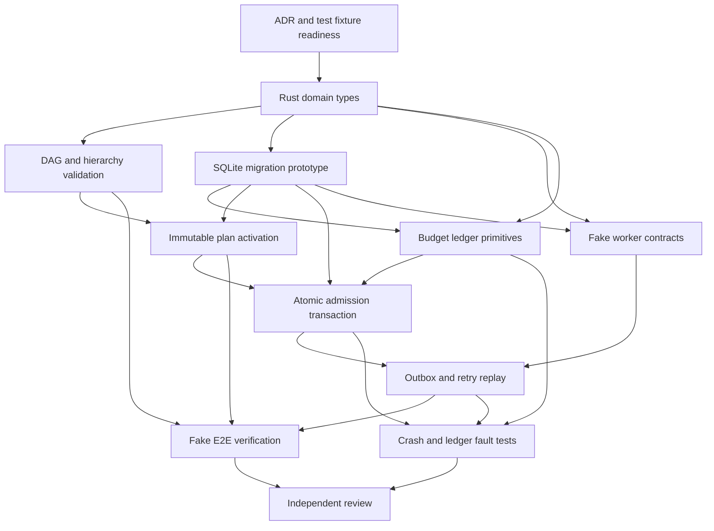

# Initial Rust and SQLite engineering task packages

## What these packages are — and are not

This is a **proposed engineering work breakdown** for future AI coding agents developing Rolvya itself, not an activated Rolvya project plan, not a running worker queue and not implemented code. The user's approved architecture requires a **single main agent to produce and freeze the complete task DAG, including its exact model and effort assignments, before activating a real run**. These packages are reusable planning inputs. Before any execution, the main agent must assign final owners/models/effort/context/resource/costs and close the full dependency graph; no worker may create new nodes during runtime.

**Binding foundations:** [ADR 0001](../decisions/0001-fixed-upfront-dag.md) immutable upfront planning; [ADR 0002](../decisions/0002-hard-budget-approval.md) explicit budget gate; [ADR 0003](../decisions/0003-remote-git-only.md) remote Git only; [ADR 0004](../decisions/0004-control-plane-language.md) Rust-only backend; [ADR 0005](../decisions/0005-authoritative-database.md) SQLite only. This plan uses synthetic fake providers first, no user personal-computer agents and no live billable provider work.

## Ready-to-implement boundaries

- **Documentation can proceed now.** Synthetic pure Rust domain/graph experiments can be scoped without choosing cloud or GitHub authentication, but they still need an approved toolchain and remote development environment.
- **Schema-changing or security-relevant code** requires explicit interface/authorization and transaction choices, plus an isolated remote test setup.
- **Live worker/Git/API integration** requires provider permissions, transport choices and separately approved spending. CLI subscription entitlement cannot be guessed.
- **Group-only parent semantics and verified aggregation are Approved** ([ADR 0009](../decisions/0009-parent-aggregation.md)); **bounded-or-stop in-flight budget policy is Approved** ([ADR 0010](../decisions/0010-inflight-budget.md)). Validate both in fake-worker tests. Plan activation UX/supersession, optional-child behavior and provider-specific cancellation limits remain open.

## Candidate task list and dependency graph

| Package | Prerequisite packages | Scope/primary deliverable | Candidate isolated ownership area |
| --- | --- | --- | --- |
| R00 | None | Capture approved ADR invariants, dependency version constraints and synthetic test fixture contract | `docs/` and future test fixtures |
| R01 | R00 | Rust domain IDs, typed money, graph identifiers, immutable plan-content DTOs | Proposed `domain` crate |
| R02 | R01 | Hierarchy + DAG validator, deterministic diagnostics, plan hash test vectors | Proposed `plan-validator` crate |
| R03 | R01 | SQLite draft migration implementation with foreign keys, compound refs and rollback tests | Proposed `persistence-sqlite` crate |
| R04 | R01, R03 | Atomic SQLite approval/ledger/hold primitives and integer cost invariants | Proposed `budget` and persistence boundary |
| R05 | R02, R03 | Draft-to-validated-to-active plan persistence with immutable activation guard | Plan store and validator adapter |
| R06 | R03, R04, R05 | Atomic task admission, fencing epoch, reservation and outbox in one SQLite transaction | Proposed scheduler admission module |
| R07 | R01, R03 | Fake worker and fake provider state contracts with deterministic clock | Proposed `worker-contracts` / test harness |
| R08 | R06, R07 | Outbox replay/idempotency, duplicate result and stale lease handling in fake mode | [Implemented SQLite synthetic control](durable-worker-recovery.md) |
| R09 | R02, R05, R08 | End-to-end synthetic dependency execution/validation with persisted artifacts | [Implemented bounded Rust coordinator](synthetic-dag-orchestration.md) |
| R10 | R04, R06, R08 | Crash/locking/ledger/unknown-billing fault tests | [Implemented private fault-injection harness](resilience-fault-injection.md) |
| R11 | R09, R10 | Review evidence, benchmark report, documentation/status and next-stage gate | Review/handoff artifacts |

**Important:** these are **engineering packages** for Rolvya's own implementation. Their names, lengths, and dependencies are not the runtime user's activated task graph. The main planner must fully validate and freeze actual implementation assignments before beginning a chosen run. A single package can be further decomposed by that planner **before** plan activation; workers cannot decompose it after.



The graph is an **illustrative future development sequence**, not a Rolvya running project.

## Per-package acceptance contracts

### R00 — Shared definitions and test sandbox

**Goal:** create a reviewed, versioned specification bundle for synthetic work: actual approved ADRs, task/attempt/lease vocabulary, test data boundaries, fake provider capability definition, permissible remote repository and toolchain constraints.

**Accept:** all approval statuses accurately linked; no private credentials and no workspace on user's personal computer; no fake-green tests; documented toolchain choice/permissions, even if still pending. **Blocking questions:** Rust version/edition, dependency sourcing and CI/test host.

### R01 — Rust domain IDs and money safety

**Goal:** use opaque noninterchangeable IDs for project/plan/task/attempt and explicitly checked minor-unit money per currency. Separate immutable planned task description from mutable attempt/runtime state.

**Accept:** invalid/overflowing amounts rejected; two currencies cannot be silently added; task ID never mistaken for attempt ID; no `f64` in spending authorization; a plan content hash is independent of runtime state. Tests include zero, maximum, negative/correction and overflow boundaries.

### R02 — Graph and hierarchy validator

**Goal:** deterministically validate parent tree/forest and explicit dependency DAG with useful diagnostics.

**Accept:** reject missing/duplicate/cross-plan IDs, parent cycles, dependency cycles, undefined predecessor, unsupported group policy, missing criteria and invalid unplanned write conflicts. Accept A and B independent, C depending on both; validate nested hierarchy without automatically adding edges. Keep complexity bounded and measured.

**Approved policy:** a node with children is a non-executable group, only planned leaves execute, and group success requires independently validated required descendants plus applicable group acceptance criteria. Optional children still require a separate approved contract; reject ambiguous optional semantics.

### R03 — SQLite schema and migrations

**Goal:** instantiate an *approved revision* of the [SQLite schema draft](../architecture/sqlite-schema-draft.md) in an isolated remote test DB. Implement schema versioning and rollback/preflight evidence.

**Accept:** every connection enforces foreign keys; composite plan/task relations reject cross-plan refs; no second DB engine; database can be backed up/restored; attempt and financial event uniqueness work. Schema text in the Markdown draft is **not** automatically approved migration SQL.

### R04 — Atomic financial ledger

**Goal:** implement exact-currency ceiling, append-only approvals, settled costs, reservations, provider uncertainty and idempotent billing callbacks.

**Accept:** simultaneous reservations never admit more than authorized exposure; a duplicate approval event does not change ceiling twice; a worker cannot approve a ceiling; late charges remain visible and new risky admissions fail closed. No percentage overrun. Reserve categories `ai_api`, `compute`, `storage`, `transfer` separately.

### R05 — Immutable activation

**Goal:** persist whole validated plan in SQLite; make draft→active transition idempotent with expected version/hash check.

**Accept:** no task/edge mutation after activation, duplicate activation request idempotent, stale activation rejected, runtime status updates do not change static plan hash, and ambiguous parent policy cannot silently activate.

### R06 — Atomic scheduler admission

**Goal:** Rust scheduler uses current validated prerequisites, worker eligibility and budget state; in **one SQLite write transaction** records attempt/lease epoch, cost reservation, audit and outbox.

**Accept:** no cloud or fake provider launch before commit; parallel contention for insufficient budget yields at most one admitted attempt; a stale lease cannot own a newer attempt; denied admission writes no chargeable dispatch. File boundaries should keep policy in Rust and actual SQLite atomic operation together, even if crate interfaces differ.

### R07 — Deterministic fake remote worker contracts

**Goal:** fake remote worker simulates capabilities, progress, success/failure, malformed payload and disconnect without real paid provider. **It must not be a Local Agent running on user's personal computer.**

**Accept:** every mock result identifies original task and attempt, scope, lease epoch and immutable context hash; no new task creation, no mutation of ceiling, no external Git side effect. Record whether tests run in-process or on isolated remote infrastructure.

### R08 — Outbox/lease replay

**Goal:** safely replay pending dispatch after crashes; reject duplicate progress/results and old fencing epochs. No claim of exactly-once external execution.

**Accept:** idempotent fake operation effects, bounded retries, stale attempts rejected, preservation of already verified outputs and explicit reconciliation of ambiguous external actions.

### R09 — Synthetic DAG end-to-end

**Goal:** run a small fixed plan with two independent fake executable leaves and one dependent integration leaf, organized under **non-executable group parents** per Approved ADR 0009.

**Accept:** dependent start only after both predecessor artifacts independently pass acceptance; validated remote-style artifact hashes; run survives restart; task/attempt counts and plan hash intact.

### R10 — Failure-injection evidence

**Goal:** intentionally simulate SQLite lock conflict, process kill after each transaction stage, low disk, delayed invoice, duplicate callback, fake worker loss and canceled/expired lease.

**Accept:** no unauthorized paid admission, no duplicate effective Git/job action, no lost approvals/artifacts and clear `unknown` exposure on missing billing. Tests must not use live providers without separate spending authorization.

**Implemented synthetic evidence:** [R10](resilience-fault-injection.md) adds 20 SIGKILL boundaries, real SQLite size-limit/interruption failures, consistent restore and artifact attacks, repeated races and 192 seeded operation prefixes. Git/provider/authentication/hardware guarantees remain outside this test evidence; the machine-readable inventory separates existing tests and unverified boundaries.

### R11 — Review and release handoff

**Goal:** collect real commit refs, exact commands, test results, simulated vs measured costs, redacted logs and unresolved decisions, then update affected docs.

**Accept:** independent review, no claims of shipped/live product from a fake-only demo; describe not-run tests explicitly; preserve open transport, cloud and GitHub auth ADR status.

## Agent handoff template for every package

```yaml
# Illustrative template; model/effort, refs and measurements are not assigned here.
package_id: Rxx
planned_task_id: assigned-by-main-planner-before-activation
prerequisite_artifacts: []
assigned_model: pending-main-planner-assignment
assigned_effort: pending-main-planner-assignment
access_mode: pending-entitlement-verification
remote_base_commit: pending
goal_and_allowed_paths: pending
acceptance_ids: []
tests_run: []
tests_not_run: []
budget_reservation_ref: none-for-documentation-or-synthetic-test
remote_result_ref: pending
validation_status: not-verified
```

**Do not submit placeholders as completed deliverables.** Worker agents must use the actual signed/authorized task package from their preplanned run, not reinterpret this table as permission to pick an unplanned follow-on task.

## Parallelism and shared file conflicts

R02 (validation), R03 (schema) and R07 (fake contracts) may progress independently **after R01**, but cannot concurrently edit an unowned central `Cargo.toml`, root workspace definition or shared persistence schema. R04 and R05 depend on R03 and need explicit transaction interface coordination. R09 and R10 can be parallel after their common prerequisites. The main planner must predeclare all conflict-isolation edges or exclusive ownership before actual activation.

## Blocked decisions and escalation

Sole backend Rust, SQLite, **group-only parents** and **bounded-or-stop in-flight worker policy** are settled. Edition/toolchain/dependency versions, SQLite schema/durability tuning, optional-child details and provider-specific stop enforcement remain open. **Worker HTTPS and GitHub App authentication are approved**, while exact wire/app permission implementation, first provider region/billing and live-spend approval **do not authorize live integration**. If an implemented package requires a consequential unapproved choice, the worker stops and reports the blocker rather than selecting by convenience.

## Traceability and references

Map to [PR requirements](../product/requirements.md), [acceptance criteria](../product/acceptance-criteria.md), [milestones M1–M4](../project/milestones.md), [implementation slices S1–S5](../project/implementation-slices.md) and the [Rust + SQLite test matrix](rust-sqlite-test-matrix.md). Source of truth for handoffs: [agent handoffs](agent-handoffs.md), [review](review-process.md), [project status](../project/status.md).
