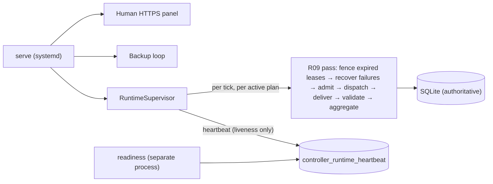

# Installed controller runtime composition (RC-02)

RC-02 makes the installed `rolvya-controller serve` process run the scheduler/worker control loop beside the human HTTPS panel and the backup loop. The loop composes the existing R06 admission/dispatch authority, R08 durable dispatch/replay/recovery and R09 coordinator. It adds **no new authority**: it only calls `SyntheticCoordinator::pass`, which re-reads all state from SQLite on every pass.

## Composition

- `crates/persistence-sqlite/src/orchestration/runtime.rs` — `RuntimeSupervisor<R: RuntimeAuthority, C: RuntimeClock>`, `ClosedRuntime`, `RuntimeConfig`, `RuntimeLiveness`.
- `crates/persistence-sqlite/src/controller_keys/operations/service.rs` — `ControllerService` starts the supervisor on the same stop signal as the backup loop and stops it gracefully (15 s bound; a stuck loop is aborted and startup recovery is required).
- Migration `0025_controller_runtime.sql` — singleton `controller_runtime_heartbeat` (instance, mode, state, timestamps, tick/failure counters). It is liveness evidence, never authority. Published migrations 0001–0024 are unchanged.

## Authority: closed in production

The production service composes only `ClosedRuntime`. Its authority type is the uninhabited `NoAuthority`, so a closed loop can never pass a coordinator any admission, dispatch, worker or assignment permission — it examines active plans, counts them as `closed` and writes nothing except its heartbeat. Paid constructors stay closed; no configuration switch enables execution. Synthetic/offline authorities are supplied only by tests; RC-04 ([#48](https://github.com/ygtdmr/rolvya/issues/48)) adds the separately reviewed offline profile that production configuration must reject.

This is the Owner-selected RC-02 design (2026-11-10): supervisor + closed authority, rather than recovery-only production passes or a prior ADR.

## Lifecycle guarantees

| Concern | Behavior | Evidence |
| --- | --- | --- |
| Start | `serve` prints `control_loop_started` with mode `closed`; heartbeat row becomes `running` | TLS service test asserts liveness `running`/`closed` |
| Graceful stop | Stop signal ends the loop; heartbeat becomes `stopped` | TLS service test, supervisor tests |
| Crash | A killed process leaves `running` with a stale heartbeat; readiness reads it as **not** running after 60 s | SIGKILL tests check stale liveness |
| Restart | A new process resumes from SQLite only; no in-memory queue | SIGKILL and restart tests |
| Panic in a tick | Contained in its own task, counted (`failed_ticks`, `last_failure='panic'`), retried with bounded exponential backoff (≤ 60 s default) | `panicking_tick_is_contained_counted_and_retried` |
| One project failing | Reported per project; other projects continue | `TickReport.failures` |
| Retry | Only after the failed attempt is fenced and its recovery recorded **and** trusted termination/billing reconciliation exists | `transient_retry_waits_for_recorded_reconciliation_across_restart` |
| Uncertain launch | A crash inside the launch transaction leaves the dispatch held for trusted reconciliation; the loop never re-launches it | `LaunchEffect` SIGKILL boundary |

Readiness (`rolvya-controller readiness <config>`) adds `control_loop_running` and `control_loop_mode`. `billable_execution_allowed` stays `false`.

## SIGKILL boundaries

`sigkill_supervisor_at_commit_boundaries_resumes_without_duplicate_effects` runs the **real supervisor loop** in a child test process, kills it with SIGKILL at a typed SQLite write boundary using the existing R10 update-hook harness, then restarts a fresh supervisor on the same database. One test parent covers seven nested boundaries (not seven unique tests):

| Boundary | Kill point | After restart |
| --- | --- | --- |
| `AttemptCreation` | first `task_attempts` write (inside first admission) | completes; 3 attempts, 3 effects |
| `AfterCommit` | second `task_attempts` write (first admission committed) | completes; no duplicate admission |
| `OutboxInsertion` | first `dispatch_outbox` write | completes; one outbox message per attempt |
| `LaunchEffect` | first `synthetic_operations` write (inside launch) | **held** with `recovery_required=1`; no re-launch |
| `MessageWrite` | third `worker_messages` write | completes; no duplicate effect |
| `ValidationCommit` | first `task_acceptances` write | completes; 4 acceptances |
| `GroupCommit` | third `task_acceptances` write (group) | completes; 4 acceptances |

Every boundary asserts preserved fencing and acceptances (`AuthorityImage::preserves`), one outbox message and one dispatch record per attempt, at most one non-rejected launch effect per attempt, zero failed ticks after restart, and SQLite integrity.

## Limitations

- Production admits nothing until RC-04 supplies an offline profile and later phases supply qualified real authority. This is installed **liveness**, not installed end-to-end execution evidence (that is RC-05, [#49](https://github.com/ygtdmr/rolvya/issues/49)).
- The `LaunchEffect` gap has no synthetic operator resolution path yet; it is held fail-closed.
- The heartbeat is written at most every 15 s and on failures; liveness uses a 60 s window. These are implementation defaults, not approved operational SLOs.
- The installed-binary prefix fixture in `apps/release` does not yet exercise `serve`; RC-05 covers the installed journey.
