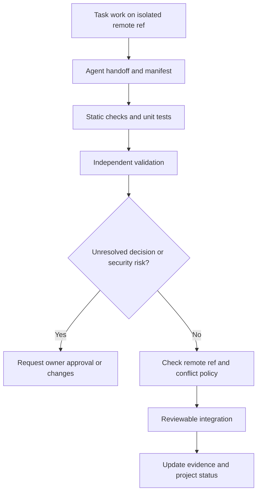

# Change review and documentation governance

## Objective

Define a reproducible, auditable path from approved requirement to accepted remote repository change. This is a **proposed repository governance process**, not evidence branch-protection rules or CI are configured.

## Roles and decision authority

| Role | Proposed authority | Explicit restriction |
| --- | --- | --- |
| Product owner | Approves material product, cost-ceiling, licensing and architecture decisions | Approval must be recorded explicitly |
| Main planner/orchestrator | Produces complete up-front DAG, selects model/effort, schedules and reassigns attempts | Cannot append tasks at runtime or approve budget increase |
| Worker agent | Implements assigned scoped task on isolated remote refs | Cannot self-merge, create new tasks, access user's personal computer |
| Reviewer/validator | Evaluates changes and evidence against requirements | Cannot turn an unapproved decision into an approved one |
| Security/operations reviewer | Evaluates high-risk changes, secrets, deployment and recovery | Must not equate a written policy with deployed enforcement |

Team membership, required reviewer count and reviewer implementation remain open.

## Change request contract

Every review should state: plan/task/attempt IDs, exact base commit and remote target; requirements and acceptance IDs; related ADRs; changed files and risk class; test commands/results; security/data/cost impacts; architecture deviations; affected documentation and status update; follow-up/blockers.

A scope expansion requiring newly planned tasks must be proposed as a **new, human-reviewed plan**, not silently added to a running DAG.

## Suggested review stages

A failed stage results in actionable feedback; do not erase successful artifacts from other tasks. External provider cost from review/test work must pass the same hard budget admission gate.

## Risk-based gates

- **Critical:** budget gate, billing ledger, authentication/secrets, arbitrary code execution, remote Git write authority, migrations and task/attempt state invariants. Demand independent negative and fault-injection tests.
- **High:** concurrency/lease recovery, worker sandboxing, provider adapters, integrations and project isolation. Demand integration tests and side-effect reconciliation.
- **Normal:** bounded internal refactoring, noncritical UI and documentation. Require clear diffs, relevant tests and link consistency.
- **Documentation-only:** check metadata status, provenance, approved-vs-proposed separation, relative links, readability and no duplicate authority.

Do not call a product feature *verified* without concrete code ref and repeatable evidence; approval of a design is not implementation.

## ADR governance

A consequential decision uses a numbered Markdown ADR with context, alternatives, accepted tradeoffs, approving actor/date (if known), links to requirements/tests and supersession. Use **Proposed** while owner approval is absent. Avoid overwriting the original ADR rationale; use a superseding ADR when reversing decisions. Follow [decision register](../decisions/README.md).

## Repository integration policy (2026-10-25)

The Owner requested hands-free squash integration of verified routine internal Codex PRs. The [integration contract](pull-request-integration.md) defines the implemented CI foundation, narrow reviewed routine path list, trusted numeric author IDs, strict branch rules and one-time activation/verification steps. Workers still publish isolated PRs; a separate trusted repository workflow performs eligible merges. Security, authentication, secrets, budget authority, infrastructure, workflows, architecture/ADRs and unfamiliar paths require separate human Owner review and are never automatically merged. Agent self-approval and labels are not human authority. A worker must not claim a merge or operational automation without GitHub evidence.

## Completion / evidence standard

After integration, verify target ref and commit, update [project status](../project/status.md) with exact implementation evidence, link change and test reports, record unresolved risks, and preserve a [handoff](agent-handoffs.md). A build pipeline that does not yet exist must not be described as active.

## Open decisions

Routine repository CI/merge direction is selected by the Owner's 2026-10-25 request; actual settings and live protected-merge evidence remain activation gates in the [integration contract](pull-request-integration.md). Reviewer identity separation, conventional commit adoption, product release approvals and accepted performance targets still need their applicable implementation/evidence.

Related: [engineering standards](standards.md), [test strategy](testing.md), [agent handoffs](agent-handoffs.md), [remote Git](../architecture/integration-github.md), [documentation policy](documentation-policy.md).
