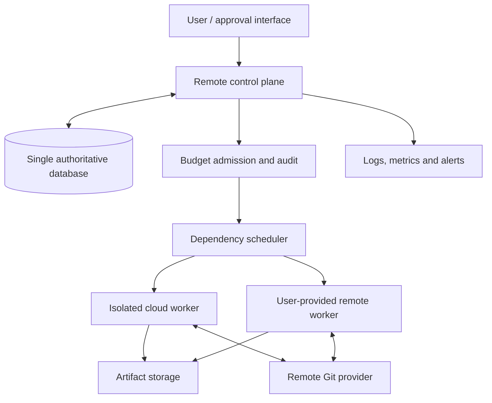

# Deployment architecture

## Constraints

Rolvya targets a lightweight remote control plane; a 2–4 GB RAM VPS was discussed, but **not benchmarked**. Computationally intensive coding agents run on remote cloud or user-supplied remote servers; the same VPS option was explored but is not preferred for concurrency. **No personal-computer Local Agent or Local Sync.** **Rust is approved as the sole backend language and SQLite as the sole authoritative database.** **Worker-initiated HTTPS (ADR 0006), GitHub App for GitHub (ADR 0008) and multi-provider remote worker adapters (ADR 0011) are Approved.** Specific cloud providers, operating system, container orchestrator, HTTPS schema/security implementation and concrete persistence configuration remain open.

## Logical topology

This represents logical flows, not finalized networking or services.

## Proposed environment boundaries

- **Control plane:** Rust-only backend services provide API access, authentication, orchestration, DAG validation, state transitions, budget authorization and lightweight coordination. Frontend language is not set by the backend decision. Avoid running arbitrary project builds in the control process.
- **Database:** **SQLite** is the single authoritative database engine; durable tasks, attempts, approvals, reservations and events are accessed only through Rust control-plane persistence. SQLite WAL/sync settings, backup technology and database file placement remain open.
- **Workers:** ephemeral isolated workspaces with CPU/RAM limits, lease/heartbeat, command execution, CLI/API adapters, validated outputs and controlled network egress.
- **Artifacts:** externally stored code/test outputs and logs with checksum, project ownership, retention policy and immutable manifest references.
- **Remote Git:** authorized provider-hosted repositories only, with branch isolation and integration gates.
- **Secrets:** authenticated references to credentials, not secrets embedded in task instructions, container images or version control.

## Deployment sequence (proposed)

1. Validate approved configuration, schema version, secret access, credentials and network boundaries.
2. Back up and verify database recoverability before applying migrations.
3. Deploy or update control plane without admitting tasks until migrations and health checks pass.
4. Register authorized remote worker pools; test lease expiry, sandbox identity and artifact write permissions.
5. Enable scheduling only if budget authority, event recording, storage and worker connectivity all pass readiness checks.
6. For rollback: stop new admissions, preserve active attempts, reconcile ambiguous remote side effects, restore compatible code/schema and resume only after health validation.

## Operational gates

Required readiness checks include database transaction access, budget reservation serialization, event persistence, remote-worker authentication, artifact access, queue capacity and provider-reachable diagnostics. Degraded external billing data must not be mistaken for zero cost. Health checks must not leak credentials.

## Non-functional measurements to establish

Control-plane idle/peak RAM and CPU, scheduler response time with large DAGs, concurrent task throughput, worker start latency, cold/warm start cost, artifact transfer, database query performance and crash-recovery time. Any numbers should come from measured benchmarks, not the historic hypothetical 20-worker example.

## Open choices

Cloud vendor, region, container or process model, networking/TLS ingress, single-node availability targets, deployment automation, schema migrations, backups, retention, rollout approval, monitoring stack and explicit disaster-recovery objectives.

Related: [Rust + SQLite backend contract](../architecture/rust-sqlite-backend.md), [SQLite operations](sqlite-operations.md), [infrastructure alternatives](infrastructure-options.md), [workers](../architecture/workers.md), [data model](../architecture/data-model.md), [budget](../architecture/budget-costs.md), [security](../architecture/security.md).
