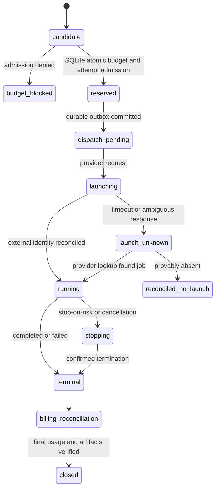

# Remote worker provisioning, cancellation and cost reconciliation

## Status

**Proposed implementation contract, not a selected cloud provider.** [ADR 0007](../decisions/0007-remote-worker-hosting.md) remains Proposed. AWS ECS Fargate, Google Cloud Run Jobs and user-supplied remote servers are candidates. The user's personal computer is never a worker. Rolvya backend and controller are Rust-only, authoritative database SQLite-only.

**Already Approved:** no new billable work without atomic reservation; a bounded previously admitted worker may continue inside enforceable pre-reserved exposure; otherwise stop-on-risk and reconcile ([ADR 0010](../decisions/0010-inflight-budget.md)). Non-executable group parents never provision workers ([ADR 0009](../decisions/0009-parent-aggregation.md)).

## Provider adapter boundary (proposal)

A Rust adapter should expose **capability discovery**, **conservative exposure estimate**, **launch**, **inspect**, **cancel**, **cleanup** and **usage reconciliation**. Each provider ID maps to the original Rolvya `project_id / task_id / attempt_id`, never replaces them. No direct SQL connection or user personal-computer checkout from a remote worker.

| Adapter operation | Mandatory input | Expected output | Safe failure |
| --- | --- | --- | --- |
| `DescribeCapacity` | Provider, region, image, CPU/memory, quotas, identity | Supported resource/timeout/price-unit metadata | Reject unsupported config before paid launch |
| `BoundExposure` | Runtime max, model mode, resource sizes, startup/minimum fees, storage+transfer policy | Conservative enforceable bound and confidence/evidence | Unknown/unbounded = no paid admission |
| `Launch` | Current admitted attempt, image digest, provider config, operation key | External execution ID or **unknown outcome** | Persist unknown; inspect before relaunch |
| `Inspect` | External ref/operation key | Running/stopped/unknown and measurable exposure | Unknown blocks reckless new spend |
| `RequestCancel` | External ref, cause, controller fence epoch | Request acknowledgment | Do not equate accepted request with termination or final invoice |
| `Cleanup` | Validated external ref, tenant boundary, retention | Verified teardown and residual billable resources | Alert and reconcile retained charges |
| `MeasureUsage` | Provider job, charge metadata, billing checkpoint | Provisional, settled and unknown usage by cost category | Missing records labeled unknown, not zero |
| `Reconcile` | Attempt, stable provider ref/idempotency key, Git/artifact evidence | Authoritative settled/held state, audit | Fail closed for unsafe admissions |

This boundary is conceptual, not compiled Rust traits or an approved SDK/CLI choice.

## Provisioning state model (proposed)



The actual status/transition enum remains open. A paid job with uncertain provider existence must **not** be relaunched solely because of a timeout.

## Provider-specific considerations (verified source behaviors, not selected configuration)

### Google Cloud Run Jobs

Google documents **three automatic retries by default per task**, and a **ten-minute default task timeout**; timeout applies to each task attempt. These are provider defaults, **not Rolvya's accepted paid-attempt policy**. For a test adapter, propose disabling provider retries where the API/config permits so that *Rolvya* creates and reserves each new attempt itself. Validate live configuration instead of assuming retry settings were applied. Limit physical execution multiplicity under the existing reservation and owner-approved budget.

Official references:
- [Cloud Run Jobs retries and checkpoints](https://cloud.google.com/run/docs/jobs-retries)
- [Cloud Run Jobs task timeout](https://cloud.google.com/run/docs/configuring/task-timeout)

### AWS ECS RunTask / Fargate

AWS documents caller-supplied `clientToken` idempotency for `RunTask`. The token is **not a perpetual deduplication guarantee**; AWS documents a bounded validity window (up to 24 hours or shorter based on task lifetime). The ECS API is eventually consistent; after unknown launch status, use stable token/ref and `DescribeTasks` with bounded backoff before contemplating another paid launch. Persist token and request parameters in SQLite (secret-free metadata); do not change parameters under a reused token.

Official references:
- [ECS RunTask idempotency](https://docs.aws.amazon.com/AmazonECS/latest/developerguide/ECS_Idempotency.html)
- [ECS RunTask API](https://docs.aws.amazon.com/AmazonECS/latest/APIReference/API_RunTask.html)

### User-provided remote server

Enforce that it is an **enrolled remote server**, not the user's personal computer. Define signed enrollment, remote identity, sandbox/rootless execution policy, memory/CPU/network quotas, cleanup, persistent volume behavior and owner-specified compute cost accounting. For a prepaid/flat-rate VPS, cloud bill may be incurred while idle; distinguish allocated cost vs incremental cost. User-supplied remote SSH credentials (if ever chosen) do not imply trusted worker code; use narrowly scoped access. SSH-first transport is not approved.

## Provider invoice and hard-budget risk

The project ceiling controls **authorization of Rolvya operations**. It does not guarantee external invoices cannot arrive after job stop. Account for compute launch minimums, image pull/startup overhead, minimum billing intervals, artifacts, logs, egress and model API charges. Record four categories separately: AI API / compute / storage / transfer. Scenarios optimistic / expected / pessimistic are forecasts; the **safe reserved bound** is a different quantity.

If the adapter cannot establish full remaining exposure under provable provider execution limits, apply approved **stop-on-risk**, fence the attempt, request cancellation, preserve verified outputs and reconcile external state. Cloud stop acknowledgment alone does not release financial liability.

### Example conceptual cost model

```text
total_reserved_exposure =
    bounded_model_api_exposure
  + bounded_compute_runtime_at_provider_rates_and_minimums
  + bounded_artifact_and_log_storage
  + bounded_data_transfer
  + any provider_retry_exposure_if_not_disabled
```

Use checked minor-unit currency arithmetic and reviewed conversion policy. **No numeric rates or duration limits are asserted** without actual region, date, provider and owner-approved test spend.

## Crash and reconciliation cases

| Failure point | Safe behavior |
| --- | --- |
| SQLite reservation commit fails | No paid provider launch |
| Outbox committed but dispatcher not run | Resume/replay outbox after restart |
| Provider accepted launch but response lost | Inspect by stable operation key and provider IDs, do not blindly relaunch |
| Provider auto-restarts task without Rolvya admission | Detect/reconcile, stop uncontrolled chargeable duplicate, block unsafe new admissions |
| Worker lost network during coding | Fence on expiry, inspect job/Git artifacts and charges before retry |
| Stop accepted but container still running | Remain stopping/uncertain, continue provider inspection and conservative liability |
| Git push possibly succeeded before crash | Look up remote ref/commit before overwrite or retry |
| Final invoice differs from hold | Reconcile ledger and surface variance; no automatic ceiling change |
| Object/log storage billed after worker exits | Attribute and clean up under authorized retention policy |

## Controlled benchmark evidence before provider approval

For identical synthetic workloads on comparable remote resource classes: record region/date, request IDs, image digest, billed startup/CPU/memory time, total latency p50/p95, load CPU/RAM, task retry defaults as observed, model CLI/API eligibility, provider max duration, cancellation latency and **invoice** versus expected/reserved exposure for each of four categories. Run paid tests only after an explicit authorized **test budget**; no benchmark in this document represents actual cloud use.

## Open choices

ADR 0007 provider/region/size and first-release set, provider credentials/IAM, worker image/runtime sandbox, quotas, provider autoscaling, retry defaults, cloud pricing changes, cancellation and cost upper-bound evidence, artifact retention and alert thresholds.

Related: [provider evaluation](worker-provider-evaluation.md), [worker lifecycle overview](worker-lifecycle.md), [budget reconciliation](../architecture/budget-reservation-reconciliation.md), [approved in-flight policy](../decisions/0010-inflight-budget.md), [remote wire draft](../architecture/worker-wire-contract-draft.md), [open decisions](../project/open-questions.md).
