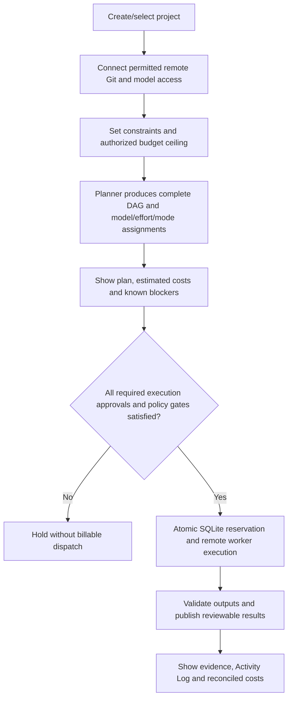

# Rolvya first-version web panel — approved navigation and proposed details

**Status: the five top-level navigation sections and their high-level purposes were Owner-approved on 2026-10-25 ([ADR 0042](../decisions/0042-five-section-web-panel-navigation.md)).** The detailed screen contents and example journey below remain **Proposed**. This approval does not select a frontend framework, finished visual design, real-time transport, deployment technology, plan-activation consent policy, or implementation.

## Primary navigation (five sections approved; screen details proposed)

1. **Projects:** List and create projects; show status, associated remote Git repository, blockers and a simple progress/cost summary. Each project's primary view displays the planned **hierarchical task tree AND true DAG dependencies**, which are distinct. Selecting a task opens goals, assigned model/effort/mode, permitted connection, input artifacts, acceptance checks and related attempts.
2. **Execution:** For a selected project, show dependency-ready, running, waiting, paused, failed and verified tasks; per-attempt worker/provider identity, time, redacted logs, retry/fencing state and validation evidence. Make it obvious that a group parent is not an executable worker task. Show when the run is blocked by an unverified provider subscription permission, unavailable worker pool or budget.
3. **Costs & Approvals:** Project-approved spending ceiling, actual/estimated/reserved/uncertain spend, four categories (**AI API, remote compute, storage, data transfer**) and optimistic/expected/pessimistic forecasts. Display paused new billable work with an explicit **fresh Owner-authenticated** budget increase flow; closing an alert is not authorization. Show pending high-risk role/provider decisions with precise scope and existing approvals.
4. **Connections:** Authorized remote GitHub App repositories; **multiple independently authenticated Claude/Codex CLI accounts** (connection identity, permission, reconnect/revoke state), independent API keys through the trusted Secret Broker; remote pools (first working version: AWS ECS Fargate; later Google Cloud Run Jobs and enrolled remote VPS). A disabled/unverified provider mode is never presented as usable. No Local Agent, personal-computer Git or credential-file upload.
5. **Results & Activity:** Verified task outputs, tests, reviewable remote Git refs, error explanations and project Activity Log. Use role-based access and redaction. Do not mark a failed or unvalidated worker output as completed just because a process exited successfully.

## Core user journey

**Important approval boundary:** An explicit budget increase always requires a current verified Owner. Whether **every** first plan activation also needs separate Owner confirmation beyond approved policy remains OQ-013/P1, not assumed in this proposal.

## Role-aware presentation

Owner manages approved critical budget/permissions/connection scope with action-bound verification; Editor may inspect and start already-authorized work when otherwise allowed; Viewer reads only authorized project data. UI visibility does not replace server-side checks.

## User experience priorities

- Readable status before fancy animation; distinguish **planned DAG node**, **worker attempt** and **verified result**.
- Show blocker causes, pending human action and uncertain cloud invoices explicitly.
- The same project dashboard can show real AWS Fargate work while Google Cloud Run Jobs and remote VPS adapters remain under development, consistent with [ADR 0041](../decisions/0041-aws-fargate-first-real-worker.md).
- Accessible keyboard/navigation design and responsive layout; do not interpret responsive web as a commitment to a native mobile app.
- Reuse the approved navy/blue/gray Rolvya identity; no gold accent, no invented replacement logo.

## Technology option for review — not approved

A lightweight [React/TypeScript + Vite, React Flow and Rust Axum REST/SSE architecture](../architecture/web-panel-technical-stack-proposal.md) is documented as **Proposed**. This does not approve libraries, lock files, UI scaffolding, endpoint paths, detailed screen design or deployment.

## Still open after navigation approval

Sidebar position/size, exact dashboard widgets, frontend framework and component library, real-time transport (SSE/WebSocket/polling), responsive breakpoints, precise graph library, animation, filter/search behavior, per-screen final copy, first plan activation UX and release accessibility test levels remain for a light design/implementation pass.

Related: [approved v0.1 scope](scope.md), [existing user journeys](user-flows.md), [budget hard stop ADR](../decisions/0002-hard-budget-approval.md), [roles ADR](../decisions/0024-project-human-roles.md), [current provider order ADR 0041](../decisions/0041-aws-fargate-first-real-worker.md), [approved five-section navigation ADR 0042](../decisions/0042-five-section-web-panel-navigation.md), [remaining OQ-013](../project/open-questions.md).

This is **not** a completed, implemented or visually reviewed UI.
