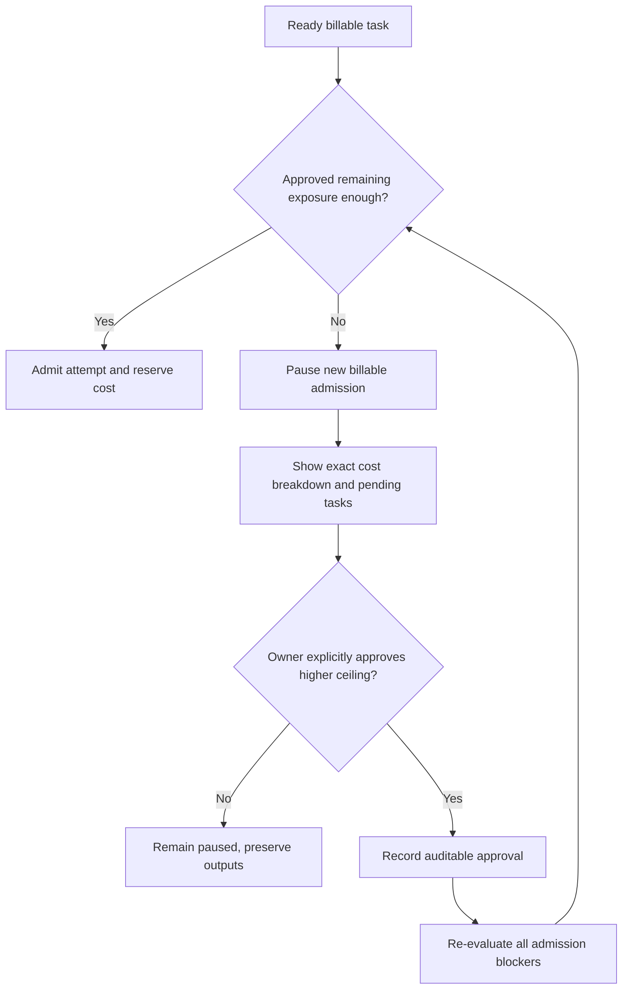

# User journeys and panel interaction

## Scope

This document proposes interaction flows for the Rolvya owner panel. **Approved facts** are the fixed upfront task DAG, parallel execution only when dependencies permit, remote-worker-only integration and the hard, explicitly approved project budget. Screen layouts, navigation, authentication, widgets and real-time transport have **not** been selected or implemented.

## Journey 1: Create project and attach remote repository

1. Owner creates a project with goal, constraints, excluded work and authorized remote repository.
2. Panel checks that the repository is a remote provider (including eventual self-hosted support) and requests minimal-scoped access through a secure flow; **no Local Agent or personal-computer Git sync**.
3. Owner configures worker access mode (eligible CLI / API), allowed remote worker capacity, authorized cost ceiling and other constraints.
4. Panel displays provider authorization status and unresolved eligibility or security questions.
5. Project begins in a non-executing draft state until a full plan is validated.

**Failure flows:** unreachable repository, insufficient scope, incompatible model/access mode, unsupported remote provider and missing budget. These are actionable blockers, not reasons to fabricate a successful connection.

## Journey 2: Review complete upfront plan

1. Main planning agent produces the **entire** nested task hierarchy with explicit dependency DAG, task goals, acceptance criteria, model and effort per task and compact context refs.
2. Panel shows both parent/child organization and independent prerequisite edges; changing a parent relation must not silently change scheduling dependencies.
3. Display all ready/blocked paths, potential remote Git conflicts, worker resource assumptions and estimated runtime (approximately ten minutes per task is a sizing target only).
4. Display three cost scenarios and four categories: AI API, cloud compute, storage and transfer; explain forecast uncertainty.
5. Require any material approval gate defined by future owner policy before activating a validated immutable plan.
6. After activation, no new task nodes are inserted; reassignments/retries create attempts of existing tasks.

**Open decision:** whether every plan needs manual approval, what edits are allowed between draft and activation, and how a new version is authorized.

## Journey 3: Monitor parallel execution

The panel should distinguish **task graph state** from **individual execution attempts**. For each selected task show task ID, prerequisites, wait reason, current attempt, worker, model/effort, permitted remote Git ref, test evidence and redacted logs. A task moves to success only after validation; a worker exit code alone is not enough.

Suggested areas: DAG view, task details, attempt timeline, remote repository changes, project-wide cost/approvals, worker availability and incident alerts. These are interaction concepts, not an approved visual design.

## Journey 4: Budget insufficient, explicit approval and resume

Owner must see current approved ceiling, actual recorded cost, outstanding reservations, unknown delayed charges and reason for pause. A notification acknowledgment, page refresh or estimate change is **not** a budget increase. There is **zero automatic percentage overrun**. Previously validated outputs remain accessible.

**Open decision:** running-attempt cancellation when costs become uncertain; do not imply a settled policy.

## Journey 5: Failure, reassignment and recovery

1. Task or attempt fails with classified reason (model limit, worker lost, Git ambiguity, invalid output, security or cost).
2. Panel shows affected task, unsuccessful attempt and dependent tasks still blocked.
3. Main orchestrator diagnoses and may retry/reassign **the existing task** to another permitted worker/model/effort under authorization and budget policy.
4. Ambiguous Git writes are reconciled before retry; old lease is fenced.
5. Successful sibling artifacts remain available; history shows what changed, who approved it and exact measured costs.

The panel must not imply that a fallback fixes a failed task before acceptance tests confirm the result.

## Journey 6: Review outputs and close project

1. Validate all required task outputs against acceptance criteria, gather changes from remote Git refs and identify integration conflicts.
2. Show verified vs unverified results, tests run/not run, current merged/unmerged state, four cost classes and any missing invoices.
3. Request an authorized integration/release decision under the future review policy.
4. Preserve final project report, provenance and [agent handoff](../development/agent-handoffs.md) for future work.

## Accessibility, privacy and reliability (proposed)

Show textual status as well as color; use understandable labels for blocked/failed/paused/verified. Never leak credentials in worker output or cost logs. Respect project separation and authorized roles. If observability is unavailable, show unknown rather than claiming success or no charge. A disconnected UI must not control the server's authoritative approval state.

## Acceptance tests to implement

- An ineligible dependency cannot be manually started from a button.
- Worker reassignment does not add task nodes.
- User can inspect both nested hierarchy and actual dependency edges.
- Approving a notification does not increase spending authorization.
- Budget denial pauses new billable tasks without deleting prior verified outputs.
- Incorrect/missing cost meter data is visibly uncertain.
- The UI cannot grant an unapproved provider integration or direct access to a personal computer.
- A task labeled verified links to real tests/results and a remote commit/artifact.

## Open decisions

Identity and roles, plan approval UX, layout/visual system, real-time updates, accessibility targets, in-flight cancellation, project sharing, mobile support and authorization for merges/releases.

Related: [requirements](requirements.md), [acceptance criteria](acceptance-criteria.md), [scheduler](../architecture/scheduler.md), [budget](../architecture/budget-costs.md), [observability](../architecture/observability.md).
