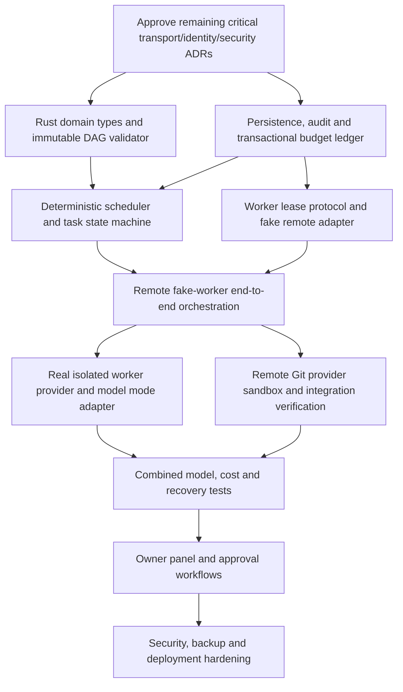

# Evidence-driven implementation slices

## Purpose and caveat

Translate current Rolvya architecture and accepted constraints into an **ordered implementation proposal** that an AI coding agent can execute after the owner approves the relevant technology ADRs. This is a **project development roadmap**, **not** the immutable task DAG for any specific user project. Creating future development milestones does not authorize runtime generation of new tasks inside a Rolvya execution plan.

No code implementation, worker deployment, provider integration or passing CI is implied by the presence of this document.

The [decision readiness checklist](decision-readiness.md) separates approved architecture from transport/provider/security approvals, and the [worker provider evaluation](../operations/worker-provider-evaluation.md) specifies billable benchmark requirements.

## Mandatory foundations before implementation

1. **Rust-only backend and SQLite database are approved** by [ADR 0004](../decisions/0004-control-plane-language.md) and [ADR 0005](../decisions/0005-authoritative-database.md). Resolve remaining worker communication and initial hosting choices using [proposed ADRs 0006–0008](../decisions/README.md) and the [open-decision register](open-questions.md).
2. Decide budget reservation/settlement semantics and provider-side bill limits (especially in-flight attempts and delayed invoices). Approved invariant: **no percentage overrun, explicit human approval for higher ceiling**.
3. Approve security/identity and Git merge authority and define tenant isolation.
4. Establish a sandboxed remote development/test environment using fake provider adapters first; no user's local computer worker or repository access.
5. Define measurable acceptance/benchmark thresholds and capture exact toolchain versions in the handoff.

See the [Rust + SQLite backend implementation contract](../architecture/rust-sqlite-backend.md) for approved engine boundaries, atomic admission requirements and proposed SQLite lifecycle. The [SQLite operations](../operations/sqlite-operations.md) document covers the safety and recovery requirements.

## Suggested dependency-aware sequence

The diagram's edges are **development dependencies**, not an actual activated Rolvya task graph. Parallelize nonconflicting implementation work after prerequisites are approved and isolated.

## Slices and acceptance gates

| Slice | Outcome | Minimum evidence to complete |
| --- | --- | --- |
| S0 — Decision gates | Rust + SQLite recorded as approved; owner-approved remaining transport/hosting/identity ADRs, threat boundaries and benchmark envelope | Explicit approval history, reasons, known costs and rejected alternatives |
| S1 — Rust core domain & validator | Rust project/plan/task/edge types; immutable active DAG and graph checks | Reject cycles, unknown IDs, mutable active nodes; hierarchy not equal dependency |
| S2 — SQLite persistence & budget ledger | SQLite schema/migrations, durable attempts, events, approvals and atomic admission | Simultaneous reservations never exceed approved headroom; crash replay safe |
| S3 — Deterministic scheduler | Ready queue, dependency guards, attempt state and fencing | Independent tasks parallel-eligible; dependents wait for validation |
| S4 — Remote fake-worker protocol | Authenticated lease, heartbeat, results, idempotency using fake executors | Stale/duplicate callback rejected; simulated partition recovery |
| S5 — Minimal E2E run | Test project with 3–5 tasks across two branches of a DAG | Verified artifacts, source hashes, attempt histories and accurate cost state |
| S6 — Real remote executor adapter | Launch/cleanup on selected remote provider, model mode validation | CPU/RAM profile, correct cleanup, externally measured bill/cost exposure |
| S7 — Remote Git sandbox | Install/connect one approved remote provider, isolate refs, conflict gating | Ref provenance, stale-base rejection, no local desktop sync |
| S8 — Resilience & cost reconciliation | Recovery from ambiguous push, process loss, delayed billing | No duplicate remote writes/charges; preserved sibling work |
| S9 — Owner panel & hard approvals | Readable DAG, task attempts, budget and explicit ceiling increase | Denial preserves pause; approval audited; no automatic overrun |
| S10 — Release hardening | CI, adversarial tests, backup/restore, privacy, docs and packaging | Independent verification, tests with exact environment, rollback procedure |

All slice names are **proposed engineering breakdown**, not runtime task nodes. Each coding job inside a slice must be described with task goal, scope, model/effort, accepted context, time estimate, budget exposure and acceptance evidence.

## Incremental demo definitions

- **Demo A (after S1–S3):** single control process can validate a DAG and safely schedule simulated tasks without live providers.
- **Demo B (after S4–S5):** two fake remote workers complete independent tasks; a dependent task waits; logs/verified results survive restart.
- **Demo C (after S6–S8):** isolated remote worker makes reviewable changes to a throwaway remote Git repository with hard budget reservation and reconciliation.
- **Demo D (after S9–S10):** owner sees task graph and costs, approves or denies budget increase, and inspects verified artifacts and audit evidence.

## Evidence pack per slice

Record requirement/acceptance IDs from [PR/AC inventory](../product/requirements.md) and [acceptance criteria](../product/acceptance-criteria.md), code commit, remote branch, toolchain/OS, exact test commands/results, workload seed/CPU/RAM, simulated vs invoiced costs, redacted logs, changed docs, risks, unresolved ADRs and reviewer signoff. Follow [agent handoff](../development/agent-handoffs.md) and [review process](../development/review-process.md).

## Stop/go conditions

Do not advance from fake providers to paid live cloud/model testing without explicit authorized spend and a confirmed provider access mode. Do not mark S9 completed if a budget notification can bypass owner approval. Do not publish a release if migration, security, rollback or artifact provenance remains unverified.

## Known gaps

Formal timeline, remaining owner choices, Rust framework/crates, SQLite configuration/schema details, tenant model, performance SLOs, exact API schema, retry caps, official CLI automation permissions and provider credentials remain unresolved. **Rust and SQLite choices are fixed.** Track them in [open questions](open-questions.md).

Related: [documentation index](../README.md), [project status](status.md), [open questions](open-questions.md), [architecture overview](../architecture/overview.md), [testing](../development/testing.md).
